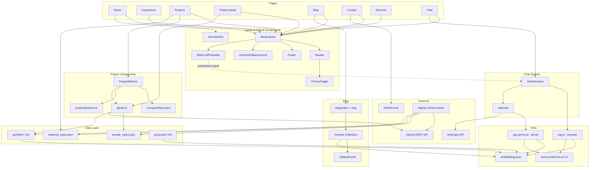
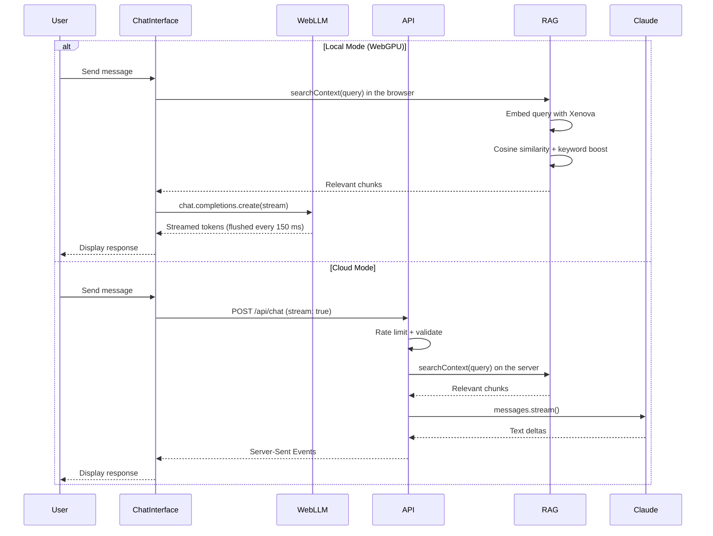

# Architecture

## System Overview



## Data Flow



## Key Architecture Decisions

### 1. Hybrid AI Chat System

I implemented a dual-mode chat system that can run either locally in the browser or via a cloud API:

- **Local Mode**: WebLLM runs SmolLM2-1.7B (4-bit quantized) on WebGPU. A site-wide preloader (`WebLLMPreloader.astro`, mounted in `BaseLayout`) starts downloading the model once any page goes idle and parks the engine on `window`. Because the site uses View Transitions, that engine survives navigation, so the chat is usually ready by the time a visitor opens it. The weights land in the browser's Cache Storage, so later visits skip the download.
- **Cloud Mode**: Anthropic's Claude Haiku 4.5, called from the `/api/chat` serverless route. It is the default mode for everyone and the only mode on devices that can't run the model locally.

`ChatInterface.tsx` only shows the Local/Cloud toggle when the viewport is at least 1024px wide and the browser can actually create a WebGPU device. Phones, tablets and browsers without WebGPU get a cloud-only header. Switching modes resets the conversation.

### 2. RAG (Retrieval-Augmented Generation)

Rather than fine-tuning a model or stuffing all project information into the system prompt, I implemented semantic search over pre-computed embeddings:

- **Build-time**: `scripts/generate-embeddings.ts` reads every project's portfolio docs, the personal knowledge files in `public/data/personal/`, and published Markdown blog posts. `scripts/lib/chunker.ts` splits each file on `##`/`###` headings, then packs each section's paragraphs into chunks of at most about 500 tokens (estimated at four characters per token). Short sections stay as one chunk, and a fenced code block is never split, even when it is larger than the limit. Each chunk is embedded with MiniLM-L6-v2 (384 dimensions) into `public/data/rag/embeddings.json`. Drafts and future-dated posts are skipped with the same rule the blog listing uses, so the chat can't discuss a post before it goes live. `.mdx` posts are not indexed.
- **Runtime**: the query is embedded with the same model, scored against every chunk by cosine similarity, then re-ranked with keyword boosting. The top 8 chunks scoring at least 0.20 are appended to the system prompt as plain background text, with no labels the model could quote back.
- **Hybrid Search**: pure semantic search missed exact project names, so any query word longer than two characters that isn't a stopword and appears verbatim in a chunk adds 0.15 (words over four characters) or 0.08, capped at 1.0.

The same search exists twice: `src/lib/rag.ts` fetches the index over HTTP for local mode, and `src/lib/rag-server.ts` reads it from disk inside the API route. The trade-off is that local mode downloads the whole index, which runs to tens of megabytes of JSON, on the first question.

### 3. Static Site with Dynamic Islands

I chose Astro for its island architecture:

- **Static pages**: `output: 'static'` pre-renders every page at build time; only `src/pages/api/chat.ts` opts out with `prerender = false` and runs as a Vercel function.
- **React islands**: the chat (`client:only="react"`), the theme toggle and the project shelves (`client:load`) hydrate on the client. Blog posts written in MDX can embed islands too.
- **View Transitions**: `BaseLayout` enables Astro's View Transitions, so scripts that touch the DOM (theme, hero typing animation, Mermaid rendering, the GitHub stats image) re-run on `astro:after-swap` or `astro:page-load`.

### 4. Theme System

The theme implementation handles several edge cases:

- **No flash**: an inline script in `<head>` reads the persisted Zustand state from localStorage before paint
- **System preference**: respects `prefers-color-scheme` when nothing is saved
- **React sync**: `themeStore.ts` reads its initial value from the `dark` class already on `<html>`, and only re-applies on rehydration if the saved value differs, avoiding a hydration mismatch
- **Persistence**: Zustand's persist middleware stores the preference under the `theme` key

### 5. GitHub Integration

Project data is synced, not hand-maintained. A nightly GitHub Action (`.github/workflows/sync-private-repos.yml`, 07:00 UTC, also runnable by hand) runs `scripts/fetch_private_repos.js` with a personal access token:

- **Repo snapshot**: every owned repo, public and private, goes into `public/data/private_repos.json` with language bytes, push date, and a domain category from `scripts/repo-categories.js`. Forks are dropped apart from a small allowlist, and an exclusion list keeps some repos off the site entirely. That list is a short array in the script plus names read from an `EXCLUDED_REPOS` repository secret, so a hidden repo's name never has to appear in this public repo. Excluded repos are filtered before processing, so nothing is fetched from them. A per-repo override table corrects language stats where GitHub's linguist misrepresents the work.
- **Portfolio files**: each repo's `.portfolio/architecture.md`, `stack.md` and `qa.md` are copied to `public/data/portfolio/<repo>/`, and `.portfolio/preview.png|gif` to `public/screenshots/<slug>/`. Directories for repos that drop out are pruned.
- **Featured projects**: a hard-coded, ordered list in the sync script writes `featured_repos.json` and sets `metadata.featured` on the matching snapshot entries.

The bot commits the snapshot to `main` only when something changed, which triggers a Vercel deploy, which rebuilds the embeddings. A new project's docs reach the chat the morning after they land in its repo.

In the browser, `getShelfRepos()` in `src/lib/github.ts` also fetches GitHub's public listing for my account (forks and archived repos dropped) and merges it with the snapshot by `full_name`, the snapshot winning because it carries the categories, screenshots and doc flags. A small client-side hidden list is applied after the merge.

### 6. Project Shelves & Categorization

The projects page groups every repo into domain shelves (AI, Crypto & Fintech, Developer Tools & Infrastructure, Automation & Scraping, and so on) rather than a flat wall. The placement logic lives in `src/lib/projectSections.ts` and is deliberately small:

- **`shelfFor(repo)`**: maps a repo to a shelf. `academic` is an explicit stored category that always wins. Any repo without a preview image is demoted to a `work-in-progress` shelf, so unfinished work never sits next to polished projects. Otherwise the repo lands on its stored domain category, or `other` if the category is unknown.
- **`sortWithinShelf`**: orders each shelf featured → active → archived, breaking ties by most-recent push.
- **`groupReposByCategory`**: buckets repos and emits shelves in a fixed `SECTION_ORDER`, with the domain shelves first and Other, Academic Coursework and Work in Progress at the bottom.
- **`featuredFromShelves`**: collects featured repos across every shelf into one cross-shelf group that backs the mobile "Featured" filter.

`ProjectShelves` is a client island; on narrow screens it renders a sticky pill bar (All / Featured / per-shelf) so mobile visitors can filter instead of scrolling every shelf. Featured repos are badged and sorted first within their shelves, and the separate Featured band on the page is hidden by default. The categorization is pure and unit-tested in `src/lib/projectSections.test.ts`.

`CompactRepoCard` makes the preview image the card. On desktop hover it grows the card's real size, so the image stays sharp, shifts the card back inside the viewport if it would overflow, and reveals a popover with the description, languages and actions. Touch devices have no hover, so a tap toggles the popover instead of navigating. Repos with docs link to their internal detail page. Public repos without docs link to GitHub. A private repo never links to its GitHub URL, which would 404 for visitors, so it falls back to its live demo or stays an info card.

### 7. Project Detail Pages

`src/pages/projects/[slug].astro` builds one static page per repo that has `.portfolio/` docs. `marked` converts the three Markdown files to HTML at build time and shows them as About, Tech Stack and Architecture tabs, ordered by technical depth, with Live Demo and GitHub links alongside (GitHub only for public repos). Mermaid is imported only on the client: a script finds code blocks that start with a Mermaid keyword (`graph`, `flowchart`, `sequenceDiagram` and so on), renders them to SVG with Mermaid's dark theme recoloured to the site palette, and adds zoom in, zoom out and reset controls.

### 8. Scheduled Blog Publishing

The blog is an Astro content collection (`src/content/blog`, schema in `src/content.config.ts`) that accepts both Markdown and MDX, so richer posts can embed React (for example the `TabbedGuide` island, which keeps the active tab in the URL hash). Each post's frontmatter carries a `pubDate` and a `draft` flag:

- A `draft: true` post has no page at all.
- A post with a future `pubDate` still builds a page, so the URL can be shared in advance, but it is filtered out of the listing and marked `noindex` until a build after its date.

Because the repo rebuilds nightly (the same job that snapshots repo data), a scheduled post surfaces on its publish date with no manual step. This lets me queue a slate of posts ahead of time.

### 9. Rate Limiting & Security

The chat API (`src/pages/api/chat.ts`) implements defensive measures:

- **IP-based rate limiting**: 20 requests per minute per IP, keyed on Astro's server-set `clientAddress` rather than a spoofable `X-Forwarded-For` header. The map lives in function memory, so it is per instance and resets on a cold start, which is an accepted trade-off at portfolio traffic.
- **Memory bounds**: at most 10,000 tracked IPs. Expired entries are swept every five minutes and before rejecting a new IP.
- **Input validation**: at most 20 messages, 4,000 characters per message and 32,000 in total, and only `user`/`assistant` roles
- **Prompt hygiene**: leading assistant turns (the UI's canned greeting) are dropped before the conversation reaches the model
- **Error sanitization**: internal errors are logged but generic messages returned to clients
- **Crawling**: `robots.txt` disallows `/api/` and `/data/rag/`

### 10. Component Organization

```
src/
├── components/
│   ├── blog/         # TabbedGuide (MDX-embedded React island)
│   ├── chat/         # ChatInterface - both chat modes
│   ├── global/       # Navbar, Footer, ThemeToggle, GeometricBackground, WebLLMPreloader
│   ├── hero/         # Landing page hero with typing animation
│   └── projects/     # ProjectShelves, CompactRepoCard
├── content/          # Blog posts (Markdown/MDX)
├── content.config.ts # Blog collection schema
├── layouts/          # BaseLayout wraps all pages (meta tags, theme script, preloader)
├── lib/              # github.ts, rag.ts, rag-server.ts, projectSections.ts (+ test)
├── pages/            # Astro pages, blog/project routes, chat API
├── stores/           # Zustand theme store
└── styles/           # Global CSS with theme variables
```

### 11. Build Pipeline

The build process generates embeddings before Astro builds:

```bash
npm run build
# 1. tsx scripts/generate-embeddings.ts → public/data/rag/embeddings.json
# 2. astro build → static pages + the chat function, via @astrojs/vercel
```

This ensures RAG data is always fresh when deployed. Because every nightly snapshot commit triggers a deploy, the index is rebuilt at least once a day. `npm test` runs Vitest over `src/**/*.test.ts` and `scripts/**/*.test.ts`.

## External Integrations

| Service | Purpose | Notes |
|---------|---------|-------|
| GitHub REST API | Nightly repo snapshot and `.portfolio/` file copy; public repo listing in the browser | Sync authenticates with the `GH_PRIVATE_TOKEN` secret; the browser call is unauthenticated |
| Anthropic API | Cloud chat mode (Claude Haiku 4.5) | `ANTHROPIC_API_KEY` server-side only; streamed and non-streamed responses supported |
| Hugging Face model hosting | WebLLM weights and the MiniLM embedding model | Downloaded once, then served from the browser cache |
| Vercel | Hosting, serverless chat route, Vercel Analytics | Every push to `main` deploys |
| Web3Forms | Contact form submissions | Posted from the browser; the page shows inline success or error status |
| Google Fonts | DM Sans, Inter, JetBrains Mono | Loaded from `BaseLayout` |
