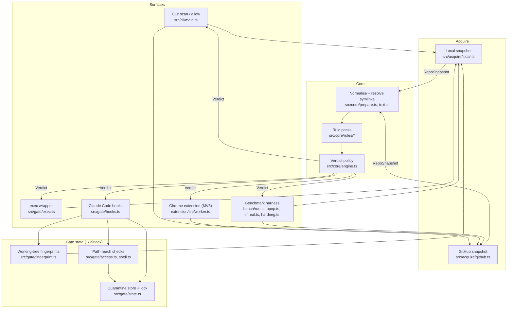

# Architecture

## System Diagram

## Component Descriptions

### Acquirers
- **Purpose**: Turn a directory or GitHub URL into a `RepoSnapshot`: tree, text of the files that matter, release metadata, and an explicit list of coverage gaps.
- **Location**: `src/acquire/local.ts`, `src/acquire/github.ts`
- **Key responsibilities**:
  - read every *targeted* path in full: auto-run configs, agent instructions, install and build manifests, READMEs
  - read any script those files reference
  - open files with `O_NOFOLLOW | O_NONBLOCK`
  - resolve in-repo symlinks, and treat links that escape the repo as critical gaps
  - pin GitHub scans to a resolved commit SHA
  - rebuild truncated GitHub trees from per-directory listings
  - never download release assets

### Rule engine
- **Purpose**: Run content-scored rule packs and combine their findings into a verdict.
- **Location**: `src/core/engine.ts`, `src/core/rules/`
- **Key responsibilities**:
  - five packs: `exec-on-open`, `autorun`, `lure`, `hidden`, `ioc`
  - a deliberately simple aggregation policy: any critical, or high findings from two independent rules, means malicious
  - a critical coverage gap turns `clean` into `unknown`
  - a rule that crashes is recorded as a gap, never as a pass

### Coding-agent gate
- **Purpose**: Stop a Claude Code session from reading or running a repository it just fetched until that repository is scanned.
- **Location**: `src/gate/`
- **Key responsibilities**:
  - `exec` scans the working directory before launching the agent
  - the PreToolUse(Bash) hook fingerprints the working tree, and the PostToolUse hook diffs it, quarantining and scanning anything new
  - the PreToolUse hook on every tool (including `mcp__*`) denies calls whose arguments can reach a guarded path
  - self-protection treats repos that try to reconfigure or disable the gate as malicious

### Chrome extension
- **Purpose**: Show the same verdict on GitHub repository pages before anyone clones or downloads anything.
- **Location**: `extension/` (`src/worker.ts`, `content.ts`, `popup.ts`, `options.ts`, `build.ts`)
- **Key responsibilities**:
  - a thin MV3 shell: the service worker runs the unchanged engine and GitHub acquirer, the same reads as `airlock scan <url>`
  - derive owner, repo and ref from the browser-supplied tab URL, never from page content, and cache verdicts per `owner/repo@sha` and engine version
  - show a badge, a toolbar popup with findings, and inline warnings on README and release links that lead to archives or executables
  - a guarded fetch that only reaches `api.github.com` and `raw.githubusercontent.com` and only sends the optional token to the API
  - bundled at build time by esbuild (a dev dependency); the few Node modules the engine imports are swapped for throwing stubs and a `Buffer` shim, and the build fails if any other Node import or dynamic code loading survives

### Benchmark
- **Purpose**: Measure detection and false positives without tuning on the test data.
- **Location**: `bench/`
- **Key responsibilities**:
  - inert corpus generator with a safety checker (`bench/build-corpus.ts`, `bench/safety.ts`)
  - red-team and real-malware train/held-out splits (`bench/mreal.ts`: repositories from published incident reports and vendor IOC lists, pinned to the malicious commit, with a post-freeze mode for a time-split set)
  - false-positive harnesses over popular repositories (`bench/bpop.ts`) and over hard negatives: low-star repos and legitimate users of risky features (`bench/hardneg.ts`)
  - Docker-sandboxed adapters for third-party scanners (`bench/adapters/`)

## Data Flow

1. A surface receives a target: a path, a URL, or a hook event from Claude Code.
2. An acquirer builds a `RepoSnapshot`, recording every file it needed but couldn't read as a gap.
3. `prepare.ts` normalises text (HTML entities, NFKC, zero-width stripping) and resolves in-repo symlinks.
4. Each rule pack inspects the snapshot and emits findings with severity, path, line and an escaped evidence excerpt.
5. The engine aggregates findings and gaps into a verdict.
6. The surface acts on the verdict:
   - the CLI prints it or returns an exit code
   - `exec` refuses to launch the agent
   - hooks stop the session or deny tool calls
   - the benchmark scores it against expectations

## External Integrations

| Service | Purpose | Notes |
|---------|---------|-------|
| GitHub REST API | Repository metadata, commit resolution, trees, releases | About 4 calls per scan. Optional token; rate limits become `unknown`, never `clean`. |
| raw.githubusercontent.com | File contents at a pinned SHA | No API quota. Required paths are fetched first. |
| Claude Code hooks | PreToolUse / PostToolUse integration | Installed into user settings only. `onFailure: block`. |
| Chrome extension APIs | Badge, popup, per-commit verdict cache | `storage` and `activeTab` only; storage restricted to trusted extension contexts. |
| Docker | Sandbox for competitor scanners in the benchmark | `--network none`, read-only mounts; never used by Airlock itself. |

## Key Architectural Decisions

### Detect fetched repositories by result, not by command
- **Context**: An agent can fetch code in endless ways: `git clone`, `gh repo clone`, `$G clone`, `python -c`, `curl | tar`, `--no-checkout` then `checkout`.
- **Decision**: Fingerprint the working tree before every shell command and diff it afterwards. The command parser in `src/gate/shell.ts` remains only as a fast hint.
- **Rationale**: A command allow-list is always one spelling behind an attacker, whereas a tree diff catches the outcome regardless of how it was produced.

### A wrapper in addition to hooks
- **Context**: Claude Code runs user and project hooks in parallel, SessionStart hooks can't block, and `-p`/SDK runs never show the trust dialog. A malicious repo's own startup hook runs before any user hook could object.
- **Decision**: `airlock exec -- <agent>` scans the directory before the agent process exists.
- **Rationale**: It's the only point in the lifecycle that precedes the repository's own code. Hooks cover everything fetched after launch.

### `unknown` is a first-class verdict
- **Context**: Rate limits, truncated trees, oversized files and symlinks make complete coverage impossible to guarantee.
- **Decision**: Acquirers record gaps, and any critical gap prevents a `clean` verdict.
- **Rationale**: For a security control, "couldn't check" reported as "safe" is the worst failure mode. The original prototype failed exactly this way.

### Content-scored, reachability-weighted rules
- **Context**: Legitimate projects increasingly ship `tasks.json`, devcontainers, agent hooks and install scripts. Presence-based rules flagged 14% of the 300 most-starred repos as malicious.
- **Decision**: Severity is roughly *how automatically it runs* × *how malicious the content looks*.
  - Referenced local scripts are analysed.
  - Detection code that merely lists indicator strings isn't treated as an indicator.
- **Rationale**: This brought malicious false positives on that set to 0% without losing benchmark recall.

### Reputation can raise suspicion but never lower it
- **Context**: The Miasma campaign pushed agent-hook payloads into Microsoft-owned repositories.
- **Decision**: Stars and owner identity never discount execution-trigger findings.
- **Rationale**: Trusting popularity is exactly what account-compromise campaigns exploit.

### Zero runtime dependencies, no build step
- **Context**: The gate runs inside every agent tool call, and a security tool's own supply chain is part of its attack surface.
- **Decision**: Node built-ins only, with TypeScript executed via native type stripping.
- **Rationale**: Nothing to compromise transitively, fast hook start-up (~16 ms pre-tool on a 10k-file tree), and the code that runs is the code that's reviewed.

### One engine, a thin browser shell
- **Context**: A browser extension is where people first meet a lure repository, but a second detection codebase would drift from the CLI and gate.
- **Decision**: The extension bundles `src/core` and the GitHub acquirer unchanged. Only browser glue lives in `extension/`, and Node-only imports are stubbed at bundle time rather than refactored out of the engine.
- **Rationale**: A verdict in the browser means exactly what it means on the command line, and every benchmark number applies to both. esbuild stays a dev dependency, so the CLI keeps zero runtime dependencies.

### Measure blind before tuning
- **Context**: Held-out halves of a set share reports, authors and campaign generations with the training halves.
- **Decision**: Freeze the engine, collect a new real-malware set and a new hard-negative set without scanning them, measure once, and only then tune on half and measure the other half once.
- **Rationale**: The blind run exposed what the earlier held-out numbers hid: the README-lure rules caught only half of a newer campaign generation. Publishing that result alongside the tuned one is what makes the tuned one credible.
