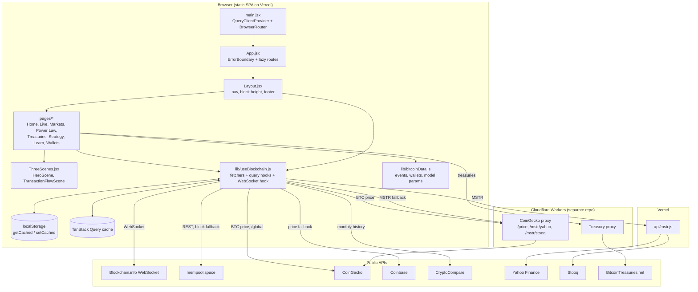

# Architecture

## System Diagram

## Component Descriptions

### App shell
- **Purpose**: Boot the app, provide routing and server-state caching, and contain render failures.
- **Location**: `src/main.jsx`, `src/App.jsx`, `src/lib/queryClient.js`
- **Key responsibilities**:
  - Lazy-load all eight routed pages behind one `Suspense`
  - Wrap the route tree in `ErrorBoundary` so one failing page cannot blank the app
  - Set query defaults: 60 s stale time, no refetch on window focus, refetch on reconnect, one retry

### Layout
- **Purpose**: Persistent chrome around every route.
- **Location**: `src/components/Layout.jsx`
- **Key responsibilities**:
  - Desktop nav with keyboard-operable dropdowns (Enter, Space, ArrowDown, Escape) and a mobile menu
  - Prefetch the price and mempool queries when a nav link is hovered
  - Show the current block height; link the static Terms, Privacy and Disclaimer pages in `public/`
  - Skip-to-content link and scroll-to-top on route change

### Data layer
- **Purpose**: Single home for every network call, cache and fallback.
- **Location**: `src/lib/useBlockchain.js`
- **Key responsibilities**:
  - Pure fetchers (`fetchBitcoinPriceSnapshot`, `fetchMempoolSnapshot`, `fetchMstrPriceSnapshot`, `fetchGlobalCryptoStats`, `fetchBitcoinPriceHistory`, `fetchLightningStats`) that are unit-testable without React
  - Query hooks (`useBitcoinPrice`, `useMempoolData`, `useMstrPrice`, `useBitcoinPriceHistory`, `useGlobalCryptoStats`, `useLightningStats`) that seed `initialData` from localStorage and poll only while the tab is visible
  - `useBlockchainWebSocket` for the live transaction and block stream
  - Shared helpers: `getCached`/`setCached` (TTL localStorage), `fetchWithTimeout` (AbortController), `parseBlockHeight`, `normalizeTransaction`

### MSTR serverless function
- **Purpose**: Same-origin MSTR quote that the browser cannot get directly.
- **Location**: `api/mstr.js`
- **Key responsibilities**: Query Yahoo Finance server-side with a browser User-Agent, fall back to Stooq, return `{ price, changePct }` with `s-maxage=60, stale-while-revalidate=120`, or a 503 if both fail.

### Pages
- **Location**: `src/pages/`
- **HomePage**: hero (lazy `HeroScene`), live price, fees, block height and BTC dominance
- **LivePage**: stream or 3D view (`TransactionFlowScene`), last 10 blocks, fee tiers, mempool totals
- **MarketsPage → VisualizationsPage**: price history, adoption by country, halving cycles
- **PowerLawPage**: model chart, deviation, milestones, projection calculator
- **CorporateHoldingsPage**: treasury fetch, 6-hour cache, 43-entity fallback, search, sort, category filter, charts
- **MicroStrategyPage**: Strategy holdings and MSTR quote
- **LearnPage → TechnologyPage**: protocol explainers plus live Lightning stats
- **WalletsPage**: hardware and software wallet comparison

### 3D scenes
- **Location**: `src/components/ThreeScenes.jsx`
- **Key responsibilities**: Textured spinning Bitcoin logo, particle field, node network and block chain for the hero; a transaction-flow scene driven by the live transaction list. Both are imported with `React.lazy` inside their pages, and each `Canvas` is wrapped in its own `ErrorBoundary` with a placeholder fallback.

### Static datasets
- **Location**: `src/lib/bitcoinData.js`
- **Contents**: 50 historical events (2008-10-31 to 2025-01-20), 6 hardware and 6 software wallets, power-law coefficients, adoption estimates, technology specs, and the `STRATEGY_BTC_HOLDINGS` / `BTC_MAX_SUPPLY` constants with a `supplyPercent` helper shared by the treasury and Strategy pages.

## Data Flow

1. **Cold open.** Each query hook reads its localStorage entry first and passes it as `initialData`, so a returning visitor sees the last good values before any request completes.
2. **Polling.** TanStack Query refreshes on per-hook intervals (price 60 s, mempool 45 s, MSTR 2 min), and the `refetchInterval` callback returns `false` while `document.visibilityState` is hidden. Slow-moving data is fetched once per stale window: dominance 5 min, Lightning 30 min, price history 24 h.
3. **Mempool snapshot.** `fetchMempoolSnapshot` fires five mempool.space requests through `Promise.allSettled` under one 8 s abort. A failed endpoint becomes `null` for that field only.
4. **Live stream.** On the Live page, `useBlockchainWebSocket` opens `wss://ws.blockchain.info/inv`, subscribes to `unconfirmed_sub` and `blocks_sub`, and keeps the newest 100 transactions and 10 blocks. If no block arrives within 5 s of connecting, or the socket errors or closes, it fetches the last 10 blocks from mempool.space and de-duplicates by hash.
5. **Reconnect.** On close, the hook retries with exponential backoff from 3 s, capped at 30 s, and resets the counter on a successful open. Unmount detaches `onclose` first so teardown cannot schedule a reconnect.
6. **Price fallback chain.** BTC price tries the CoinGecko Worker, then CoinGecko directly, then Coinbase, then the last good value. MSTR tries `/api/mstr`, then Yahoo and Stooq through a Worker (or directly if no Worker is configured), then the last good value.
7. **Treasuries.** The page reads its 6-hour localStorage cache (`?refresh=1` bypasses it), reuses in-memory data younger than 5 minutes, otherwise calls the treasury Worker. It rejects payloads with fewer than 10 valid entities, and falls back to the last good list or the bundled dataset. It re-checks every 5 minutes.

## External Integrations

| Service | Purpose | Notes |
|---------|---------|-------|
| Blockchain.info WebSocket | Unconfirmed transactions, new blocks | Public, no key |
| mempool.space | Tip height, fees, mempool, 3-day hashrate, difficulty adjustment, recent blocks, Lightning statistics | Public, no key |
| CoinGecko | BTC price and 24 h change; total market cap and BTC dominance (`/global`) | Keyless free tier; price goes through a Worker when configured |
| Coinbase | Spot price fallback | Public; no 24 h change, so the last known change is kept |
| CryptoCompare | Daily BTC closes (`histoday`, 2000 days) bucketed to monthly | Keyless quota is low, so the hook uses a 24 h stale time and returns `null` on an error response |
| Yahoo Finance | MSTR quote | Called server-side from `api/mstr.js` with a User-Agent header |
| Stooq | MSTR fallback | No CORS headers, so it is only usable server-side or via a Worker |
| BitcoinTreasuries.net | Treasury holdings | Reached only through the treasury Worker |
| Vercel | Static hosting, `api/mstr.js`, www → apex redirect, SPA rewrite | `vercel.json` |
| Cloudflare Workers | CORS and caching proxies for treasury and CoinGecko data | Code lives outside this repo; URLs injected via `VITE_TREASURY_PROXY_URL` and `VITE_COINGECKO_PROXY_URL` |

## Key Architectural Decisions

### Static SPA with a single serverless function, not a backend
- **Context**: The site is read-only and every dataset comes from a public API. Only a few sources (Yahoo, Stooq, BitcoinTreasuries.net) block browser requests.
- **Decision**: Ship a static Vite build and add server code only where CORS forces it: one Vercel function for MSTR and two Cloudflare Workers.
- **Rationale**: A Node or Next.js backend would add a runtime to host and monitor just to relay public data. A same-origin Vercel function removes the CORS preflight for MSTR, and its `s-maxage` header lets the CDN absorb repeated requests.

### Pure fetchers separated from hooks
- **Context**: The fallback chains have the most branching logic in the app and are the likeliest to regress.
- **Decision**: Every network path is an exported async function (`fetch*Snapshot`, `fetch*Stats`, `fetchBitcoinPriceHistory`). Hooks only wire those functions into TanStack Query and localStorage.
- **Rationale**: The fetchers can be tested by stubbing `fetch` alone, without a `QueryClientProvider`. That is how `src/lib/*.test.js` covers per-endpoint mempool degradation, price-history bucketing, Lightning node-count fallbacks and dominance parsing. Layout reuses the same fetchers for hover prefetch.

### Degrade per field, not per request
- **Context**: Five mempool.space endpoints feed one dashboard, and any one of them can 429 or time out.
- **Decision**: `Promise.allSettled` with a shared abort timer, mapping each rejected or non-OK response to `null`. Block height is parsed through `parseBlockHeight`, so a malformed body cannot become `NaN`.
- **Rationale**: With `Promise.all`, one slow endpoint would blank every stat. With `allSettled`, the UI shows a dash in the one affected cell.

### Layered fallbacks for every live number
- **Context**: Free tiers rate-limit unpredictably, and some data has no free live source.
- **Decision**: Live API (with alternate providers where they exist) → localStorage with a per-dataset TTL → a last-resort value. For prices that is the last good response held in a ref. For Lightning stats and BTC dominance it is a static snapshot labelled with its capture date. For the price-history chart it is the curated event series, and for treasuries the bundled entity list.
- **Rationale**: Every panel always renders something defensible. The static snapshots are dated in code, so stale data is traceable rather than silently wrong.

### Isolate WebGL behind lazy imports and error boundaries
- **Context**: Three.js is the largest dependency, and WebGL can fail outright on some devices.
- **Decision**: `vite.config.js` puts `three`, `@react-three/fiber` and `@react-three/drei` in their own `three` chunk, and both scenes load via `React.lazy` inside the page. Each `Canvas` sits in an `ErrorBoundary` with a placeholder fallback.
- **Rationale**: Pages without 3D (treasuries, Strategy, wallets) never download the chunk. A GPU or context failure costs one decorative panel, not the route.

### One source of truth for shared figures
- **Context**: Strategy's BTC holdings appeared on two pages and had drifted apart.
- **Decision**: `STRATEGY_BTC_HOLDINGS`, `BTC_MAX_SUPPLY` and `supplyPercent()` live in `src/lib/bitcoinData.js`, and both `CorporateHoldingsPage` and `MicroStrategyPage` import them. `bitcoinData.test.js` locks the values.
- **Rationale**: Updating a holdings figure is now a one-line change, and the percentage-of-supply text is computed rather than hand-written.
