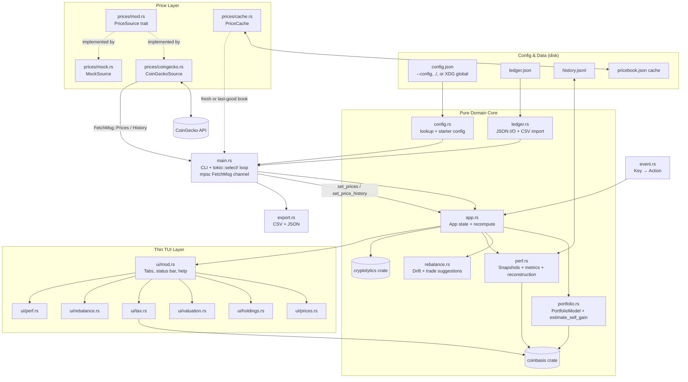

# Architecture

## System Diagram

## Component Descriptions

### `main.rs` — CLI, terminal setup, async event loop
- **Purpose**: Entry point. Parses `--config`, `--ledger`, `--offline`, and `--import`, sets up the ratatui terminal, and drives a `tokio::select!` loop over key events, a one-second tick, and fetch results.
- **Location**: `src/main.rs`
- **Key responsibilities**: Resolving the config and the ledger path; running a CSV import and exiting when `--import` is given; spawning background fetch tasks with `tokio::spawn`; routing `FetchMsg` results into `App`; storing each successful `PriceBook` to the cache and recording a snapshot to `history.jsonl`; writing Tax/Holdings exports; restoring the terminal from a custom panic hook.

### `config.rs` — Configuration and discovery
- **Purpose**: Deserializes `config.json` into typed structs and decides which file to load.
- **Location**: `src/config.rs`
- **Key responsibilities**: `resolve` applies the lookup order — explicit `--config` (must exist), then `./config.json`, then `$XDG_CONFIG_HOME/crypto-price-tracker-v2/config.json` (or `~/.config/...`). If none exists it writes `Config::example()` to the global path and reports it. `resolve_relative` anchors relative paths (`ledger_path`, `history.jsonl`) to the config file's directory. Also handles `~` expansion for the cache directory, target-weight normalization, ticker fallbacks, and the `COINGECKO_API_KEY` env-var override.

### `app.rs` — Central application state
- **Purpose**: Owns all mutable state and keeps derived reports in sync whenever the method, tax year, strategies, prices, or price history change.
- **Location**: `src/app.rs`
- **Key responsibilities**: `recompute()` rebuilds holdings, valuation, capital gains, income, rebalance actions (with a tax estimate on each sell), and then `recompute_analytics()` derives per-coin volatility, the correlation matrix, value-weighted portfolio volatility, current-vs-target buy-and-hold backtests, and the ledger-replay series. Target weights come from `cryptolytics::allocation::target_weights` under the active Custom / Equal / MarketCap strategy, falling back to the configured targets.

### `portfolio.rs` — coinbasis wrapper
- **Purpose**: Thin adapter over `coinbasis::Portfolio` that adds live market value and unrealized P&L to holdings (fields `coinbasis::Holding` does not carry).
- **Location**: `src/portfolio.rs`
- **Key responsibilities**: `PortfolioModel::holdings_with_value`, `capital_gains`, `income`, `valuation`; `estimate_sell_gain`, which appends a hypothetical `Sell` to the ledger and diffs HIFO realized gains with and without it.

### `rebalance.rs` — Drift and trade suggestions
- **Purpose**: Pure, deterministic drift computation and trade suggestions.
- **Location**: `src/rebalance.rs`
- **Key responsibilities**: `suggest()` normalizes target weights, computes each asset's drift against the portfolio total, and emits `RebalanceAction`s filtered by minimum trade size. `Strategy::Band` skips assets whose drift is within the band tolerance; `Strategy::Full` suggests a trade for every drifted asset. Sells are capped at the asset's current value. `summarize()` totals buys and sells and flags the in-balance case.

### `perf.rs` — Performance snapshots and reconstruction
- **Purpose**: Persists `(date, total_value, cost, pl)` snapshots to `history.jsonl` and reconstructs a historical series by replaying the ledger against fetched price history.
- **Location**: `src/perf.rs`
- **Key responsibilities**: `record_snapshot` skips the write if the last snapshot is newer than the refresh interval, otherwise rewrites the file one object per line. `load_history` accepts both JSONL and a legacy JSON array, and older snapshots without `cost`/`pl` load with zero defaults. `reconstruct_series` walks every timestamp in the price history, filters the ledger to transactions on or before it, and values that portfolio with `coinbasis`. `metrics` computes volatility, Sharpe ratio, max drawdown, and cumulative return through `coinbasis::stats`.

### `prices/` — Price abstraction and caching
- **Purpose**: A `PriceSource` trait with two implementations — `CoinGeckoSource` (live) and `MockSource` (deterministic, for tests) — plus `PriceCache`, which persists the last fetched `PriceBook`.
- **Location**: `src/prices/`
- **Key responsibilities**: `CoinGeckoSource::fetch` makes one `coins_markets` request for price, 24h/7d change, market cap, volume, all-time high, and the 7-day sparkline. `fetch_history` calls `coin_market_chart` per coin and skips any coin that fails rather than aborting. `PriceCache::load_fresh` honors the TTL; `load_last_good` returns the cached book at any age, marked `stale`.

### `ledger.rs` — Ledger I/O and CSV import
- **Purpose**: Loads and saves `ledger.json` (a JSON array of `coinbasis::Transaction`) and imports CSV rows.
- **Location**: `src/ledger.rs`
- **Key responsibilities**: A missing ledger file loads as an empty ledger; a malformed one returns an error naming the path. `import_csv` parses `buy`/`sell` rows, validates dates and non-negative amounts, skips rows already in the ledger, and only rewrites the file when something was added. `assets` collects every asset ID referenced by any transaction type, including both sides of a `Trade`.

### `export.rs` — CSV + JSON export
- **Purpose**: Writes a `CapitalGainsReport` or a list of `Holding`s as both CSV and pretty JSON. The CSV writer is hand-rolled because every field is a plain number, date, or identifier.
- **Location**: `src/export.rs`

### `ui/` — Thin ratatui rendering layer
- **Purpose**: Reads `&App` and renders a `ratatui::Frame`. The views only format and lay out data that `App` has already computed; the one exception is the Tax view, which calls `coinbasis::tax::estimate` on the current report when it draws.
- **Location**: `src/ui/`
- **Key responsibilities**: `ui::draw` composes the tab bar (with the active method and refresh countdown), the active view, the status bar (loading, `[stale]`, last message), and the help overlay. Each view module renders its own pane.

## Data Flow

1. **Startup**: `main.rs` resolves the config (writing a starter file on first run), resolves the ledger path, and loads the ledger. A fresh cached `PriceBook` is used if one is within the TTL, otherwise the last-good book is used and marked stale, so the UI is populated before the network responds. Existing `history.jsonl` snapshots are loaded for the Performance view.
2. **Async fetch**: Unless `--offline`, two `tokio::spawn` tasks run concurrently: one calls `CoinGeckoSource::fetch` for current quotes, the other calls `fetch_history` for each coin's price series. Results arrive as `FetchMsg::Prices` and `FetchMsg::History` on a bounded `mpsc` channel.
3. **State update**: The loop calls `app.set_prices` or `app.set_price_history`; both trigger `App::recompute`. After a successful price fetch it also writes the cache and records a snapshot.
4. **Render**: `ui::draw` runs on every loop iteration and renders the active view from `App`.
5. **User interaction**: `event.rs` maps crossterm key presses to `Action`s, and `apply` mutates `App`. Changing the method, tax year, rebalance strategy, or target strategy calls `recompute`. `r` re-fetches both prices and history; `e` exports from the Tax or Holdings view.
6. **Auto-refresh**: The one-second tick counts down `refresh_seconds` and then re-fetches current prices. Price history is fetched only at startup and on `r`.

## External Integrations

| Service | Purpose | Notes |
|---------|---------|-------|
| CoinGecko API | Current quotes, 24h/7d change, market cap, volume, all-time high, 7-day sparklines, and per-coin price history | Accessed through the `coingecko` crate. The key comes from `COINGECKO_API_KEY` or `config.json`, and `plan` selects the Demo or Pro client. With no key the client sends keyless requests to the Demo base URL. The history call is one request per coin, and a failure for one coin skips only that coin. |

## Key Architectural Decisions

### Pure domain core + thin TUI for testability
- **Context**: ratatui draws to a real terminal, which makes logic embedded in render code awkward to test.
- **Decision**: Business logic lives in `app.rs`, `portfolio.rs`, `rebalance.rs`, `perf.rs`, `ledger.rs`, and `config.rs`, all exposed through `src/lib.rs`. The `ui/` modules receive `&App` and only draw.
- **Rationale**: Unit tests exercise `recompute`, `suggest`, `reconstruct_series`, config resolution, and CSV import directly. View tests render into a `ratatui::backend::TestBackend` buffer and assert on the text. `tests/integration.rs` drives `App` with `MockSource` prices. None of these need a terminal or network.

### Delegate tax and cost-basis to coinbasis rather than reimplementing
- **Context**: FIFO / LIFO / HIFO / Average lot matching, short/long-term classification, income reporting, and progressive bracket estimation are stateful financial logic where subtle mistakes are easy to make.
- **Decision**: Use `coinbasis::Portfolio` for all lot matching and reports, and `coinbasis::tax::TaxConfig` directly as the config's `tax` block.
- **Rationale**: Keeping this logic in a separately tested library leaves `portfolio.rs` as a small adapter. It also lets the rebalance sell-gain estimate reuse exactly the same lot matching as the Tax view. The cost is that the TUI's tax semantics follow whatever `coinbasis` implements.

### `Decimal` for money; `f64` only for statistics and API input
- **Context**: Floating-point arithmetic is unsuitable for cost basis and gains, but CoinGecko returns `f64` fields and statistical functions naturally work in `f64`.
- **Decision**: Prices, cost bases, gains, valuations, and drift amounts use `rust_decimal::Decimal`. CoinGecko quotes are converted with `Decimal::from_f64_retain` in `prices/coingecko.rs`. Price-history points stay `f64` because they feed `cryptolytics` return, volatility, and correlation math. They are converted to `Decimal` only where a valuation needs them (`perf::reconstruct_series`, the playback breakdown), and computed target weights are converted back to `Decimal` before `rebalance::suggest`.
- **Rationale**: Exact arithmetic where totals must reconcile (tax rows, holdings, rebalance amounts) and float arithmetic where it is the natural domain (standard deviations, correlations), with the conversions at a handful of explicit call sites instead of scattered casts.

### Config discovery with a first-run starter
- **Context**: The app installs as a global binary (`cargo install`, Homebrew), so it cannot assume it runs from a directory containing `config.json`.
- **Decision**: `config::resolve` checks an explicit `--config`, then `./config.json`, then the XDG global path. If nothing exists it writes a starter config there and continues. Relative `ledger_path` and `history.jsonl` resolve against the config's own directory, and a missing ledger means an empty portfolio.
- **Rationale**: A fresh install launches without setup, project-local configs still take precedence, and one global config works from any working directory. `resolve` takes the candidate paths as arguments, so every branch is unit-tested against temp directories without touching the real home directory.

### On-disk cache with last-good fallback
- **Context**: The TUI should stay usable when CoinGecko is unreachable or rate-limiting, and should not open empty while the first request is in flight.
- **Decision**: `PriceCache` writes every successful `PriceBook` to `pricebook.json`. Startup tries `load_fresh` (within TTL) and then `load_last_good` (any age, marked `stale`). `--offline` skips all network calls.
- **Rationale**: Failing hard without network would make the app useless offline. Showing old prices with a `[stale]` marker in the status bar keeps the data visible without misrepresenting how current it is.

### Ledger-replay reconstruction for historical P&L
- **Context**: Snapshots recorded on refresh only cover the time the app has been running; they cannot show what the portfolio was worth last month.
- **Decision**: `perf::reconstruct_series` replays the ledger as of each price-history timestamp and values it with that point's prices. The Performance view uses this series when price history is available and falls back to the recorded `history.jsonl` snapshots otherwise.
- **Rationale**: Replay gives a complete series for the whole `history_days` window, including the period before the app was first launched, with no stored state. Each point rebuilds a `coinbasis::Portfolio` from the filtered ledger, so cost grows with points × transactions, which is acceptable for a personal ledger.

### Single `recompute` pass rather than incremental invalidation
- **Context**: Most derived reports depend on the same inputs (method, tax year, strategies, prices, history), and they must agree with each other across views.
- **Decision**: `App::recompute` regenerates everything in one synchronous call whenever any of those inputs changes.
- **Rationale**: Personal portfolios hold tens of assets, so recomputing everything is cheap. Always rebuilding the whole `Derived` struct rules out stale cross-view data without tracking dependencies between reports.
