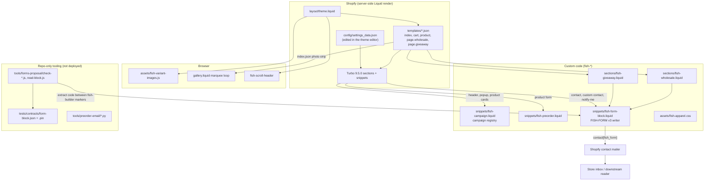

# Architecture

## System Diagram

## Component Descriptions

### Campaign registry
- **Purpose**: One place that decides what is being promoted and where, so the announcement bar, the popup and the product chips cannot disagree.
- **Location**: `snippets/fish-campaign.liquid`; consumed by `sections/header.liquid`, `snippets/popup-newsletter.liquid`, `snippets/product-thumbnail.liquid` and `snippets/js-variables.liquid`
- **Key responsibilities**:
  - Each campaign is defined in exactly one `case` branch: mode, handle, named variants, start and end dates.
  - Each mode has a gate. `preorder` runs while a variant is tracked, depleted and set to keep selling. `restock` runs while real units are on hand. `launch` applies the restock test to the named variants only.
  - Emits one field per call (`banner`, `popup_rows`, `variant_chip`, ...). Callers capture the output and `| strip` it.
  - The announcement-bar dismiss cookie is derived from the campaign that owns the bar, so a new message is not hidden by an old dismissal.
  - `fish_campaign_enabled` is the master switch.

### Variant image filter
- **Purpose**: Show only the selected colourway's photos, on the product page and in quick view.
- **Location**: `assets/fish-variant-images.js` (loaded with `defer` after `vendors.js` in `layout/theme.liquid`)
- **Key responsibilities**:
  - Scans every `[data-product-gallery]`. It polls at load and runs a short burst of re-scans on DOM mutations, which catches the quick-view modal.
  - Scopes each gallery to its nearest swatch container, so the page and the modal stay independent.
  - Matches slides by filename prefix, orders angle shots first, and falls back to all images if nothing matches.
  - Renumbers `data-index` in both the attribute and jQuery's data cache, so the theme's `sections.js` variant handler selects the right slide.

### Wholesale catalog
- **Purpose**: A B2B order builder that needs no wholesale app.
- **Location**: `sections/fish-wholesale.liquid`, `templates/page.wholesale.json`
- **Key responsibilities**:
  - Renders `collections.all` with every variant, wholesale prices computed with `divided_by`, quantity steppers and a live summary.
  - Password gate: compares a SHA-256 of the input (Web Crypto) with a SHA-256 of the page metafield, which is computed in Liquid. It accepts `?pass=` and remembers the unlock in `sessionStorage`.
  - Optional server-side gate on a customer tag (`require_customer_tag`).
  - Submits through `` with a `wholesale` tag and a honeypot field. The human-readable body is built by pure functions between `// <fish-builder>` markers, and the item list (variant id, quantity, list and unit price, totals) goes into the FISH-FORM block.

### Team record form
- **Purpose**: Lets team members record a hat they gave away or sold for cash, so the inventory change can be entered centrally.
- **Location**: `sections/fish-giveaway.liquid`, `templates/page.giveaway.json`
- **Key responsibilities**:
  - Server-side gate on a team customer tag. Logged-out visitors get a login link with a `return_url`, joined correctly when the login URL already has a query string.
  - Holder list from a `location id|name` section setting, hat tiles from every variant, and a date that cannot be in the future.
  - Sends through the shared form-block pipeline, tagged `give-away` or `cash-sale`.

### FISH-FORM block writer
- **Purpose**: Make every form email machine-readable, even though Shopify's mailer re-wraps the plain-text body.
- **Location**: `snippets/fish-form-block.liquid`; rendered beside the forms in `include-contact-form`, `include-custom-contact-form`, `product-notify-me`, `fish-wholesale` and `fish-giveaway`
- **Key responsibilities**:
  - Listens for `submit` in the capture phase and writes `contact[fish_form]` before any other handler serializes the form.
  - Takes the fields from `FormData`, not from a hard-coded list, so a new form field is picked up automatically.
  - Encodes each value as percent-encoded UTF-8 in chunks of at most 36 characters, never split inside a `%XX`, with `len=` for verification. Keys are normalized to at most 32 characters.
  - Forms with extra facts register a function through `window.FishForm.extra(id, fn)`. Wholesale, the team form and notify-me use it, for example for wholesale's item rows and totals.
  - Fails open: if the script errors, the form still sends without a block.

### Pre-order support
- **Purpose**: Sell depleted variants with an honest ship date, without a pre-order app.
- **Location**: `snippets/fish-preorder.liquid`, `snippets/product-form.liquid`, `snippets/fish-quick-add-button.liquid`, `locales/en.default.json`, `tools/preorder-email/`
- **Key responsibilities**:
  - Parses a `preorder:YYYY-MM-DD` product tag. A malformed date is treated as no date.
  - Writes a `Pre-Order` line-item property and keeps the note in sync with the selected variant.
  - Quick Add sends pre-order variants to the product page, using the same three-part test, so the property is never skipped.
  - A Python patcher applies matching edits to the admin-only order-confirmation template, with exact-once anchor checks.

### Photo-strip marquee
- **Purpose**: A continuously scrolling strip of lifestyle photos that loads only what is about to be seen.
- **Location**: `sections/gallery.liquid` (script at the foot of the section), tile widths in `assets/fish-apparel.css`
- **Key responsibilities**:
  - Moves at `marquee_speed` px per second using the frame delta. The delta is capped at 0.25 s, so a backgrounded tab does not lurch.
  - Wraps at the measured width of the non-duplicate tiles.
  - Unveils each tile through lazysizes when it comes within 900 px of the viewport edge.
  - Declares a `sizes` value matching the fixed CSS tile widths.

### Storefront snippets
- `fish-shipping-progress.liquid`: a cart progress bar toward free shipping at 3 hats, rendered from a `custom-liquid` block in `templates/cart.json`.
- `fish-quick-add-button.liquid`: one-tap add on cart recommendations (`template.name == 'cart'` in `product-details.liquid`).
- `fish-scroll-header.liquid`: hides and shows the header on scroll, throttled with rAF, with a 200 px threshold.
- `fish-mega-menu-products.liquid`: product cards in the mega menu (`snippets/mega-menu.liquid`, 150 ms close delay).
- `fish-newsletter-instagram.liquid`: a newsletter and Instagram block on the homepage.

## Data Flow

### Wholesale order
1. A retailer opens `/pages/wholesale` by typing the password or scanning a business-card QR code that carries it.
2. If a customer tag is required, Liquid renders the catalog only for a tagged, logged-in customer. Otherwise the page renders and the password gate decides.
3. The browser hashes the input and compares it with the hash rendered into `data-pw-hash`. On a match it reveals the catalog.
4. Changing any quantity rebuilds the summary and the hidden `contact[body]` text.
5. On submit, `fish-form-block` writes `contact[fish_form]` with every field, each item's variant id, quantity and prices, and the totals.
6. Shopify's mailer emails the submission. A reader can parse the block and re-price each item from the catalogue by variant id, because every value in the block is a claim made by the browser.

### Variant gallery
1. A shopper opens a product page or a quick-view modal.
2. `fish-variant-images.js` finds the Flickity instance and its colour swatch.
3. On a swatch change, it handleizes the colour and removes non-matching cells from both carousels.
4. It renumbers the remaining cells, then selects the first one (the angle shot).

## External Integrations

| Service | Purpose | Notes |
|---------|---------|-------|
| Shopify Online Store | Hosting, rendering, checkout, customer accounts | All logic is Liquid or client JS; there is no app backend |
| Shopify contact form + mailer | Wholesale orders, team records, contact and notify-me | Plain-text body is hard-wrapped by the mailer, which is why the encoded block exists |
| Shopify customer form | Newsletter signups | Goes straight to the customer list |
| Shopify notifications | Pre-order banner in the order confirmation | Edited in the admin and patched by `tools/preorder-email/apply-preorder-edits.py` |
| Instagram | Outbound follow links | Links only, no embed |

## Key Architectural Decisions

### Theme code instead of paid apps
- **Context**: Variant images, wholesale, pre-orders and a shipping bar each had a paid app at $5 to $49 a month, and each app adds its own script to every page.
- **Decision**: Build each feature in Liquid and vanilla JS inside the theme, in `fish-`-prefixed files.
- **Rationale**: A custom Shopify app with a backend was overkill for a small catalogue. Theme code costs nothing to run, adds no third-party script, and the prefix keeps it separate from Turbo's files when the theme is updated.

### A registry for campaigns instead of per-surface settings
- **Context**: The bar, the popup and the product chips each need to know what is being promoted, and two campaigns (a launch and a restock) can run at once.
- **Decision**: One snippet holds every campaign in a single `case` branch each, and the surfaces ask it for a field.
- **Rationale**: Settings scattered across surfaces drift apart. Parallel comma-separated arrays were rejected because Liquid's `split` drops trailing empty strings and silently shifts columns. Inventory gates mean a campaign cannot outlive its stock.

### An encoded block instead of a formatted email body
- **Context**: Form submissions arrive as Shopify mailer emails. The theme controls only field names, values and their order, and the mailer hard-wraps long plain-text lines at a space.
- **Decision**: Add one hidden field holding a versioned block with no spaces, short lines and percent-encoded chunked values, read from `FormData` at submit time. The format is pinned to a JSON contract by SHA-256.
- **Rationale**: The first block format wrote one long row per item, and the first real email arrived with that row cut in two by the mailer. Encoding into short, space-free lines makes wrapping irrelevant. Reading `FormData` means new fields are never silently dropped. Failing open means a script error never loses a submission.

### Test the code the store runs, not a copy of it
- **Context**: The builder functions live inside Liquid files, and Liquid cannot be unit-tested directly.
- **Decision**: Keep them as pure functions between `// <fish-builder>` markers. `tools/forms-proposal/builder.js` extracts that exact text with `new Function`, and `check-block.js` and `render-samples.js` run it.
- **Rationale**: A separately maintained JS copy would drift from the theme. Extracting the shipped code means a passing check describes the code on the store. `check-browser.js` covers the DOM wiring that pure functions cannot, by running the real snippet in headless Chrome.

### Client-side password plus an optional server gate
- **Context**: The wholesale page needed a lightweight gate, but a theme cannot run server code beyond Liquid.
- **Decision**: Keep the hashed password as a convenience, and add a Liquid customer-tag check for when a real boundary is wanted.
- **Rationale**: The password is not a security boundary, since anyone can post to the store's contact endpoint. The tag gate keeps the catalog out of the HTML entirely, and the downstream reader re-prices orders from the catalogue instead of trusting the submitted prices.

### Loading driven by the animation loop
- **Context**: The 24-tile strip is translated, not scrolled, so `loading="lazy"` and lazysizes never re-check visibility. Loading every tile eagerly downloaded all of them in the first second.
- **Decision**: The rAF loop that moves the strip also unveils each tile when it is 900 px from the viewport edge.
- **Rationale**: At a fixed, known speed, 900 px of runway is a predictable number of seconds of warning, which a scroll-driven lazy loader cannot guarantee.
