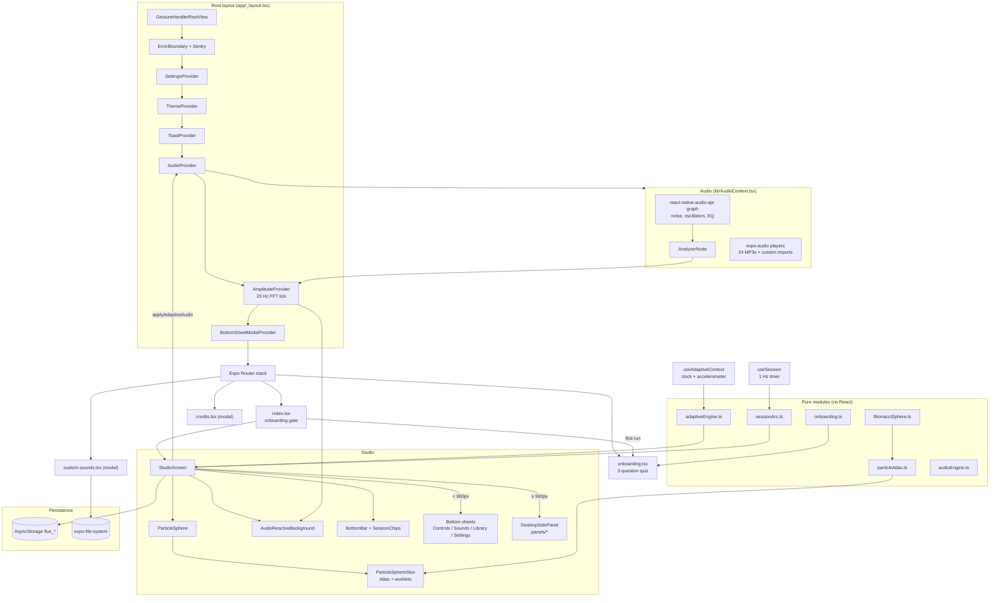

# Architecture

## System Diagram

## Component Descriptions

### StudioScreen
- **Purpose**: The main screen; owns the user's particle settings and decides what the renderer actually sees
- **Location**: `components/studio/StudioScreen.tsx`
- **Key responsibilities**: Loads and persists particle settings, layers a micro-session (priority) or the adaptive engine on top of them without mutating the stored values, pushes the audio half of either into `AudioProvider`, resets the audio coloring when both stop, switches between bottom sheets and the desktop side panel at `DESKTOP_BREAKPOINT` (900px, `constants/layout.ts`), runs auto-save, and handles the save flow with SVG thumbnails

### ParticleSphere / ParticleSphereSkia
- **Purpose**: The particle visualization
- **Location**: `components/ParticleSphere.tsx`, `components/ParticleSphereSkia.tsx`, geometry in `lib/particleAtlas.ts`
- **Key responsibilities**: On web, wraps the renderer in `WithSkiaWeb` so CanvasKit loads first, resolving `canvaskit.wasm` from the site root. The renderer draws all particles with one Skia `Atlas` (a shared white circle texture tinted per instance) and trails with a second. Rotation, wobble, perspective projection, and depth-based size and opacity are computed per particle inside `useRSXformBuffer` / `useColorBuffer` worklets on the UI thread. Physics runs in a JS `requestAnimationFrame` loop and publishes positions through ping-pong `Float32Array` buffers. Pan gestures add manual rotation.

### AudioProvider
- **Purpose**: All audio state and playback
- **Location**: `lib/AudioContext.tsx`, pure helpers in `lib/audioEngine.ts`
- **Key responsibilities**: Defines the 34 built-in layers (15 nature, 3 noise, 9 tonal, 7 ambient) and the four soundscapes. The 10 synthesized layers run through a `react-native-audio-api` `AudioContext` on every platform: noise buffers, harmonic and FM oscillators, hard-panned binaural beats, and a per-layer lowshelf (250 Hz) / peaking (1 kHz) / highshelf (4 kHz) chain feeding an `AnalyserNode`. The 24 file-backed layers and custom imports play through `expo-audio`. Also handles custom sounds with trim-window looping, custom soundscapes, the master EQ, and the adaptive gain and EQ hooks.

### AmplitudeProvider
- **Purpose**: Real-time frequency bands for the reactive visuals
- **Location**: `lib/AudioContext.tsx` (`AmplitudeProvider`, `useAmplitude`)
- **Key responsibilities**: Every 50 ms while playing, reads the analyser (FFT size 256), splits the bins into bass / mid / treble / overall with `computeFrequencyBands`, and smooths them. It is a separate context so the 20 Hz tick only re-renders `AudioReactiveBackground` and the studio's three audio dots.

### Adaptive engine
- **Purpose**: Make the sound and visuals drift with the time of day and the user's movement
- **Location**: `lib/adaptiveEngine.ts` (pure), `lib/useAdaptiveContext.ts` (sampling)
- **Key responsibilities**: Samples cyclic 24-hour keyframe curves with smoothstep interpolation, so outputs are continuous across phase boundaries and midnight. Applies a per-mode profile (Focus / Relax / Sleep / Energy) and a motion term from the accelerometer, sampled at about 1 Hz and exponentially smoothed. Outputs an audio state (intensity, EQ tilt, change rate) and a visual state (speed, wobble, size multipliers). In `AudioProvider` these map to the master EQ, an adaptive gain factor of 0.65–1.0 on top of user volumes, and the LFO rate of synthesized layers. The engine also computes a per-category layer bias, which the audio side does not apply yet.

### Micro-sessions
- **Purpose**: Two-minute guided arcs (Reset, Pre-Focus, Wind-Down)
- **Location**: `lib/sessionArc.ts` (pure), `lib/useSession.ts`, `components/studio/SessionChips.tsx`
- **Key responsibilities**: Each session is a 120-second envelope with settling (0–25 s), core (25–100 s), and resolve (100–120 s) phases. The resolve phase lands every track on neutral so the handoff back to normal or adaptive mode has no jump. Output is shaped like the adaptive engine's state, so it reuses the same apply paths. Starting a session with nothing playing seeds the matching soundscape.

### Onboarding
- **Purpose**: First-run setup
- **Location**: `app/onboarding.tsx`, `lib/onboarding.ts`, gate in `app/index.tsx`
- **Key responsibilities**: Three questions (goal, environment, visual mood) map deterministically to a soundscape, a visual preset, and the adaptive-mode setting. All 24 answer combinations are covered. The gate reads `flux_onboarding_done` and treats a failed read as "done", so a storage error can never trap a user on the quiz.

### Bottom sheets and desktop panels
- **Purpose**: Controls UI that keeps the sphere visible
- **Location**: `components/sheets/`, `components/studio/panels/`, `components/studio/DesktopSidePanel.tsx`
- **Key responsibilities**: On mobile, only the active sheet is mounted. Sheets cross-fade between peek and expanded content with `SheetContentWrapper` / `useSheetTransition`, and the sphere slides up and scales to 0.75 while one is open. On desktop, `DesktopSidePanel` is a small switch over four panel components that reuse the same building blocks (`SoundLibrary`, `SoundMix`, `EQPanel`, `PresetCard`, `GalleryCard`) and the shared `lib/settingsBackup.ts`.

### Entitlements
- **Purpose**: A free/premium seam with no paywall yet
- **Location**: `lib/entitlements.ts`
- **Key responsibilities**: A persisted `flux_entitlement` value, a subscribe/notify emitter, a `useEntitlement()` hook, and an `isGated()` check against `PREMIUM_GATES`. That map ships empty, so nothing is gated today.

## Data Flow

1. **First launch**: `app/index.tsx` reads the onboarding flag and redirects to the quiz. The result sets the soundscape, the particle settings, and the adaptive-mode setting, then marks onboarding done.
2. **Playback**: Toggling a layer calls `startLayer`. File-backed layers get an `expo-audio` player. Synthesized layers get a gain node, a three-filter EQ chain, and sources connected to the analyser.
3. **Amplitude**: Every 50 ms the `AmplitudeProvider` reads the analyser, smooths the bands, and `AudioReactiveBackground` animates its orbs toward the new values with short `withTiming` transitions.
4. **Adaptive and sessions**: While adaptive mode is on and audio is playing, `useAdaptiveContext` samples the clock each minute and the accelerometer each second. `StudioScreen` applies the visual state to a derived copy of the settings and sends the audio state to `applyAdaptiveAudio`. A running session overrides both.
5. **Rendering**: The effective settings reach `ParticleSphereSkia`. Geometry is rebuilt only when the point count, cap, or palette changes. Rotation and wobble advance on the UI thread with no per-frame React renders.
6. **Persistence**: Slider changes save to `flux_current_settings`. Saves write a creation with an SVG thumbnail from `lib/thumbnailGenerator.ts`. Backups go through `lib/settingsBackup.ts`: a browser download on web, the share sheet on native.

## External Integrations

| Service | Purpose | Notes |
|---------|---------|-------|
| Expo / EAS Build | Native builds and store submission | Profiles in `eas.json`; production auto-increments the build number |
| Vercel | Static web hosting | `vercel.json`: SPA rewrite, HSTS, CSP limiting `connect-src` to self and `*.sentry.io` |
| Sentry | Crash reporting | Initialised only outside `__DEV__` and when `EXPO_PUBLIC_SENTRY_DSN` is set; `ErrorBoundary` forwards caught errors |
| Freesound.org | Source of the 24 bundled recordings | CC0 or CC-BY; the 10 CC-BY credits live in `lib/creditsData.ts` |

## Key Architectural Decisions

### Skia Atlas with UI-thread worklets instead of SVG circles
- **Context**: The sphere needs to stay smooth with thousands of particles on phones, tablets, and browsers, with depth-sorted sizing, per-particle color, and trails
- **Decision**: Render through `@shopify/react-native-skia`'s `Atlas`: one texture, one draw call for particles and one for trails, with transforms and colors computed in worklets on the UI thread
- **Rationale**: One SVG element per particle meant React reconciliation and native view work that grew with the count. Atlas lets the cap rise to 2,000 on mobile and 5,000 on desktop (`computeMaxParticles` in `lib/particleAtlas.ts`) with no per-frame React renders. The trade-off is that Atlas has no per-sprite z-sort, so points are sorted back-to-front once and the depth cue (alpha and scale) hides the drift during rotation. On web this needs CanvasKit WASM, which a build step copies into `public/`.

### One audio graph library on every platform
- **Context**: Procedural noise, oscillators, EQ, and FFT analysis originally worked only on web, so native users got simulated amplitude and no synthesis
- **Decision**: Build the synthesis graph on `react-native-audio-api`, which provides the same `AudioContext` API natively and on web, and keep `expo-audio` for MP3 playback
- **Rationale**: One code path for synthesis and analysis on all three platforms, without a custom native module. The cost is that the file-backed layers do not pass through the graph, so the master EQ and FFT only cover the synthesized layers. On native, the EQ panel shows a note that EQ is optimized for web playback.

### Pure cores with thin React shells
- **Context**: The adaptive curves, session envelopes, quiz mapping, atlas geometry, audio math, and storage validation all decide behaviour, and they are hard to test through components
- **Decision**: Each lives in a dependency-free module (`adaptiveEngine.ts`, `sessionArc.ts`, `onboarding.ts`, `particleAtlas.ts`, `audioEngine.ts`, `fibonacciSphere.ts`), with hooks (`useAdaptiveContext`, `useSession`) that only own timers, sensors, and state
- **Rationale**: Jest can call them directly, with no renderer or audio mocks. The test suite (28 suites, 322 tests) checks properties such as curve continuity across midnight and session tracks landing on neutral.

### Adaptive and session effects layered on top, never written back
- **Context**: Adaptive mode and sessions change speed, size, EQ, and loudness continuously, but the user's own settings and per-layer volumes must survive intact
- **Decision**: `StudioScreen` derives `effectiveSettings` with `applyAdaptiveVisual` instead of calling `setSettings`. The audio side multiplies a separate adaptive gain (0.65–1.0) over `layer.volume * masterVolume`. `resetAdaptiveAudio` restores unity gain and a flat EQ when both stop.
- **Rationale**: Turning adaptive off or ending a session returns exactly to what the user set, and nothing adaptive is ever saved to storage. A ref guard stops the reset from flattening a user-set EQ when the app mounts with adaptive mode off.

### Isolating the 20 Hz amplitude tick
- **Context**: Amplitude changes 20 times a second during playback. With it in the main audio context, every `useAudio()` consumer re-rendered at 20 Hz.
- **Decision**: A separate `AmplitudeContext` beneath `AudioProvider`. Its interval is keyed on `isPlaying` and the active layer count, not the layers array, and the studio's level dots are their own component.
- **Rationale**: Only the reactive background and the dots re-render on the tick. Adaptive changes that rebuild the layers array no longer restart the analyser loop.

### Namespaced keys with a per-key import allowlist
- **Context**: Backups move between devices and can be hand-edited, and a malformed value must not reach the renderer
- **Decision**: Every key is prefixed `flux_`. `exportAllData` collects them into a versioned JSON object. `importData` accepts only known keys whose values pass `isImportableValueForKey` (arrays for creations, favorites, and recordings; objects for settings; a boolean for onboarding; `free`/`premium` for the entitlement).
- **Rationale**: Unknown or malformed keys are skipped and reported, not written. The entitlement is stored as JSON like every other key, so it survives an export/import round trip, and legacy bare-string values are still read.
