# Architecture Overview

## System Diagram

```mermaid
flowchart TD
    subgraph SharedData["Shared Data Layer"]
        SD[shared/slangDictionary.js<br/>126 terms, filters]
    end

    subgraph WebApp["React Web App (webapp/)"]
        Entry[main.jsx<br/>Sentry + Providers] --> App[App.jsx<br/>Thin shell: titles + tabs]
        Entry -->|/moderate| Moderate[ModeratePage<br/>claim-gated, lazy]

        subgraph Layout["Layout"]
            Header[Header<br/>title + Settings button]
            Settings[SettingsModal<br/>appearance, account, about]
            Banner[AppStoreBanner<br/>Home only]
        end

        subgraph Contexts["Context Providers"]
            Theme[ThemeContext<br/>Dark mode]
            Auth[AuthContext<br/>Google + Apple sign-in]
            Approved[ApprovedTermsContext<br/>Single onSnapshot subscription]
        end

        subgraph Tabs["Feature Tabs (kept mounted via TabPanels)"]
            Decode[DecodeTab<br/>+ HighlightedText<br/>+ DefinitionList<br/>+ AiInsightPanel]
            Encode[EncodeTab<br/>+ VariationCard<br/>+ EncodeGlossary]
            Browse[BrowseTab<br/>+ FilterBar<br/>+ TermCard<br/>+ TrendingRow]
            Community[CommunityTab<br/>+ AuthPrompt<br/>+ SubmissionForm<br/>+ SubmissionCard<br/>+ ReportModal]
        end

        subgraph Hooks["Custom Hooks"]
            useTranslation[useTranslation]
            useAiTranslation[useAiTranslation]
            useEncode[useEncode]
            useDictionary[useDictionary]
            useCommunity[useCommunity]
        end

        subgraph Services["Service Layer"]
            CommService[communityService.js<br/>Firestore CRUD + transactions]
            ModService[moderationService.js<br/>batched actions + log]
        end

        subgraph Utils["Utilities"]
            Speak[speak.js]
            Detect[detectInputType.js]
            Escape[escapeRegex.js]
            FindTerms[findTermsInText.js<br/>Shared word-boundary matcher]
            MergeGloss[mergeGlossary.js<br/>Curated + AI glossary merge]
            Blacklist[blacklist.js<br/>+ Unicode confusables]
        end

        LocalDict[data/slangDictionary.js]
    end

    subgraph Serverless["Vercel API (webapp/api/)"]
        AIFunc[ai-translate.js]
        EncodeFunc[ai-encode.js]
        ApiLib[_lib/<br/>cors + kv + rate-limit + stream]
        AIFunc --> ApiLib
        EncodeFunc --> ApiLib
    end

    subgraph ExternalAPIs["External Services"]
        Claude[LLM API<br/>Anthropic SDK]
        FirebaseAuth[Firebase Auth]
        Firestore[(Firestore<br/>+ firebase/firestore.rules)]
        SentryAPI[Sentry<br/>Error Tracking]
        KV[(Vercel KV Cache<br/>+ rate-limit counters)]
    end

    subgraph Hosting["Deployment"]
        Vercel[Vercel<br/>Hosting + Serverless]
        GHA[GitHub Actions<br/>ci-v2 test pipeline]
    end

    subgraph CloudFns["Firebase Cloud Functions (functions/index.js)"]
        Publisher[publishDictionary]
        AutoApprove[autoApprove]
        ReportAlert[reportAlert]
        Unpublish[unpublishOnRemove]
        DeleteAcct[deleteAccount]
    end

    Firestore --> Publisher
    Publisher -->|published/dictionary| Firestore
    Firestore --> AutoApprove
    Firestore --> ReportAlert
    Firestore --> Unpublish
    Settings -->|callable| DeleteAcct
    DeleteAcct --> Firestore
    App --> Header
    App --> Banner
    Header --> Settings
    Settings --> Theme
    Settings --> Auth
    Moderate --> ModService
    ModService --> Firestore

    SD -->|first-launch seed| LocalDict
    Firestore -->|published doc, 1 read/launch| LocalDict

    App --> Theme
    App --> Auth
    App --> Approved
    App --> Decode
    App --> Encode
    App --> Browse
    App --> Community

    Decode --> useTranslation
    Decode --> useAiTranslation
    Encode --> useEncode
    Encode --> MergeGloss
    Browse --> useDictionary
    Community --> useCommunity

    useTranslation --> FindTerms
    useTranslation --> LocalDict
    MergeGloss --> FindTerms
    MergeGloss --> LocalDict
    useDictionary --> LocalDict
    useDictionary --> Approved
    useCommunity --> CommService
    useCommunity --> Approved

    useAiTranslation -->|/api/ai-translate| Vercel
    useEncode -->|/api/ai-encode| Vercel
    Vercel --> AIFunc
    Vercel --> EncodeFunc
    CommService --> FirebaseAuth
    CommService --> Firestore
    Auth --> FirebaseAuth
    Approved --> Firestore
    AIFunc --> Claude
    AIFunc --> KV
    EncodeFunc --> Claude
    EncodeFunc --> KV
    Entry --> SentryAPI
```

## Component Descriptions

### App.jsx (Application Shell)
- **Purpose**: Thin orchestration shell that renders the header, tab bar, Settings sheet and active tab
- **Location**: `webapp/src/App.jsx`
- **Key responsibilities**:
  - Manages active tab state (decode, encode, browse, community); the decode tab is labelled "Home" in the tab bar, matching the iOS app, while its id stays `decode`
  - Supplies each non-Home page's plain-sentence title and one-line instruction to `Header` ("Say it in kid talk", "Slang dictionary", "New slang"); Home shows the brand instead
  - Shows the "Now on iOS" `AppStoreBanner` on Home only, and opens `SettingsModal` from the header
  - Declares the panel list and hands it to `TabPanels`, which keeps each visited tab mounted so its state survives switching tabs
  - Subscribes to `dictionaryStore` (one published-dictionary read per launch), calls `useDictionary` once and passes data down
  - There is no page footer: the tagline and the Privacy, Terms and Support links live in Settings

### Header, SettingsModal and AppStoreBanner (Layout)
- **Purpose**: The title row on every page, and the one place for preferences and account actions
- **Location**: `webapp/src/components/Layout/Header.jsx`, `SettingsModal.jsx`, `AppStoreBanner.jsx`
- **Key responsibilities**:
  - `Header` renders the centered brand on Home, or the page's plain-sentence title with its instruction elsewhere, plus a 44px Settings button whose glyph shows sign-in state (a person in a coral ring when signed in, a gear when not) rather than the provider's profile photo
  - `SettingsModal` is a bottom sheet on phones and a centered dialog on desktop, closed by Done or Escape. It holds a three-way Appearance radio group (Match device / Light / Dark), the account section (Google and Apple sign-in via the shared `SignInButtons`, sign-out, and account deletion with a confirmation that states the timeline), and links to the iOS app, Privacy, Terms and Support
  - `AppStoreBanner` is a single "Now on iOS" link to the App Store listing (URL in `webapp/src/utils/appStore.js`); `webapp/index.html` also carries Apple's `apple-itunes-app` Smart App Banner tag

### TabPanels (Tab State Persistence)
- **Purpose**: Render tab panels while preserving each one's state across tab switches
- **Location**: `webapp/src/components/Layout/TabPanels.jsx`
- **Key responsibilities**:
  - Mounts a panel the first time its tab becomes active, then keeps it mounted (hidden via `display:none`) instead of unmounting — so a panel's typed input, results, and filters survive navigating away and back
  - Never renders a tab that hasn't been visited, so lazy-loaded panels keep their separate code-split chunks and load on demand
  - Wraps each panel in its own `Suspense` boundary so a first-visit chunk load only shows a spinner in that panel's area

### main.jsx (Entry Point)
- **Purpose**: Bootstraps the app with providers and error boundary
- **Location**: `webapp/src/main.jsx`
- **Key responsibilities**:
  - Initializes Sentry (production only)
  - Wraps app in ThemeProvider → AuthProvider → Sentry.ErrorBoundary

### DecodeTab (Smart Translation)
- **Purpose**: Primary feature — decodes slang from text, sentences, or conversations
- **Location**: `webapp/src/components/Decode/DecodeTab.jsx`
- **Key responsibilities**:
  - Detects input type (term, sentence, or conversation) via `detectInputType`
  - Orchestrates local translation (`useTranslation`) and AI translation (`useAiTranslation`) in parallel
  - Renders highlighted text with clickable slang terms and scrollable definitions
  - Leads the results with the AI insight panel ("In plain English"), then the highlighted text and the word-by-word definitions in a single column

### EncodeTab (Reverse Translation)
- **Purpose**: The inverse of decode — rewrites plain adult English into current kid slang
- **Location**: `webapp/src/components/Encode/EncodeTab.jsx`
- **Key responsibilities**:
  - Sends the input to `useEncode`, which calls the `/api/ai-encode` serverless function and returns three slang-intensity variations (light → medium → full Gen Alpha) plus a glossary
  - Renders each variation as a `VariationCard` with a copy-to-clipboard button and an escalating colour accent that conveys the intensity spectrum
  - Builds the displayed glossary with `mergeGlossary`, which detects curated-dictionary terms in the output (so they carry vetted definitions) and folds in the model's own glossary for everything else; `EncodeGlossary` caps the list at six with a "Show all" toggle
  - Scrolls to results only once they arrive, since encode has no synchronous output to anchor to

### BrowseTab (Dictionary Browser)
- **Purpose**: Filterable, searchable dictionary with a trending row
- **Location**: `webapp/src/components/Browse/BrowseTab.jsx`
- **Key responsibilities**:
  - Renders FilterBar with labelled "Year:" and "Kind:" selects; their options are derived from the dictionary data in `useDictionary`, so they grow with it
  - Shows TermCards that open to a "Sounds like" pronunciation, a labelled Listen button, an example and a "Don't say" warning
  - Displays TrendingRow, a random sample of the local dictionary (`pickTrendingTerms` in `useDictionary.js`)
  - Shows a no-results card when a search matches nothing; there is no remote fallback

### CommunityTab (User Submissions)
- **Purpose**: Community-driven term submissions with voting
- **Location**: `webapp/src/components/Community/CommunityTab.jsx`
- **Key responsibilities**:
  - Shows AuthPrompt for unauthenticated users (Google/Apple sign-in through the shared `SignInButtons`)
  - Renders SubmissionForm behind a "Suggest a word" button (with blacklist filtering)
  - Displays SubmissionCards with worded "Yes · n" / "No · n" vote pills (Firestore transactions), plus Report and Block actions
  - Enforces daily submission limits (5/day per user)

### ThemeContext (Appearance)
- **Purpose**: Light, dark, or follow the device
- **Location**: `webapp/src/context/ThemeContext.jsx`
- **Key responsibilities**:
  - Exposes `appearance` (`system` | `light` | `dark`) and `setAppearance` for the Settings sheet; `system` clears the saved `ktt_theme` key so the page follows the device again, while `light` / `dark` pin it
  - With no saved choice, follows `prefers-color-scheme`, including live OS changes
  - Adds/removes `dark` class on `<html>` for Tailwind dark mode

### AuthContext (Firebase Authentication)
- **Purpose**: Manages user authentication state
- **Location**: `webapp/src/context/AuthContext.jsx`
- **Key responsibilities**:
  - Google and Apple sign-in via Firebase popup
  - User-friendly error messages for common auth failures
  - Provides `user`, `authError`, `signInWithGoogle`, `signInWithApple`, `signOut`, and `deleteAccount` (backed by the `deleteAccount` callable Cloud Function)

### ApprovedTermsContext (Single Subscription)
- **Purpose**: Owns the only `onSnapshot` subscription for approved community submissions
- **Location**: `webapp/src/context/ApprovedTermsContext.jsx`
- **Key responsibilities**:
  - Subscribes once via `subscribeToApproved` at mount
  - Exposes the live list to both `useDictionary` (for merging into `allTerms`) and `useCommunity` (for the community feed) so they share a single Firestore listener instead of opening one each

### findTermsInText.js (Shared Term Matcher)
- **Purpose**: One canonical implementation for matching slang terms in arbitrary text
- **Location**: `webapp/src/utils/findTermsInText.js`
- **Key responsibilities**:
  - Sorts candidate terms longest-first so multi-word phrases match before their constituent words ("no cap" beats "no")
  - Word-boundary regex with claimed-range tracking so partial matches inside other terms don't double-count ("rizz" inside "rizzler" is rejected)
  - Used by both `useTranslation` (decode) and `mergeGlossary` (encode glossary)

### mergeGlossary.js (Encode Glossary Builder)
- **Purpose**: Assemble the glossary shown under the encode results from two sources of differing trust
- **Location**: `webapp/src/utils/mergeGlossary.js`
- **Key responsibilities**:
  - Runs `findTermsInText` over the generated variation texts to detect curated-dictionary terms, which carry vetted definitions and are listed first
  - Folds in the encode model's own glossary for any slang not in the dictionary, deduping case-insensitively so the curated definition always wins
  - Tolerates malformed model output (non-object entries, missing fields) without throwing

### communityService.js (Firestore Layer)
- **Purpose**: CRUD operations for community submissions and voting
- **Location**: `webapp/src/services/communityService.js`
- **Key responsibilities**:
  - Submit terms with duplicate detection and daily rate limiting
  - Atomic vote transactions (upvote/downvote with counter updates)
  - Real-time subscriptions to pending and approved submissions via `onSnapshot`

### slangDictionary.js (Shared Data)
- **Purpose**: Bundled first-launch seed (the live source of truth is Firestore)
- **Location**: `shared/slangDictionary.js`
- **Key responsibilities**:
  - Exports `slangDictionary` (126 seed terms with definition, example, wrongUsage, era, origin, type, pronunciation)
  - Exports filter option arrays (`tabs`, `eras`, `origins`, `types`)

### ModeratePage.jsx (Moderation dashboard)
- **Purpose**: Where a human actually reviews reports — the dependency the
  "nothing is ever auto-hidden" decision rests on
- **Location**: `webapp/src/pages/ModeratePage.jsx`, `src/services/moderationService.js`
- **Key responsibilities**:
  - Web-only, reached at `/moderate` via a pathname branch in `main.jsx` (the site has no
    router) and lazy-loaded, so its code never enters the main bundle
  - Gated on a `moderator` custom claim; without it the route renders the same empty shell an
    anonymous visitor sees, rather than a locked door that advertises itself
  - Queues for open reports and each submission status; resolve / remove / restore / edit /
    approve-and-publish, each committed in one batch with its `moderationLog` entry so an
    action can never land unlogged

### dictionaryStore.js (Live Dictionary)
- **Purpose**: Keeps the dictionary current without app deploys
- **Location**: `webapp/src/data/dictionaryStore.js`, `functions/index.js`
- **Key responsibilities**:
  - Serves the seed synchronously at first paint, then makes one Firestore read per
    launch (`published/dictionary`, a single versioned document maintained by a
    debounced publisher Cloud Function watching the `dictionary/*` collection)
  - Swaps strictly-newer versions in live and caches them in localStorage; rejects
    version regressions and malformed or gutted payloads so a bad publish can never
    brick clients

### webapp/api/_lib/ (Shared API Helpers)
- **Purpose**: One implementation each for the cross-cutting concerns every serverless function needs
- **Location**: `webapp/api/_lib/cors.js`, `kv.js`, `rate-limit.js`, `stream.js`
- **Key responsibilities**:
  - `cors.js` — single `ALLOWED_ORIGINS` array; production domain changes require editing one file
  - `kv.js` — returns the real Vercel KV client in prod and a no-op stub in tests; `isReal` flag lets callers gate KV-specific paths
  - `rate-limit.js` — per-IP token bucket using KV `INCR`/`EXPIRE` with an in-memory fallback that self-prunes; trims `x-forwarded-for` whitespace; anonymous requests share an `unknown` bucket rather than bypassing the limit
  - `stream.js` — opt-in NDJSON streaming for both AI endpoints: `streamClaude` relays the model's text as `{"partial": …}` lines (throttled to one per 60ms and deduplicated), produced by `parsePartialJson`, a tolerant parser that closes open strings and containers in a truncated JSON prefix; it ends with a `{"done": …}` line identical to the non-streaming JSON body, or `{"error": …}`. `streamCached` serves a cache hit as a single `done` line

### firebase/firestore.rules (Server-Side Integrity)
- **Purpose**: Last line of defence on community-data integrity; the client-side transaction logic can't be trusted alone
- **Location**: `firebase/firestore.rules` (tested by `firebase/__tests__/firestore.rules.test.js`)
- **Key responsibilities**:
  - Vote-counter writes are restricted to the `upvotes`/`downvotes`/`netScore` keys, each delta bounded to ±1, and `netScore` must equal `upvotes − downvotes` after the write
  - Submissions require `activeTermLower == termLower` on create — clearing `activeTermLower` server-side marks a slug resubmittable after rejection/merge
  - Per-user counter doc enforces the 5-submissions-per-UTC-day cap; same-day increments must add exactly 1, new-day writes must reset to 1
  - Vote subcollection reads are owner-only; aggregate counts stay public via the parent submission doc
  - Delete is denied client-side; moderators (a `moderator` custom claim) act through
    rules-validated status transitions (`pending|approved|removed`) — nothing is ever deleted
    or auto-hidden, and every action lands in an append-only `moderationLog`

### firebase/firestore.indexes.json (Query Support)
- **Purpose**: Both community listeners use a composite filter-plus-sort that Firestore cannot
  serve from single-field indexes, so the indexes are declared in the repo and deployed with the
  rules rather than being created by hand from a console error link
- **Location**: `firebase/firestore.indexes.json`, wired through `firebase.json`
- **Key responsibilities**:
  - `status` + `netScore desc` + `submittedAt desc` — the pending feed, ranked by score then recency
  - `status` + `submittedAt desc` — the approved feed
  - Deploy with `firebase deploy --only firestore:indexes`; a missing composite index makes the
    listener fail at runtime rather than at build time, which is why it lives in version control

## Data Flow

### Decode Flow
1. User enters text in the decode tab
2. `detectInputType` classifies input as term, sentence, or conversation
3. For conversations: `annotateConversation` processes each line, wrapping detected slang in brackets
4. For terms/sentences: `translateText` checks local dictionary (sorted by length, longest first); a miss returns a "No slang detected" row without any network request
5. Simultaneously, `useAiTranslation` sends the input to the LLM endpoint for contextual analysis
6. Results render in one column: the plain-English answer first, then the highlighted text and the definitions

### Encode Flow
1. User types a plain-English phrase in the encode tab
2. `useEncode` checks its in-memory and localStorage caches, then POSTs to `/api/ai-encode` on a miss
3. The serverless function calls Claude with a system prompt that injects the curated dictionary's terms and definitions, asking for three intensity-graded rewrites plus a glossary, and validates/whitelists the response shape before caching it
4. `mergeGlossary` cross-references the returned variations against the local dictionary so curated terms get vetted definitions; the rest come from the model's glossary
5. Results render as three `VariationCard`s, named in plain words ("A little slang", "Some slang", "All slang") with a Copy pill each, and the glossary, capped at six terms with a "Show all" toggle

### Browse Flow
1. User searches with debounced input in the browse tab
2. Local dictionary filtered by search query + year/kind filters
3. Results shown as TermCards; curated and community-approved terms are merged into one list
4. If a search longer than 2 characters matches nothing, a no-results card is shown (no network request)

### Community Flow
1. User authenticates via Google or Apple sign-in (Firebase popup)
2. Submission form validates input and checks blacklist
3. `communityService.submitTerm` checks for duplicates, enforces daily limit, writes to Firestore
4. `subscribeToPending` provides real-time updates via Firestore `onSnapshot`
5. Voting uses Firestore transactions to atomically update vote doc + submission counters

### Streaming Flow (iOS clients)
1. A client sends `stream: true` in the POST body to `/api/ai-translate` or `/api/ai-encode`; the web app does not, and gets the unchanged JSON response
2. After CORS, input validation and rate limiting, a KV hit is returned as one `done` line
3. On a miss, `streamClaude` calls the model with streaming on, re-parses the accumulated text with `parsePartialJson` and normalizes each snapshot into the final response shape (decode waits until `translation` has started; encode drops a glossary entry that may still be mid-definition)
4. The final text goes through the same `finalize` function as the JSON path, so validation, fallback and the never-cache-a-fallback rule are shared, and the `done` line is byte-for-byte the JSON body

## External Integrations

| Service | Purpose | Documentation |
|---------|---------|---------------|
| Anthropic Claude Haiku 4.5 | Contextual slang analysis on decode (`ai-translate`) and slang generation on encode (`ai-encode`) | `@anthropic-ai/sdk` via Vercel serverless |
| Firebase Auth | Google and Apple sign-in for community features | `firebase/auth` |
| Firebase Firestore | Community submissions storage, voting, real-time sync, server-enforced integrity rules | `firebase/firestore` |
| Firebase Emulator | Drives the Firestore rules unit tests in CI | `firebase-tools` + `@firebase/rules-unit-testing` |
| Vercel KV | Server-side response cache + per-IP rate-limit counters | `@vercel/kv` package |
| Vercel Hosting | Static hosting at `kidtalktranslator.app` + serverless AI proxy functions | `vercel.json` config |
| Sentry | Production error tracking and performance monitoring | `@sentry/react` |
| Web Speech API | Text-to-speech pronunciation of slang terms | Browser built-in |

## Key Architectural Decisions

### Feature-Scoped Component Architecture
- **Context**: The app grew from a single-file component to multiple features (decode, browse, community)
- **Decision**: Organize components into feature directories (Decode/, Browse/, Community/, Layout/) with co-located logic
- **Rationale**: Each feature is self-contained; hooks encapsulate business logic while components handle rendering. App.jsx stays a thin orchestration shell

### Dual Translation Engine (Dictionary + AI)
- **Context**: Local dictionary provides curated definitions but can't explain context, cultural nuances, or evolving usage
- **Decision**: Run dictionary lookup and an LLM translation in parallel for every decode request
- **Rationale**: Dictionary results appear instantly (cached locally); AI results stream in shortly after, providing deeper cultural context. Users get the best of both worlds without waiting

### Encode as a Separate Endpoint with a Dictionary-Anchored Prompt
- **Context**: The reverse direction (plain English → slang) can't reuse the decode pipeline — the local dictionary is a forward index with no "meaning → slang" lookup, and the response shape (intensity-graded variations + glossary) differs from decode's. Output also needs to be accurate to current slang *and* link back to vetted definitions where possible
- **Decision**: A dedicated `webapp/api/ai-encode.js` function with its own system prompt that injects the curated dictionary's terms and definitions to steer the model toward linkable terms, its own cache namespace (`enc:`) and rate-limit bucket (`enc-rate`), and response validation that reconstructs each variation/glossary entry from only its declared fields before caching
- **Rationale**: Keeping encode out of the proven decode handler avoids mode-branching two different contracts through one function and isolates its cache/limits so the two features can't collide. The field-whitelisting validation means a malformed or adversarial model response can never poison the 30-day KV cache. The shared `_lib/` helpers are reused, so the new endpoint adds a prompt and a validator, not new CORS/KV/rate-limit code

### Persisting Tab State Without Breaking Code-Splitting
- **Context**: Tabs were rendered conditionally and unmounted on switch, discarding their state — typing in decode, glancing at encode, and returning wiped the decode input. The naive fix (render everything always) would eagerly bundle every tab and defeat the lazy-loaded code-split chunks
- **Decision**: `TabPanels` tracks which tabs have been visited, mounts a tab on first visit, and thereafter keeps it mounted but hidden (`display:none`) rather than unmounting; never-visited tabs are still not rendered
- **Rationale**: React preserves the state of a mounted-but-hidden subtree, so switching away and back is lossless with no re-fetch or re-render flash — while unvisited tabs keep their separate chunks and load on demand. The behaviour is locked down by unit tests asserting unvisited tabs don't mount and visited tabs retain their state

### Firebase for Community Features
- **Context**: Community submissions need authentication, real-time updates, and atomic voting
- **Decision**: Firebase Auth (Google + Apple) + Firestore with client-side transaction voting
- **Rationale**: Firestore's `onSnapshot` provides real-time submission feeds without polling. Client-side transactions ensure vote counts stay consistent without adding Cloud Functions cold starts to the voting path. Firebase Auth handles OAuth complexity

### Firestore Rules as the Integrity Backstop
- **Context**: A client-side transaction can keep counters consistent under honest concurrent voters, but a malicious client can still write arbitrary values directly to Firestore — the transaction logic isn't part of the trust boundary
- **Decision**: Move integrity guarantees into `firebase/firestore.rules`: vote-counter deltas bounded to ±1; `netScore == upvotes − downvotes` enforced post-write; submission daily cap (5/UTC-day) and `activeTermLower` dedup invariant checked at the rules layer; vote-doc reads restricted to the owner
- **Rationale**: The rules become the contract — the client transaction merely satisfies them. Rules are unit-tested against the Firestore emulator (`npm run test:rules`) so a regression that loosens an invariant fails CI

### One onSnapshot for Approved Community Terms
- **Context**: Both `useDictionary` (merging community-approved terms into `allTerms`) and `useCommunity` (rendering the community feed) needed the same approved-submissions stream and each opened its own listener
- **Decision**: Lift the subscription into `ApprovedTermsContext`, mount it once at the app root, and consume from both call sites via `useApprovedTerms()`
- **Rationale**: Halves the Firestore listener count, eliminates duplicate-result races between the two hooks, and removes the need for any in-hook caching

### Shared API Helpers (`webapp/api/_lib/`)
- **Context**: CORS, KV access, and rate-limiting each appeared in both serverless functions with subtly different copies; a fix in one place often missed the other
- **Decision**: Extract `cors.js` (single `ALLOWED_ORIGINS` array), `kv.js` (real-or-stub KV with an `isReal` flag for tests), and `rate-limit.js` (per-IP KV bucket with in-memory fallback) under `webapp/api/_lib/`, and route every handler through them
- **Rationale**: Domain changes touch one file, the rate limiter handles KV outages by falling back to memory instead of erroring, and tests can swap in the fake KV without monkey-patching modules

### Unified Term-Matching Helper
- **Context**: Several code paths scan text for slang terms, and near-identical regex copies drift: a bug fixed in one (e.g. "rizz" matching inside "rizzler") survives in the others
- **Decision**: Extract `webapp/src/utils/findTermsInText.js` (word-boundary alternation regex, longest-first sort, claimed-range tracking) and call it from decode and the encode glossary
- **Rationale**: One place to fix term-overlap bugs; the helper is independently unit-tested so the matching contract is locked down

### Multi-tier Caching Strategy
- **Context**: LLM calls are billed per token and rate limited per IP; the UI needs fast responses
- **Decision**: Three cache layers for AI results: Vercel KV (server, production), in-memory Map (client runtime), and a 20-entry localStorage LRU (client persistent); the dictionary itself is cached separately by `dictionaryStore.js`
- **Rationale**: Minimizes API calls while keeping data reasonably fresh; graceful degradation if any layer is unavailable

### Server-Published Dictionary (No Deploys for Content)
- **Context**: The dictionary must grow (community approvals, curated additions) and reach both the website and the iOS app without a rebuild or App Store release per change
- **Decision**: Terms live in a Firestore `dictionary/{slug}` collection; a debounced Cloud Function regenerates a single versioned `published/dictionary` document that every client reads exactly once per launch, caches locally, and falls back from (cache → bundled seed) offline
- **Rationale**: One document read per launch keeps read costs flat regardless of dictionary size or user count; the strictly-increasing version plus payload validation on clients means a bad publish degrades to "stale" rather than "broken"

### Serverless Proxies for the AI Calls
- **Context**: The Anthropic API key can't ship to the browser, and the AI endpoints need caching and abuse limits
- **Decision**: The client calls same-origin `/api/ai-translate` and `/api/ai-encode`; Vercel's filesystem-routed functions hold the key and route through the shared `_lib/` helpers
- **Rationale**: One set of fetch URLs, secrets stay server-side, and CORS, KV and rate limiting live in one place

### Streaming as an Opt-In Flag, Not a Second Endpoint
- **Context**: The iOS app wanted text to appear while the model was still writing, but the web app and older app builds depend on the existing JSON contract, and both endpoints' validation and cache-poisoning guards had to keep applying
- **Decision**: A `stream: true` body flag on the existing endpoints switches the response to NDJSON. Each handler factors its parse/validate/cache step into one `finalize` function used by both paths, and `webapp/api/_lib/stream.js` owns the wire format and the partial-JSON parser
- **Rationale**: No new routes, CORS entries or rate-limit buckets, and no client is forced to change. Because the closing `done` line is produced by the same `finalize` call, a streamed reply can never be cached or shaped differently from a JSON one. A separate streaming route would have duplicated CORS, rate limiting and validation for the same two prompts

### One Settings Sheet Instead of Header Icons
- **Context**: The header held an unlabelled theme toggle and sign-out icon, the footer held the legal links, and account deletion was a separate link; the iOS app had already gathered all of this into a Settings screen
- **Decision**: A single `SettingsModal` reached from a labelled Settings button on every page, with a three-way appearance choice that replaces the two-state toggle
- **Rationale**: Every control now has a word on it, "Match device" can be chosen again after a manual pick (the old toggle could only pin a theme), and the two platforms share one mental model

### Curated Dictionary Only, No Third-Party Fallback
- **Context**: Decode and Browse used to fall back to Urban Dictionary for unmatched terms, but its terms of service allow API access only with express permission, which the project never had
- **Decision**: Removed the fallback, its proxy endpoint, its content filter and the dev proxy. A miss now shows "No slang detected" (Decode) or a no-results card (Browse) and makes no network request; the long tail is covered by the AI insight panel and community submissions
- **Rationale**: Every definition shown as a dictionary result is now curated or community-approved, and the app depends on no service it lacks permission to use
