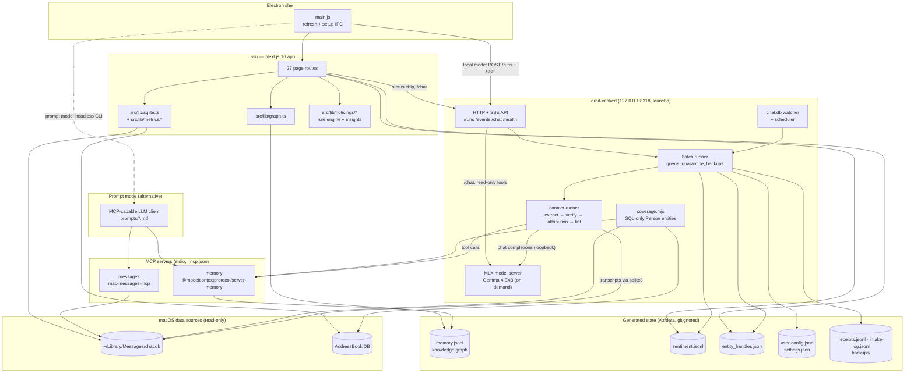

# Architecture Overview

## System Diagram

## Component Descriptions

### MCP layer (`.mcp.json`)
- **Purpose**: Expose iMessage and the knowledge graph as tools, both to an external LLM client and to the daemon's own tool loop.
- **Location**: `/.mcp.json` (project scope).
- **Key responsibilities**: Declares two stdio servers: `messages` (`uvx mac-messages-mcp`) and `memory` (`npx -y @modelcontextprotocol/server-memory`). The daemon connects to the same file through `@modelcontextprotocol/sdk` in `viz/scripts/lib/mcp.mjs`, so both build paths write through one server.

### Local intake daemon (`viz/scripts/intaked.mjs`)
- **Purpose**: Keep the graph current without a cloud model or a human pasting prompts.
- **Key responsibilities**:
  - Installs a loopback-only `fetch` guard before anything else runs (`scripts/lib/guard.mjs`); any request to a host other than `127.0.0.1`, `localhost`, or `::1` throws.
  - Watches `~/Library/Messages` (`scripts/lib/watch.mjs`, with a polling fallback) and asks a scheduler (`scripts/lib/scheduler.mjs`) whether a sweep or the weekly sentiment pass is due: 15-minute debounce after activity, 6-hour staleness ceiling, AC power required by default (`scripts/lib/settings.mjs`).
  - Serves `/health`, `/status`, `/runs` (returns 202 and runs the batch in the background), `/events` (SSE progress), and `/chat` (`scripts/lib/api.mjs`).
  - Backs off exponentially after failed scheduled runs, and degrades gracefully when it lacks Full Disk Access.
- **Install**: `scripts/install-daemon.mjs` writes a launchd LaunchAgent (`com.technical1.orbit.intake`) and prefers a dedicated `~/.orbit/bin/orbit-node` binary, so the Full Disk Access grant is scoped to the daemon instead of every Node script.

### MLX model lifecycle (`viz/scripts/lib/mlx.mjs`, `guided_server.py`)
- **Purpose**: Run the local model only while there is work, and never on a machine that cannot afford it.
- **Key responsibilities**: Starts the server through `uvx` on port 8317, waits for `/v1/models`, and stops it after 5 idle minutes. Refuses to start below 55% free memory (parsed from `memory_pressure -Q`), kills stray servers so only one model process ever exists, and health-probes before trusting an "up" state so an externally killed server recovers. The guided variant wraps the stock `mlx_lm` server with per-request JSON-schema decoding via `outlines` (pinned to 1.3.0). The prompt cache is disabled (`--prompt-cache-size 0`) so temperature-0 runs are reproducible.

### Batch runner (`viz/scripts/lib/batch.mjs`, `diff.mjs`, `state.mjs`)
- **Purpose**: Turn a sweep into a checkpointed per-contact queue.
- **Key responsibilities**: Lists chats straight from `chat.db` via the `sqlite3` CLI (`scripts/lib/chats.mjs`), diffs message counts against `intake-state.json`, and queues up to 25 changed contacts while skipping the owner's handles and configured exclusions. Backs up `memory.jsonl` before writing (five rotating copies, `scripts/lib/backup.mjs`), quarantines a contact after three consecutive failures, writes handle mappings back for newly created people, and pauses the run instead of failing contacts when memory headroom runs out.

### Contact runner (`viz/scripts/lib/contact-runner.mjs`)
- **Purpose**: Produce one contact's tagged observations, with every claim grounded in the messages.
- **Key responsibilities**:
  1. `[freq]` stats are computed in SQL (`contactStats` in `chats.mjs`) and handed to the model; it never does arithmetic.
  2. The transcript is sampled with a bookend + stratified sampler (dense earliest, dense recent, stratified middle) into up to three windows of about 12,000 characters, decoding `attributedBody` blobs for messages that carry no plain `text`. Configured redaction rules are applied before any text reaches the model.
  3. Each window runs an extractor tool loop (`scripts/lib/loop.mjs`) whose graph write is intercepted by the validation gate (`scripts/lib/validate.mjs`) instead of reaching the graph. Later windows get a short "already established" block so they look for new facts.
  4. A verifier (`scripts/lib/verify.mjs`) that never sees the extractor's reasoning returns KEEP/STRIP per claim with a quoted receipt, using claim IDs and a static JSON schema under guided decoding. A recall pass asks specifically for missed identity facts (occupation, education, location, family), which are verified the same way.
  5. An attribution pass (`scripts/lib/attribution.mjs`) asks who the receipt identifies (CONTACT, OWNER, or THIRD_PARTY) and either strips the claim or rewrites it as a relation-scoped fact ("brother works at …"). It fails open: if the check itself errors, the verified claims pass through unchanged.
  6. Deterministic lints (`scripts/lib/lint.mjs`) strip claim classes the verifier will always find a receipt for (the contact's own name or handle as a bio fact, a pasted first-person quote, a receipt that is a bare fragment of four words or fewer) and flag tone that contradicts sentiment. Fuzzy dedupe (`scripts/lib/fuzzy-dedupe.mjs`) merges rephrased duplicates.
  7. The final write goes through the guard with replace-by-tag semantics, and the kept claims and their receipts are appended to `receipts.jsonl`.
- **Sentiment mode**: the model only appends monthly score rows through a built-in `append_jsonl` tool; `avg`, `latest`, and `trend_90d` for the `[sent]` line are computed in code.

### Coverage and onboarding (`viz/scripts/coverage.mjs`, `setup.mjs`)
- **Purpose**: Give every meaningful contact a node before any model runs.
- **Key responsibilities**: `coverage.mjs` creates a Person for every 1:1 contact that is named in Contacts or has at least 50 messages, with real `[freq]` stats and `unknown` judgment fields, using SQL and the AddressBook only. `setup.mjs` provides `detect` (owner candidate from `chat.db` accounts), `commit` (write `user-config.json`), and `seed` steps, which the Electron onboarding gate calls through IPC.

### Per-user config (`viz/scripts/lib/user-config.mjs`)
- **Purpose**: One config file for owner identity, extraction toggles (topics, tone, bio, sentiment), and privacy (excluded handles and names, redaction patterns).
- **Key responsibilities**: Loaded by the batch runner on every contact; falls back to a legacy `owner.json`. The Electron `config:read` handler imports the same module, so the frontend and the pipeline share one set of merge rules.

### Graph loader (`viz/src/lib/graph.ts`, `graph-build.ts`, `communities.ts`)
- **Purpose**: Parse `memory.jsonl` into typed nodes and edges.
- **Key responsibilities**: Tag parsing (`[freq]`, `[topic]`, `[tone]`, `[bio]`, `[sent]`), owner self-exclusion, and community detection: weighted Louvain with a seeded RNG so the partition is identical across requests. Edges combine knowledge-graph relations with co-occurrence weights from shared group chats (`src/lib/metrics/co-occurrence.ts`).

### SQLite metrics (`viz/src/lib/sqlite.ts`, `viz/src/lib/metrics/`)
- **Purpose**: Compute live numbers straight from `chat.db` instead of trusting model-written stats.
- **Key responsibilities**: Read-only `better-sqlite3` handles marked `server-only`; the AddressBook connection is optional. `metrics/` holds pure, individually tested queries: contact stats and year-over-year rank, percentiles, unreplied threads, last initiator, tapback reaction affect, shared groups, subgraph density, betweenness centrality, and per-community volume shifts. An in-memory seeded `chat.db` (`metrics/test-db.ts`) backs their tests.

### Noticings and insights (`viz/src/lib/noticings/`)
- **Purpose**: Turn metrics into short, ranked observations.
- **Key responsibilities**: Each page type has a rule module that takes a typed context and returns an item or nothing. `cross.tsx` adds six cross-signal rules for `/insights` (drifting, ball in your court, carrying the conversation, souring, rising, group fading) with calibrated severity × priority ranking. Context builders such as `insights-context.ts` and `cluster-context.ts` are pure folds with no database access, so the rules test against plain fixtures.

### Frontend pages (`viz/src/app/*`)
- **Purpose**: Each route is a focused lens onto the graph.
- **Key responsibilities**: `/network` renders Cytoscape and links into `/cluster/[anchor]`; `/insights`, `/digest`, `/closest`, `/trajectory`, `/sentiment`, `/responsiveness`, `/initiation`, `/reactions`, `/ghosts`, and `/hygiene` are ranked views; `/heatmap`, `/calendar`, `/activity`, and `/onthisday` are time-based; `/wrapped/[year]` is a slideshow; `/person/[name]` is the per-contact deep dive; `/chat` streams from the daemon; `/settings` edits owner identity. `/api/attachment/[id]` streams attachment bytes and `/thumb` generates thumbnails with `sharp`.

### Design substrate (`viz/src/lib/theme/` + `viz/src/components/ui/`)
- **Purpose**: Give every route one visual language.
- **Key responsibilities**: Typed token sets resolved to CSS custom properties: the dark "Observatory" theme by default and a light "Annals" theme selected with `NEXT_PUBLIC_PRODUCT=annals`. `src/components/ui/` holds the presentational primitives (mastheads, filter bars, sortable headers, stat grids, noticings panels, sparklines, tone pills), and the sidebar is driven by a nav config (`src/lib/nav/observatory-routes.ts`).

### Electron shell (`viz/electron/`)
- **Purpose**: Native window, first-run onboarding, and the Refresh button.
- **Key responsibilities**: Starts Next.js on port 3737 and opens a `BrowserWindow` with context isolation. In local mode (`ORBIT_LLM=local` or `"llm": "local"` in `data/settings.json`), Refresh posts to the daemon's `/runs` and relays its SSE events, queuing them until the run is confirmed so a "busy" rejection always wins over a stray completion event (`local-refresh.js`). Otherwise it runs `prompts/update.md` and `prompts/sentiment.md` through the `claude` CLI in headless mode, finishing on the stream's `result` event and reaping the whole process group (`refresh.js`). Setup IPC spawns `scripts/setup.mjs` with an argv array, never a shell string (`setup-ipc.js`).

## Data Flow

1. **Onboard** — The Electron gate (or `node scripts/setup.mjs all`) detects the owner's handles, asks for confirmation, writes `user-config.json`, and runs the coverage seed, so every meaningful contact exists as a Person with real `[freq]` stats.
2. **Sweep** — New messages land in `chat.db`. The watcher records activity; after the debounce the scheduler starts a sweep. The batch runner diffs message counts, queues changed contacts, backs up the graph, and processes contacts one at a time, starting the MLX server on demand.
3. **Extract and verify** — For each contact: SQL stats, sampled transcript windows, extractor → verifier → recall → attribution → lints, then a single replace-by-tag write through the memory MCP server. Receipts and groundedness totals are logged; progress streams over SSE.
4. **Sentiment (weekly)** — The same runner scores each contact per month, appends rows to `viz/data/sentiment.jsonl` (replacing any existing row for that person and month), and writes a code-computed `[sent]` line.
5. **View** — Each route calls `loadGraph()` plus the SQLite metrics it needs, builds a rule context, and renders noticings next to the main chart or table.
6. **Ask** — `/chat` posts the conversation to the daemon, which runs a tool loop limited to read-only tools (`read_graph`, `search_nodes`, `open_nodes`, and three message and contact lookup tools) and streams text back.

Prompt mode replaces steps 2–4 with the user pasting `prompts/update.md` and `prompts/sentiment.md` into an MCP client.

## External Integrations

| Service | Purpose | Notes |
|---------|---------|-------|
| `mac-messages-mcp` | MCP server exposing iMessage read tools | Launched by `uvx`; `tool_send_message` is never exposed to chat |
| `@modelcontextprotocol/server-memory` | Knowledge-graph store | Writes `memory.jsonl` inside its `npx` cache directory |
| `mlx-lm` + `outlines` | Local inference with optional JSON-schema decoding | Launched per run by `uvx`; loopback only |
| Gemma 4 E4B (MLX 4-bit QAT) | Extraction, verification, sentiment, and chat model | Pinned as `CHOSEN_MODEL` in `docs/local-llm-benchmark.md`; override with `ORBIT_LOCAL_MODEL` |
| macOS Messages (`chat.db`) | Source of truth for message history | Apple-internal SQLite schema; needs Full Disk Access |
| macOS AddressBook | Contact-name resolution | Optional; degrades to raw handles |
| launchd | Keeps the daemon running | `com.technical1.orbit.intake` LaunchAgent |

## Key Architectural Decisions

### Local model behind a verifier, not a bigger model
- **Context**: The machine has to host the model alongside everything else, and a small model will confidently write facts that are not in the messages.
- **Decision**: Run a 4-bit Gemma 4 E4B and make every topic or bio claim survive an independent verifier that must quote a receipt, followed by an attribution check and deterministic lints.
- **Rationale**: A 26B model passed tool-call qualification at a 14.2 GB peak but was disqualified during the golden-set evals on memory grounds, because it risked taking down a 24 GB Mac under real load. Grounding checks fix the small model's real failure (invented or misattributed facts) for less memory than scaling up would. The attribution pass exists because a receipt can be genuine and still describe the wrong person.

### The system does arithmetic and formatting; the model does judgment
- **Context**: The model ran out of tokens computing message-gap statistics by hand and failed contacts silently.
- **Decision**: Compute `[freq]` in SQL, compute `[sent]` aggregates from the model's monthly rows, intercept writes behind a validation gate, and replace tagged lines in code.
- **Rationale**: Each move removed a whole class of failure. The model writes topics, tone, bio facts, and monthly scores; everything countable is deterministic and testable.

### A daemon with a loopback guard instead of a cloud client
- **Context**: The input is someone's entire message history.
- **Decision**: A launchd daemon that installs a global `fetch` guard rejecting non-loopback hosts before any other code runs, binds its API to `127.0.0.1`, and only sends CORS headers to `localhost` origins.
- **Rationale**: "Local-only" is enforced in code rather than promised in a README. The trade-off is that the daemon needs its own Full Disk Access grant, which a dedicated `orbit-node` binary keeps narrow.

### Deterministic serving for reproducible evaluation
- **Context**: Comparing pipeline changes needs stable outputs, and the MLX prompt cache made temperature-0 runs diverge.
- **Decision**: Disable the prompt cache, use static JSON schemas so guided decoding compiles once, and seed Louvain on the frontend.
- **Rationale**: The same input produces the same graph, so score differences on the gold set reflect the change being tested, not noise. Unbounded arrays in the schemas avoid a state-machine blowup that bounded lengths caused in `outlines`.

### JSONL knowledge graph through the MCP server
- **Context**: Both the prompt path and the daemon need one persistent store.
- **Decision**: Keep the memory server's native `memory.jsonl` as the source of truth, with every writer going through the server, plus rotating backups before each batch.
- **Rationale**: No migrations, easy to inspect, and one write path for both modes. Full re-parse per request is fine at personal scale.

### Pure rule contexts over page-specific logic
- **Context**: 27 routes each want a few sentences of "what's notable here".
- **Decision**: Pages compute metrics; pure context builders fold them into typed contexts; small rule functions return items or nothing; a shared ranker orders them.
- **Rationale**: Every rule tests against fixtures without a database, and new observations are a function plus a test rather than page markup.
