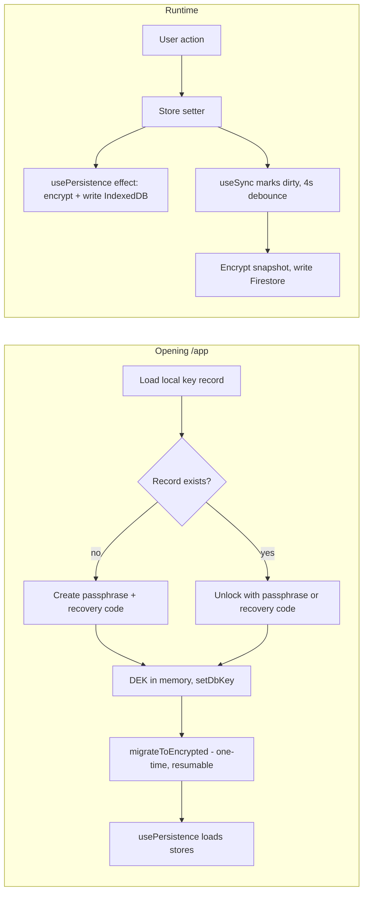

# Architecture Overview

## System Diagram

```mermaid
flowchart TD
    subgraph Browser["Browser / PWA"]
        Router["main.jsx - React Router: / landing, /app"]
        Home[HomePage - marketing landing]
        Gate[LockGate - create / unlock / recovery / restore]

        subgraph UI["UI Layer (React 19)"]
            Header[Header - Nav, Search, Sign in, SyncStatus]
            Views[Views - Dashboard, Budget, Cards, Calendar, Yearly, Goals]
            Modals[Modals - Settings, Paycheck, Receipts, AI Parser, Privacy, Conflict, etc.]
            Common[Common - FAB, Search, Toast, ErrorBoundary]
        end

        subgraph State["State Layer (Zustand 5)"]
            BS[budgetStore - template, categories, cards]
            TS[trackingStore - months, paychecks, rollover, receipts meta]
            US[uiStore - view routing, modal state]
            AS[authStore - user, in-memory DEK, sync status]
            GS[goalsStore]
            HS[historyStore]
            ToS[toastStore]
        end

        subgraph Hooks["Hooks"]
            UC[useCalculations - budget period math]
            UP[usePersistence - IndexedDB load/save, import/export]
            USync[useSync - debounced encrypted push/pull]
            UR[useReceipts - attach / open / delete]
        end

        subgraph Crypto["Crypto (WebCrypto)"]
            Env[crypto/envelope - AES-GCM, PBKDF2]
            Vault[crypto/keyVault - wrapped-key record]
            DbC[db/crypto - per-store field encryption]
        end

        DB[(IndexedDB - BudgetFlowDB v4, 13 stores)]
        SyncEng[sync/syncEngine - snapshot + resolvePull]
    end

    subgraph External["External Services"]
        FAuth[Firebase Auth - Google]
        FS[(Firestore - keys/envelope, vault/snapshot)]
        FSt[(Firebase Storage - encrypted receipts)]
        Claude[Anthropic Messages API]
    end

    Router --> Home
    Router --> Gate
    Gate --> Vault
    Gate -->|DEK| DbC
    Gate -->|unlocked| UI

    Views --> UC
    Views --> State
    Modals --> State
    UC --> BS
    UC --> TS

    UP --> State
    UP --> DB
    DB --> DbC
    DbC --> Env

    USync --> State
    USync --> SyncEng
    SyncEng --> Env
    USync --> FS
    USync --> FAuth
    UR --> DB
    UR --> FSt

    Modals -->|user API key| Claude
```

## Data Flow Diagram

## Component Descriptions

### main.jsx
- **Purpose**: Entry point and top-level routing
- **Location**: `src/main.jsx`
- **Key responsibilities**: Requests persistent storage, then routes `/` to the landing page and `/app` to the application; unknown paths redirect to `/`

### HomePage
- **Purpose**: Public landing page
- **Location**: `src/components/home/HomePage.jsx`
- **Key responsibilities**: Feature grid, privacy explanation, scroll-reveal via `IntersectionObserver` (no animation library), "Open app" and optional Google sign-in

### LockGate
- **Purpose**: Full-screen gate that holds back all data until it can be decrypted
- **Location**: `src/components/lock/LockGate.jsx`
- **Key responsibilities**: First-run passphrase creation (10+ characters) with a one-time recovery code; unlock by passphrase or recovery code; "Sign in to restore" on a fresh device, which pulls the cloud key record and adopts it locally; a last-resort "reset and erase" path

### App.jsx
- **Purpose**: Root of the unlocked application
- **Location**: `src/App.jsx`
- **Key responsibilities**: Loads the local key record, renders `LockGate` until unlocked, runs the at-rest migration, then mounts views (lazy except Dashboard), all modals, `usePersistence`, `useSync`, and `useUndoable`

### Header.jsx
- **Purpose**: Top navigation bar
- **Location**: `src/components/layout/Header.jsx`
- **Key responsibilities**: View tabs (hidden while the budget is empty), search trigger (Cmd+K), Google sign-in/out, sync status indicator, settings menu

### Dashboard (View)
- **Purpose**: Primary monthly budget view
- **Location**: `src/components/views/Dashboard/`
- **Key responsibilities**: Guided `GettingStarted` screen when the budget is empty (`src/utils/dashboardState.js`), month navigation, available funds, expense list with paid/skip toggles and receipt paperclips, paycheck allocation, savings section, health score, PDF export

### Budget, Cards, Calendar, Yearly, Goals (Views)
- **Location**: `src/components/views/{Budget,Cards,Calendar,Yearly,Goals}/`
- **Key responsibilities**: Template editor (categories, items, frequencies, deductions); drag-and-drop card assignment with per-card totals; calendar grid with bill dots and ICS export; yearly totals, trends chart, category pie, subscription timeline; goals UI (built but hidden from navigation)

### useCalculations Hook
- **Purpose**: Central computation engine
- **Location**: `src/hooks/useCalculations.js`
- **Key responsibilities**: Paycheck-centric budget periods, frequency-aware due detection, expansion of weekly/bi-weekly items into occurrences, monthly and card totals, paycheck allocation, yearly aggregation and spending trends

### usePersistence Hook
- **Purpose**: State-to-database persistence and file backup
- **Location**: `src/hooks/usePersistence.js`
- **Key responsibilities**: Loads every store from IndexedDB after unlock, per-slice write effects, legacy localStorage migration, JSON export (receipt files embedded as data URLs) and Zod-validated import

### Encryption layer
- **Purpose**: Zero-knowledge key management and at-rest encryption
- **Location**: `src/crypto/envelope.js`, `src/crypto/keyVault.js`, `src/db/crypto.js`
- **Key responsibilities**: AES-GCM 256 and PBKDF2-SHA256 (600,000 iterations) primitives; a random DEK wrapped twice — by a passphrase-derived key and a recovery-code-derived key; passphrase rotation without re-encrypting data; per-store transform that keeps only key paths and indexed fields plaintext and puts everything else in an `_enc` envelope

### db.js
- **Purpose**: All IndexedDB operations
- **Location**: `src/db.js`
- **Key responsibilities**: Schema v4 with 13 object stores (the newest is `receipts`), CRUD routed through the encryption transform, encrypted receipt blobs, local copy of the wrapped-key record for offline unlock, idempotent `migrateToEncrypted`, health check, emergency export, recovery

### useSync Hook and sync engine
- **Purpose**: Optional end-to-end encrypted sync
- **Location**: `src/hooks/useSync.js`, `src/sync/syncEngine.js`, `src/sync/keyRecord.js`, `src/firebase/`
- **Key responsibilities**: On sign-in, reconcile the local and cloud key records (seed the cloud on first use, pull when they match, pause when they differ); debounced pushes that skip unchanged content via a content signature; a serial push loop that coalesces concurrent changes; pure `resolvePull` deciding apply / push / none / conflict

### useReceipts Hook
- **Purpose**: Receipt attachments per payment
- **Location**: `src/hooks/useReceipts.js`, `src/components/modals/ReceiptsModal.jsx`, `src/firebase/storageRepo.js`
- **Key responsibilities**: Save locally first, then encrypt and upload to Firebase Storage when signed in; on open, read the local copy or download, decrypt, and cache; retry pending uploads after sync connects

## External Integrations

| Service | Purpose | Notes |
|---------|---------|-------|
| Firebase Auth (Google) | Identity for optional sync | Popup sign-in; disabled entirely when `VITE_FIREBASE_*` env vars are absent |
| Cloud Firestore | Stores the wrapped-key record and one encrypted snapshot per user | `users/{uid}/keys/envelope` and `users/{uid}/vault/snapshot`; deny-by-default rules in `firestore.rules` |
| Firebase Storage | Encrypted receipt files | `users/{uid}/receipts/{id}`; rules in `storage.rules` |
| Firebase Analytics | Usage analytics | Initialized best-effort only when supported and Firebase is configured (`src/firebase/config.js`) |
| Anthropic Messages API | AI budget parsing from images | Direct browser call with the user's own key and the `anthropic-dangerous-direct-browser-access` header |
| Web Notifications API | Bill reminders and budget threshold alerts | Local only |
| Workbox (via vite-plugin-pwa) | Service worker caching for offline support | Precache plus CacheFirst for Google Fonts |
| Vercel | Static hosting | SPA rewrites and security headers in `vercel.json` |

## Key Architectural Decisions

### Budget Periods Instead of Calendar Months
- **Context**: Users get paid on specific dates, not the 1st of the month. A bill due on the 3rd is funded by the previous month's last paycheck.
- **Decision**: Expenses belong to the paycheck period that funds them, not the calendar month they fall in.
- **Rationale**: Reflects how people actually manage money — paycheck to paycheck — and gives more accurate "available funds".

### One DEK, Two Wrappers (Envelope Encryption)
- **Context**: Users need a forgot-passphrase path, but the server must never be able to decrypt anything.
- **Decision**: A random 256-bit DEK encrypts the data; it is wrapped separately by a PBKDF2 key from the passphrase and by one from a 20-character recovery code (`src/crypto/keyVault.js`).
- **Rationale**: Either secret unlocks the same data, changing the passphrase only re-wraps one slot instead of re-encrypting everything, and the stored record is ciphertext plus salts. Deriving the data key directly from the passphrase was rejected because it makes rotation and recovery require a full re-encrypt.

### Same Key Locally and in the Cloud
- **Context**: Encryption at rest and E2EE sync both need a key; two separate passphrases would be confusing and fragile.
- **Decision**: The local key record is created at the `LockGate`; on first sign-in the cloud adopts it, and on a fresh device "Sign in to restore" adopts the cloud record locally (`src/hooks/useSync.js`, `src/components/lock/LockGate.jsx`).
- **Rationale**: One passphrase everywhere. Key-record equality is checked by comparing salts and wrapped bytes (`src/sync/keyRecord.js`), not `JSON.stringify`, because Firestore can return fields reordered.

### Field-Level Encryption Inside IndexedDB
- **Context**: Encrypting whole records would break the object stores' key paths and `monthKey` / `date` indexes.
- **Decision**: `src/db/crypto.js` lists, per store, the fields that stay plaintext (key path and indexed fields); everything else is encrypted into `_enc`. A small allowlist of settings (theme, currency, font scale, the key record) stays plaintext so the shell can render before unlock.
- **Rationale**: Keeps indexed lookups and the existing schema working while hiding amounts, names, and notes. The migration is per-record and skips anything already encrypted, so an interrupted run is safe to resume.

### Whole-State Encrypted Snapshot Instead of Per-Record Sync
- **Context**: The server can't see the data, so it can't merge it.
- **Decision**: Sync pushes one encrypted snapshot document with a monotonic version; `resolvePull` compares it with the local version and a dirty flag, and true divergence goes to a user-facing conflict dialog. Receipt files go to Storage separately rather than into the snapshot.
- **Rationale**: Last-writer-wins with explicit conflict choice is simple and predictable for a single-person budget. Keeping binary files out of the snapshot keeps it small (Firestore documents cap at 1 MiB).

### Path Routing for the Landing Page, State Routing Inside the App
- **Context**: The site needed a crawlable public landing page, while the app itself is an offline PWA with no shareable views.
- **Decision**: React Router serves `/` and `/app`; inside `/app` the active view is a string in `uiStore`.
- **Rationale**: The landing page gets a real URL and metadata; the app avoids URL-sync complexity. The PWA manifest's `start_url` is `/app` so installs open straight into the app.

### Lazy-Loaded Views
- **Context**: The app has six views, but users mostly use the Dashboard.
- **Decision**: All views except Dashboard use `React.lazy()` with `<Suspense>`, and jsPDF is loaded only when exporting.
- **Rationale**: Smaller initial bundle and faster first load.
