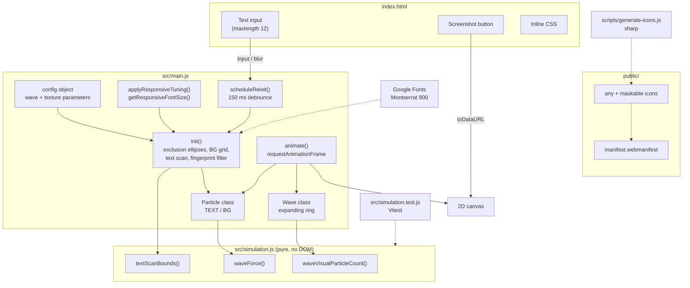
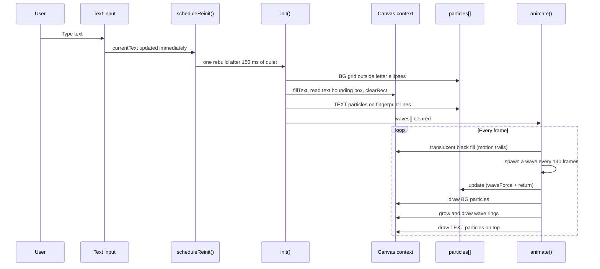

# Architecture Overview

## System Diagram

## Component Descriptions

### Scene setup — `init()`
- **Purpose**: Build the particle field for the current text and viewport.
- **Location**: `src/main.js`
- **Key responsibilities**: apply small-screen tuning, size the font to fit 86% of the width and 55% of the height, compute one exclusion ellipse per letter, lay down the jittered background grid outside those ellipses, then scan the text's bounding box and keep only the pixels that fall on a fingerprint line.

### Particles and waves
- **Purpose**: Per-frame motion and drawing.
- **Location**: `Particle` and `Wave` classes in `src/main.js`
- **Key responsibilities**: background particles sum the pull of every active wave and are snapped back by a 0.90 return factor; text particles get only a small random jitter. Each wave grows by `waveSpeed` per frame, draws a scattered ring of decorative dots, and is removed once it passes 1.2x the larger canvas dimension.

### Simulation math
- **Purpose**: The numeric core, kept free of DOM and canvas calls so it can be unit-tested.
- **Location**: `src/simulation.js`, tested by `src/simulation.test.js`
- **Key responsibilities**: `waveForce()` (pull toward the crest, with a zero-distance guard), `waveVisualParticleCount()` (ring dot budget, capped at `maxWaveVisualParticles`), `textScanBounds()` (the clamped region to read back for text pixels).

### Viewport and input handling
- **Purpose**: Keep the scene stable across window resizes and mobile keyboards.
- **Location**: bottom of `src/main.js`
- **Key responsibilities**: `window` and `visualViewport` resize listeners, a focus check that freezes the stored dimensions while the keyboard is open, a 100 ms post-blur restore, and a shared 150 ms debounce so all of these collapse into one `init()`.

### PWA and icons
- **Purpose**: Make the page installable.
- **Location**: `public/manifest.webmanifest`, `scripts/generate-icons.js`
- **Key responsibilities**: the manifest declares standalone display and four icons split by purpose (`any` at 192/512, `maskable` at 192/512). The generator renders `icon-192.svg` to 180/192/512 px and `icon-maskable.svg` to 192/512 px.

## Data Flow

## External Integrations

| Service | Purpose | Notes |
|---------|---------|-------|
| Google Fonts | Montserrat 900 | Loaded in `index.html`; `init()` waits on `document.fonts.ready`, with an 1800 ms fallback |
| Vercel | Static hosting | Serves the Vite build at `pluribus-text-gen.vercel.app` |

## Key Architectural Decisions

### 1. Vanilla JavaScript and 2D Canvas over a framework or WebGL
- **Context**: One full-screen effect, one text input, thousands of dots per frame, no shared application state.
- **Decision**: Plain ES modules drawing straight to a 2D canvas, with no runtime dependencies.
- **Rationale**: A component framework would add a render layer with nothing to diff, and WebGL would add shader work for an effect that is flat and already cheap on the CPU. The production JavaScript bundle is 6.71 kB (2.81 kB gzipped).

### 2. Pure simulation module split out of the render code
- **Context**: The wave maths had a real failure mode (see decision 5), and the canvas code cannot be tested without a browser.
- **Decision**: Move the numeric functions into `src/simulation.js` with no globals or rendering calls, and cover them with Vitest in `src/simulation.test.js`.
- **Rationale**: Mocking a canvas would mostly test the mock. Keeping the maths pure lets the 15 tests assert exact values and edge cases, while the classes in `main.js` stay thin wrappers around it.

### 3. Elliptical exclusion zones over pixel masking
- **Context**: Background dots must stay clear of the letters.
- **Decision**: One ellipse per character (padded by `gapScaleX` 1.1 and `gapScaleY` 1.3), with `1/rx²` and `1/ry²` precomputed so each test is a multiply-add-compare.
- **Rationale**: Sampling the text bitmap for every grid point costs more, and bounding rectangles let dots into letter corners. Ellipses give a smooth, even margin.

### 4. Fingerprint lines as a distance-modulo filter
- **Context**: The title's letters are filled with concentric bands, not solid dots.
- **Decision**: Keep a text pixel only when `effectiveDist % textureSpacing < textureThickness`, where the distance is measured from the first letter with the vertical offset doubled and a `sin(dy * 0.05) * 2` wobble added.
- **Rationale**: One expression produces elliptical rings centred on the first letter without any geometry for the rings themselves, and the wobble stops them looking machine-drawn.

### 5. Bounded per-frame cost
- **Context**: A particle exactly on the wave origin made the force divide by zero, and the resulting NaN stuck in its position for good. Separately, the ring dot count grew with radius without limit.
- **Decision**: `waveForce()` returns zero force at zero distance; `waveVisualParticleCount()` caps ring dots at 220 per wave; the text scan reads only the region from `textScanBounds()` rather than the whole canvas.
- **Rationale**: Each change removes a cost or failure that grows with screen size or running time, which is where a long-running animation degrades on low-end phones.

### 6. Responsive tuning in JavaScript, with debounced rebuilds
- **Context**: CSS can resize a canvas but cannot change particle density, and every rebuild re-scans the text.
- **Decision**: When the shorter side is 520 px or less, `applyResponsiveTuning()` tightens texture spacing (11 to 7), thickens the lines (1.4 to 2.4), reduces the grid gap (26 to 22), narrows the wave band (50 to 36) and samples every pixel instead of every second one. Resizes, keystrokes and keyboard close all go through one 150 ms debounce.
- **Rationale**: The fingerprint bands stay legible at phone size, and a drag-resize or a burst of typing costs one rebuild instead of dozens.
