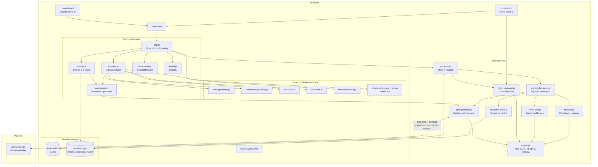
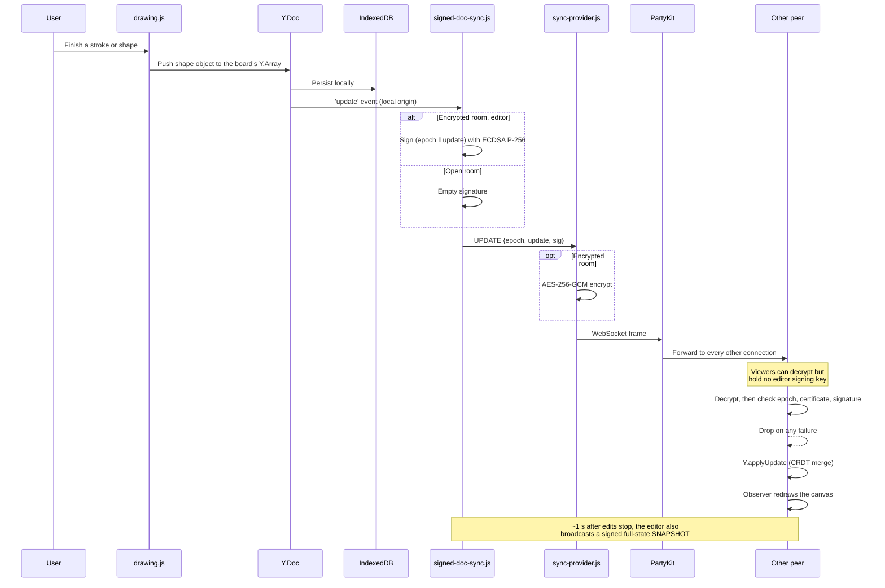

# Architecture Overview

## System Diagram

## Data Flow

A joining peer sends `SNAPSHOT_REQUEST` when its socket opens and retries every 1.5 s, up to five times, until some state applies. Editors answer with a fresh signed snapshot; viewers relay the last verified snapshot they hold, so a room with only viewers online can still bootstrap a newcomer.

## Component Descriptions

### app.js — Room entry point
- **Purpose**: Starts the room and connects the UI to the document and sync layers
- **Location**: `js/app.js`
- **Key responsibilities**: Browser feature check, display-name prompt, role-aware UI (viewers lose editing controls, only the owner sees Change password), per-tool settings remembered within the session, keyboard shortcuts, Space-drag panning and cursor-centered wheel zoom, fit-all, the PNG/PDF export dialog (2× render, jsPDF for PDF), invite / encrypt / rotate actions, and status notices for rotation, wrong password, and "invite link required"

### drawing.js — Canvas engine
- **Purpose**: Everything that touches the canvas: rendering, hit-testing, and shape editing
- **Location**: `js/drawing.js`
- **Key responsibilities**: World/screen coordinate transform; rendering every tool from the current board's Y.Array; mouse, touch and pinch input; selection and Shift multi-select; moving shapes; the settings popup (color, stroke, fill, font, arrowheads, stacking order, connector reversal, lock); copy/paste/duplicate with connector re-pointing; inline text and sticky-note editing; connector creation, rendering and cascade deletion; local and remote live previews; laser trails; lazy creation of a board's array on its first shape; conversion of stroke width to world units; and `renderBoardToCanvas`, which renders the board into an arbitrary canvas and view for export

### Pure geometry and layout modules
- **Purpose**: Logic pulled out of the canvas engine so it can be unit-tested without a DOM
- **Location**: `js/draw-geometry.js`, `js/connector-geometry.js`, `js/text-wrap.js`, `js/laser-trail.js`, `js/keyboard-intent.js`
- **Key responsibilities**: `draw-geometry.js` — arrowheads, diamond/triangle vertices, ray-casting point-in-polygon, dash patterns, text bounds, degenerate-shape detection, and `buildShapeIndex`, an id→shape `Map` built once per redraw so connector endpoint lookups are O(1). `connector-geometry.js` — compass-anchor resolution, choosing facing anchors between two boxes, anchor hints, and finding connectors whose endpoints were deleted. `text-wrap.js` — greedy word wrap with hard breaks for long words, newline-aware wrapping for sticky notes, and sticky scroll extent. `laser-trail.js` — drops trail points older than 700 ms. `keyboard-intent.js` — decides whether Delete/Backspace should consume the event.

### shape-schema.js and utils.js — Untrusted-input boundary
- **Purpose**: Make peer-supplied data safe before it reaches the DOM or the renderer
- **Location**: `js/shape-schema.js`, `js/utils.js`
- **Key responsibilities**: `escapeHtml` (the single shared implementation), `safeColor` (hex only), `safeNumber`, `safeToolName` (13 known tools, otherwise the literal `shape`), and `sanitizeShape`, which runs a shape's DOM-bound fields through them. For render cost: `clampPoints` caps a stroke at 5,000 points and `safeStrokeWidth` clamps line width to 0–200, so a hostile peer can't stall every other client's frame.

### yjs-setup.js — Document and sync wiring
- **Purpose**: Builds the per-room Y.Doc and connects storage, transport and the signed sync layer
- **Location**: `js/yjs-setup.js`
- **Key responsibilities**: Creates the `boards` and `boardNames` maps; opens a separate IndexedDB store for encrypted and open rooms; derives the AES key from the capability's password, salt and iteration count; creates `SignedDocSync` in signed mode for capability rooms and open mode otherwise; copies an open room's existing drawings into the encrypted store when encryption is first added; and implements `rotateRoom()`, which mints the next epoch, broadcasts the owner-signed notice, and reloads the owner into the new link. It deliberately does not create the `default` board at startup (see Key Architectural Decisions).

### signed-doc-sync.js — Signed document sync
- **Purpose**: Moves Y.js updates between peers and enforces the edit/view-only boundary
- **Location**: `js/signed-doc-sync.js`
- **Key responsibilities**: Two modes. *Signed*: verifies the owner-signed certificate once at start and fails closed unless it is for this epoch and pins exactly the editor key in use; signs local updates as an editor; applies only current-epoch, correctly signed updates and snapshots. *Open*: empty signatures, no verification. Also debounces signed snapshots (1 s), persists and relays the last verified snapshot, retries bootstrap requests, and on a verified owner rotation notice marks the epoch superseded, so it stops applying, broadcasting, or relaying old-epoch state. All async sign/verify work runs through one promise queue so updates apply in arrival order.

### protocol.js — Wire format
- **Purpose**: Message types and the bytes that get signed
- **Location**: `js/protocol.js`
- **Key responsibilities**: Type constants (`UPDATE`, `SNAPSHOT`, `SNAPSHOT_REQUEST`, `AWARENESS`, `ROTATE`, `PRESENCE_PROBE`); `encodeEnvelope` / `decodeEnvelope` for `epoch ‖ update ‖ sig` with lib0; `signUpdate` / `verifyUpdate`, which sign the update prefixed by its epoch so a signature can't be replayed into another epoch; and JSON encoding for rotation notices.

### sync-provider.js — Transport
- **Purpose**: The WebSocket connection, encryption of frames, and presence
- **Location**: `js/sync-provider.js`
- **Key responsibilities**: Native `WebSocket` to `/party/{roomId}` with exponential-backoff reconnect (100 ms doubling to 2.5 s); `wss://` everywhere except canonical loopback hosts; a one-byte type prefix on every frame; AES-256-GCM on every type except `PRESENCE_PROBE`, silently dropping frames that don't decrypt; Y.js awareness, re-broadcast when a new peer appears because the relay keeps no history; and the plaintext `{enc}` presence probe, which lets a visitor without a key learn the room is encrypted.

### crypto.js — Primitives
- **Purpose**: All Web Crypto usage
- **Location**: `js/crypto.js`
- **Key responsibilities**: PBKDF2 key derivation with caller-supplied iterations and salt (legacy room-ID salt fallback); AES-256-GCM with a random 12-byte IV per message; ECDSA P-256 key generation, export (raw public, PKCS8 private) and non-extractable import; `signData` / `verifyData` (64-byte r‖s, verification never throws); and `signStatement` / `verifyStatement` over canonical JSON for certificates and notices.

### room-cert.js — Epoch certificates
- **Purpose**: The owner's root of trust over the editor key
- **Location**: `js/room-cert.js`
- **Key responsibilities**: `mintCert` signs `{room, epoch, editorPub}` with the owner key; `verifyCert` returns the bound epoch and editor key, or `null` for anything missing, malformed or not owner-signed, and never throws.

### room-manager.js — Capability links
- **Purpose**: Encode, decode, mint and rotate the links that grant access
- **Location**: `js/room-manager.js`
- **Key responsibilities**: `mintRoomCapability` (owner key pair, first editor key pair, epoch-1 certificate, random salt, iteration count); role-scoped encoders (owner carries both private keys, editor only the editor key, viewer none); a v3-only decoder that downgrades any claimed role lacking its key and clamps `kdf`; `parseCapabilityHash`, which throws on a present-but-invalid fragment; owner-only `rotateCapability`; `getShareableLink`, which never emits an owner link; and room-ID parsing from `/room/{id}`.

### snapshot-store.js — Snapshot cache
- **Purpose**: Keep the latest verified snapshot so a reconnecting peer has something to apply and relay
- **Location**: `js/snapshot-store.js`
- **Key responsibilities**: Base64 snapshot in localStorage under `wb-snap-{room}-e{epoch}`; prunes the room's other epochs on construction. IndexedDB remains the real document store; this is only for bootstrap.

### awareness.js — Presence
- **Purpose**: Ephemeral per-user state
- **Location**: `js/awareness.js`
- **Key responsibilities**: Local user id, name and color; current board; cursor position (throttled to 50 ms); in-progress drawing for live preview; laser trail (remote trails capped at 300 points); the online-users list and cursor labels, with names escaped and colors allow-listed.

### boards.js — Boards within a room
- **Purpose**: The tab bar of boards
- **Location**: `js/boards.js`
- **Key responsibilities**: Create, switch, clear, rename and delete. Labels live in the separate `boardNames` map, so renaming never changes a board's key, and the `default` board can be renamed (it shows as "Main") but not deleted. The default tab is shown even before its array exists. Right-click on any tab opens the rename/delete menu.

### undo-redo.js — History
- **Purpose**: Collaborative-safe undo
- **Location**: `js/undo-redo.js`
- **Key responsibilities**: A `Y.UndoManager` over the `boards` map with a 500 ms capture window. Remote updates are applied with a dedicated origin, so they never land on the local stack.

### modal.js — Dialogs
- **Purpose**: Replacements for native `prompt` / `confirm` / `alert`
- **Location**: `js/modal.js`
- **Key responsibilities**: Prompt, confirm, alert, the invite dialog (editor or viewer link), password entry, the save/export dialog, and the shortcuts reference.

### board-history.js — My Boards
- **Purpose**: Local history of rooms visited
- **Location**: `js/board-history.js`
- **Key responsibilities**: Save and touch entries with role (owner / collaborator / viewer, never downgrading a recorded owner), encryption flag, last access and visit count; relative-time formatting; role badges.

### party/index.ts — Relay
- **Purpose**: Forward bytes between the browsers in a room
- **Location**: `party/index.ts`
- **Key responsibilities**: On each message, send it to every connection in the room except the sender. No storage, no parsing, no keys; 35 lines.

## External Integrations

| Service | Purpose | Notes |
|---------|---------|-------|
| PartyKit | WebSocket relay | Holds no state and no keys; sees only ciphertext in encrypted rooms. Deployed by GitHub Actions with `PARTYKIT_TOKEN` / `PARTYKIT_LOGIN` secrets |
| Vercel | Static hosting | Clean URLs, the `/room/:id` rewrite, CSP and security headers from `vercel.json`; deploys from Git |
| GitHub Actions | CI and relay deploy | Tests and build on every PR and push to `main`; relay deploy is path-filtered and runs behind the same gates |
| Google Fonts | Inter typeface | The only third-party origin in the CSP |

## Key Architectural Decisions

### CRDT over operational transform
- **Context**: Concurrent edits had to converge with no authoritative server, and offline edits had to merge on reconnect.
- **Decision**: Y.js.
- **Rationale**: OT needs a central server to order operations, which is exactly what this design avoids. A CRDT converges from any delivery order, so the relay can be a plain broadcast and IndexedDB-persisted offline edits merge on reconnect. Y.js is the most mature JavaScript CRDT and its UndoManager already separates local from remote changes.

### A broadcast relay over a WebRTC mesh
- **Context**: Sync had to work on corporate networks, mobile carriers and double-NAT home routers, without letting the server into the trust boundary.
- **Options**: `y-webrtc` peer-to-peer, a self-hosted Y.js WebSocket server, or a broadcast relay on PartyKit.
- **Decision**: PartyKit, with the relay reduced to forwarding bytes.
- **Rationale**: WebRTC needs STUN/TURN and still fails on restrictive networks; a WebSocket reaches anywhere HTTPS does. Encrypting before send keeps the privacy property of a peer-to-peer design. A stock Y.js server would apply and store updates, which needs plaintext; a relay that never parses messages doesn't.

### Signature-enforced view-only over a client-side flag
- **Context**: Encryption hides content from the relay, but everyone with the password can decrypt. A view-only link that only sets `readOnly` in the client is bypassed by editing the URL or the JavaScript.
- **Options**: Trust a client flag, add a server-side auth check (gives the relay a role), or sign every edit and have peers reject unsigned ones.
- **Decision**: Editors sign each update with the epoch's ECDSA P-256 key; every peer verifies before applying; viewer links contain no signing key.
- **Rationale**: Enforcement moves from convention to cryptography. A viewer's forged updates fail verification at every honest peer and never enter anyone's document. No server and no accounts are needed.

### Owner root of trust with epoch certificates
- **Context**: If the editor key is simply embedded in links, a leaked link can't be revoked, and "can edit" is indistinguishable from "controls the room". There is no server to ask.
- **Options**: One shared editor key (no revocation), server-issued tokens (needs a server), or a two-level key hierarchy rooted in an owner key.
- **Decision**: Each room has an owner key pair. The owner signs a certificate binding the current editor public key to an epoch number; peers trust an editor key only if a valid certificate vouches for it. Only the owner can mint a new epoch.
- **Rationale**: Rotation becomes "mint epoch N+1 with a new editor key and broadcast an owner-signed notice". Peers on epoch N stop applying its updates, and old links can no longer sign anything a current peer accepts.

### ECDSA P-256 over Ed25519
- **Context**: The signature algorithm had to work in whatever browser people already use.
- **Options**: Ed25519 (smaller, modern) or ECDSA P-256 (older, universal).
- **Decision**: ECDSA P-256.
- **Rationale**: Web Crypto's Ed25519 shipped only in recent browser versions and throws "Unrecognized name" on older ones, while P-256 has been available wherever `crypto.subtle` exists for years. Universal support outweighs Ed25519's size advantage.

### A custom signed sync layer instead of the stock Y.js sync protocol
- **Context**: View-only and rotation need every update to be signed, epoch-tagged and verified, but `y-protocols`' document sync exchanges state vectors and diffs with no place to attach authorship.
- **Options**: Wrap the stock protocol, or replace only document sync while keeping the Y.js CRDT core and the awareness protocol.
- **Decision**: `signed-doc-sync.js` and `protocol.js` exchange signed `{epoch, update, sig}` envelopes, with signed full-state snapshots for bootstrap.
- **Rationale**: Owning the envelope is what makes per-update signatures, epoch replay protection and fail-closed verification possible. Y.js still does all conflict resolution; the cost is a simpler bootstrap (full snapshots rather than state-vector diffs), which is fine at whiteboard document sizes.

### Shapes as whole JSON values in a Y.Array
- **Context**: Each board holds dozens to hundreds of shapes of a dozen different kinds.
- **Options**: A nested `Y.Map` per shape (field-level merging) or a plain JSON object per shape in a `Y.Array`.
- **Decision**: Plain objects. An edit replaces the object at its index (delete and insert in one transaction), and connectors store only the ids of their two shapes.
- **Rationale**: Rendering, sanitizing, copying, exporting and undo all work on simple values, and one edit is one undo step. The trade-off is no field-level merge: if two people change the same shape at the same instant, the CRDT keeps both replacement versions. On a whiteboard two people rarely grab the same shape at once, so I chose the simpler model.

### Strict CSP plus allow-list sanitization
- **Context**: In a peer-to-peer whiteboard the untrusted input is the shared document itself. Shape fields, names and presence state from other peers are interpolated into `innerHTML` in several places, and escaping at each one is easy to miss.
- **Options**: Escape at each sink, or centralize sanitization and back it with a CSP that blocks script execution if a sink is missed.
- **Decision**: One shared `escapeHtml`, type-narrowing allow-lists (`safeColor`, `safeNumber`, `safeToolName`, `sanitizeShape`), and `script-src 'self'` with no `unsafe-inline`, plus `base-uri 'none'` and `form-action 'self'`.
- **Rationale**: Allow-lists accept only the values the app itself produces, so injected markup collapses to an inert fallback. The CSP is the backstop, and it is why every page script, including the landing and My Boards bootstraps, is a separate ES module file.

### Multi-page build over an SPA
- **Context**: Four pages with very different weight: a marketing landing page, an explainer, a history list, and the whiteboard runtime (Y.js, canvas engine, crypto).
- **Options**: An SPA with a router and code splitting, or Vite MPA with one HTML entry per page.
- **Decision**: MPA (`vite.config.js` lists `index`, `room`, `boards`, `howItWorks`).
- **Rationale**: The landing page imports only room-ID, history and link-minting modules, never Y.js. No client state needs to survive navigation between pages, so routing reduces to `cleanUrls` and one rewrite.

### IndexedDB for the document, localStorage for small metadata
- **Context**: Boards must reopen instantly and work offline.
- **Decision**: `y-indexeddb` for the Y.Doc; localStorage for board history, the display name and user id, and the snapshot cache.
- **Rationale**: IndexedDB handles the growing binary document and integrates directly with Y.js. The rest is small and read synchronously at page load, where localStorage is simpler.
