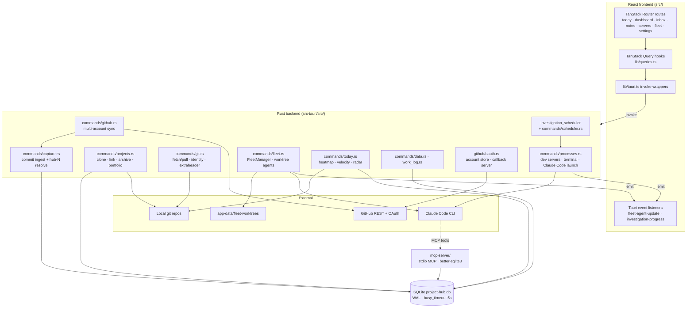

# Architecture Overview

## System Diagram

## Component Descriptions

### Frontend (`src/`)
- **Purpose**: The desktop UI: Today page, project dashboard, Task Board, notes, running servers, the Fleet board, and settings
- **Location**: `src/routes/`, `src/components/`, `src/components/today/`, `src/components/fleet/`, `src/lib/`
- **Key responsibilities**: File-based routing, server-state caching and invalidation through TanStack Query, and typed IPC through `src/lib/tauri.ts`. The app-level sync loop in `src/main.tsx` syncs 1.5s after launch (plus a one-time local git pull), then every 5 minutes, and again on window focus with a 30s throttle. Dashboard status, account, and owner filters live in `src/routes/index.tsx`. The owner filter persists to `localStorage`.

### GitHub sync and accounts (`commands/github.rs`, `github/`)
- **Purpose**: Merge repos from every signed-in GitHub account into one project table
- **Location**: `src-tauri/src/commands/github.rs`, `src-tauri/src/github/oauth.rs`, `src-tauri/src/github/api.rs`
- **Key responsibilities**:
  - Runs the OAuth flow through a localhost callback on port 8765, with CSRF state.
  - Stores accounts in `~/.project-hub-accounts.json` (`0600`, with a `.bak` copy taken before each write) and migrates the older single-token file once at startup.
  - Paginates through `/user/repos` for each account. A repo is owned by the first account that returns it.
  - Removes a stale row when a repo was deleted and recreated under the same name, and inserts new repos as `pending`.
  - Records a per-account error flag so Settings can show which accounts need reconnecting.
  - Gives every HTTP client a 10s connect timeout and a 30s total timeout.

### Ambient capture (`commands/capture.rs`)
- **Purpose**: Turn git history into an activity journal without manual logging
- **Location**: `src-tauri/src/commands/capture.rs`, called from phase 2 of `sync_github_repos`
- **Key responsibilities**: For the 20 most recently pushed projects, ingests up to 30 recent commits each into `work_log`. Ingest and `[hub-N]` auto-resolve run in one transaction (`sync_project_commits`). A partial unique index keeps re-syncs idempotent.

### Project lifecycle (`commands/projects.rs`)
- **Purpose**: Clone, link, detect, archive, and restore projects
- **Location**: `src-tauri/src/commands/projects.rs`
- **Key responsibilities**:
  - Clones over a credential-free `https://github.com/<owner>/<repo>.git` URL. The owning account's token is passed as a per-command `http.extraheader`, and any echo of it is redacted from git stderr.
  - After a clone or link, writes repo-local `user.name`/`user.email` (the account's noreply address) and the push header through `git::apply_repo_identity`.
  - Detects project types in `detect_project_type`.
  - On archive or done, saves `.portfolio/` to a status-specific root (`get_portfolio_root`: `.done/` for `done`, `.archive/` for everything else), deletes the clone, and clears `local_path`.
  - On restore, re-clones and copies `.portfolio/` back, falling back to the other root if the status changed in between.

### Local git operations (`commands/git.rs`)
- **Purpose**: Keep cloned repos current and classify their state
- **Location**: `src-tauri/src/commands/git.rs`
- **Key responsibilities**: `sync_all_projects_git` fetches all clones concurrently on blocking threads and fast-forward-pulls the ones that are clean and behind. Network git calls go through `run_git_net`, which disables credential prompts (`GIT_TERMINAL_PROMPT=0`, SSH `BatchMode`), uses a null stdin, and kills the process after 60s. A repo counts as dirty only when it has tracked modifications. Untracked files are ignored.

### Process launching (`commands/processes.rs`)
- **Purpose**: Spawn dev servers and external tools for a project
- **Location**: `src-tauri/src/commands/processes.rs`
- **Key responsibilities**:
  - `ProcessManager` tracks dev servers. Each one gets a free port from binding port 0, passed to Vite and npm scripts as `--port`.
  - Opens a terminal, Finder, or an allowlisted editor.
  - Opens Claude Code in a project, preferring `happy` and falling back to `claude`. It can also hand over a focused single-task prompt (`build_task_prompt`) or every open task at once.
  - Runs headless `/investigate` and `/update-docs` passes and runs `git_push`.
  - Validates paths by canonicalizing them and requiring a directory. Commands containing shell metacharacters are rejected.

### Fleet board (`commands/fleet.rs`, `src/components/fleet/`)
- **Purpose**: Supervise up to five headless Claude Code sessions working in parallel
- **Location**: `src-tauri/src/commands/fleet.rs`, `src/components/fleet/FleetBoard.tsx`
- **Key responsibilities**:
  - `fleet_launch` creates a worktree at `<app-data>/fleet-worktrees/hub-fleet/<slug>-<timestamp>-<id>` and spawns `claude -p … --output-format stream-json`.
  - Each `stream-json` line is parsed (`parse_stream_line`) into a session ID, a human-readable activity string, or a done event, then pushed to the UI as a `fleet-agent-update` event.
  - When a turn finishes the session goes idle. A queued note resumes it with `--resume <session_id>`.
  - `fleet_diffstat` reports `git diff --stat HEAD`. `fleet_discard` removes the worktree and deletes the branch.
  - All sessions are cancelled when the window is destroyed.

### Scheduler (`commands/scheduler.rs`, `investigation_scheduler`)
- **Purpose**: Run investigation passes unattended
- **Location**: `src-tauri/src/commands/scheduler.rs` (pure decision and grouping logic), `investigation_scheduler` in `commands/processes.rs` (the loop)
- **Key responsibilities**: Wakes every 60s and reads `investigation_enabled`, `_cadence` (daily or weekly), `_weekday`, and `_hour` from `settings`. Fires at most once per calendar day (`should_run_now`), runs only projects with `scheduled = 1`, and writes one `scheduled_runs` row per project under a shared `run_id`. Those rows are grouped for the Today card.

### Today aggregations (`commands/today.rs`)
- **Purpose**: Read-only widgets computed from `work_log` and tasks
- **Location**: `src-tauri/src/commands/today.rs`
- **Key responsibilities**: Today summary, standup digest, recommended task (in-progress first, then high-priority open), stuck tasks (open for more than 3 days), an 84-day heatmap, 14-day velocity, and the Stale Work Radar (`compute_stale_projects`, with a 7-day threshold). Every widget filters out projects with status `ignore`.

### Database (`src-tauri/src/db/`)
- **Purpose**: Local persistence that is safe for several writer processes
- **Location**: `db/mod.rs`, `db/schema.rs`
- **Key responsibilities**: Opens `project-hub.db` in the app-data directory with foreign keys on, WAL journaling, and a 5s busy timeout. It holds the tables `projects`, `notes`, `tasks`, `settings`, `work_log`, and `scheduled_runs`. `run_migrations` applies additive changes on every start: columns are checked with `PRAGMA table_info` through `column_exists`, and the work-log index is checked for an outdated definition.

### MCP server (`mcp-server/`)
- **Purpose**: Let a Claude Code session read and update Project Hub state while it works
- **Location**: `mcp-server/src/index.ts`, `mcp-server/src/tools/{identify-project,tasks,work-log}.ts`
- **Key responsibilities**:
  - Exposes 10 `hub_*` tools over stdio: identify project, list, create, update, start, resolve, and bulk-create tasks, log work, get the work log, and get project status.
  - Matches the session's directory to a project by parsing `git remote get-url origin` with `execFileSync`, so no shell is involved.
  - Exits on stdin EOF, transport close, or SIGINT/SIGTERM, so a disconnected client never leaves an orphaned process holding the database open.

## Data Flow

1. **Launch**: `lib.rs` registers the single-instance plugin first, opens the database (running migrations), and spawns the investigation scheduler and the legacy-token migration. The frontend checks auth and triggers `sync_github_repos` plus a one-time `sync_all_projects_git`.
2. **Sync**: each account's repos are upserted into `projects` (phase 1). Then the 20 most recently pushed projects have their commits ingested into `work_log`, and `[hub-N]` tags resolve open tasks (phase 2).
3. **Daily view**: Today queries aggregate `work_log` and tasks. The radar additionally shells out to `git log` to find the last commit age of dirty repos, after releasing the database lock.
4. **Acting on work**: starting a task, opening Claude Code, or launching a Fleet session spawns the CLI in the project directory or a worktree. Prompts tell the session to tag commits `[hub-N]`, so the next sync closes the loop with no UI step. A session connected to the MCP server can also update tasks directly in the shared database.
5. **Retiring a project**: changing the status to `done` or `archived` first saves `.portfolio/`, then deletes the clone. Changing it back re-clones the repo and restores the folder.

## External Integrations

| Service | Purpose | Notes |
|---------|---------|-------|
| GitHub REST API | Repo list, per-repo commits, user identity | Bearer token per account; 10s connect / 30s total timeout; auth and rate-limit errors stop the sync, other per-repo errors are skipped |
| GitHub OAuth | Sign-in for each account | Localhost callback `127.0.0.1:8765`, CSRF `state`; client ID and secret from `.env` |
| Local `git` CLI | Clone, fetch/pull, status, push, worktrees, repo identity | Prompts disabled, 60s cap on network operations |
| Claude Code CLI | Interactive task launcher, headless investigation and docs refresh, Fleet sessions | Headless runs use `--dangerously-skip-permissions`; Fleet runs use `stream-json` output |
| MCP clients | Task and work-log access from inside a coding session | Stdio transport; shares the SQLite file through WAL |

## Key Architectural Decisions

### Local-first SQLite shared by two processes
- **Context**: The desktop app and any number of MCP server processes need the same task data. There is no backend.
- **Decision**: One SQLite file in WAL mode with `busy_timeout = 5s`. The Rust app uses rusqlite and the MCP server uses better-sqlite3. A single-instance plugin stops a second app window from becoming a competing writer.
- **Rationale**: A local HTTP API owned by the app would mean the MCP tools fail whenever the app is closed. WAL allows concurrent readers, and the busy timeout makes competing writers wait in turn instead of failing with `SQLITE_BUSY`.

### Derive the work log from git instead of asking for it
- **Context**: Manual activity logging never happens consistently.
- **Decision**: Ingest commit history during sync, idempotently, and treat `[hub-N]` in a commit message as a resolution signal.
- **Rationale**: History comes for free, and standup, velocity, and the radar need no extra input. The partial unique index scoped to `action = 'committed'` lets one commit resolve several tasks without breaking dedup.

### Tokens never enter a remote URL
- **Context**: Several accounts mean private repos need the right token for clone and push. Embedding `https://token@github.com/...` leaks the token into `git remote -v` and logs.
- **Decision**: Use a clean origin URL. The token is passed as `-c http.https://github.com/.extraheader` for clone, then written as a repo-local extraheader together with the account's noreply identity, and redacted from any surfaced stderr.
- **Rationale**: Pushes from a terminal keep working with the correct account, commits are attributed correctly per account, and the token never appears in the remote configuration.

### Fleet sessions in worktrees under app data
- **Context**: Several sessions editing one checkout would overwrite each other. Worktrees placed beside the repo would clutter the clone directory.
- **Decision**: One branch and worktree per session, under `<app-data>/fleet-worktrees/`, with a hard cap of 5 active sessions enforced both in Rust (`can_launch`) and in the UI.
- **Rationale**: Each session is isolated and can be discarded cleanly (`git worktree remove` plus `branch -D`). The cap limits CPU, token spend, and review load.

### Hang guards on every external call
- **Context**: A stalled TCP connection, an expired credential prompt, or a CLI that lingers after it finishes will each leave the sync or a run spinning forever.
- **Decision**: reqwest timeouts, a wall-clock-capped `run_git_net` with prompts disabled, a 10-minute cap on `/investigate` that polls for its output file and kills the lingering process, and an MCP server that exits on disconnect.
- **Rationale**: Every operation either finishes or fails visibly. None of them can hold the database or the UI indefinitely.

### Idempotent additive migrations on every boot
- **Context**: The schema changes often, and the app is single-user with no migration tooling.
- **Decision**: `run_migrations` checks and then applies each change. Columns are checked with `PRAGMA table_info`, the index check compares the stored `sql` and not just the name, and data fixes such as demoting `active` rows that have no `local_path` run on every start.
- **Rationale**: Re-running is always safe, and there is no framework to maintain. Comparing index definitions catches an outdated index that a name-only check would miss.
