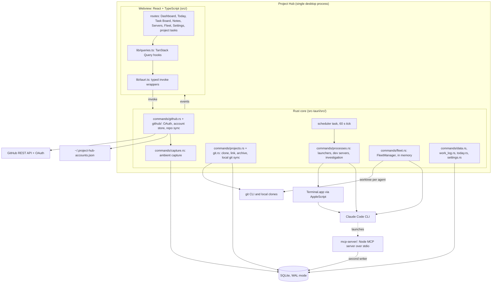

# Architecture

## System Diagram

## Component Descriptions

### Webview front end
- **Purpose**: The whole user interface: a Dashboard of project cards, the Today page, a cross-project Task Board, Notes, running Servers, the Fleet board and Settings
- **Location**: `src/routes/`, `src/components/`, `src/lib/`
- **Key responsibilities**: File-based routing with TanStack Router; all server state through TanStack Query hooks in `src/lib/queries.ts`; every call into Rust goes through a typed wrapper in `src/lib/tauri.ts`; `src/main.tsx` owns the sync timers (shortly after launch, every five minutes, and when the window becomes visible again)

### Rust command layer
- **Purpose**: Everything the UI can ask for, exposed as Tauri commands
- **Location**: `src-tauri/src/commands/` (`github`, `capture`, `projects`, `git`, `processes`, `fleet`, `scheduler`, `data`, `work_log`, `today`, `settings`), registered in `src-tauri/src/lib.rs`
- **Key responsibilities**: GitHub sync, project lifecycle, local git operations, spawning child processes, notes and tasks, the Today aggregations, settings

### GitHub client and account store
- **Purpose**: Sign in with one or more GitHub accounts and read their repositories and commits
- **Location**: `src-tauri/src/github/oauth.rs`, `src-tauri/src/github/api.rs`
- **Key responsibilities**: OAuth web flow with a temporary listener on `127.0.0.1:8765` and a random `state` check; a multi-account store in `~/.project-hub-accounts.json` (owner-only file permissions); a REST client with connect and request timeouts that reports an expired token or an exhausted rate limit as a specific error

### Ambient capture
- **Purpose**: Build an activity journal from pushed commits, with no manual logging
- **Location**: `src-tauri/src/commands/capture.rs`, called from `sync_github_repos`
- **Key responsibilities**: Insert recent commits into `work_log` idempotently; find `[hub-N]` tags in commit messages and resolve task `N` in the same transaction

### Database
- **Purpose**: Local persistence and schema evolution
- **Location**: `src-tauri/src/db/mod.rs`, `src-tauri/src/db/schema.rs`
- **Key responsibilities**: One mutex-guarded connection; WAL mode, foreign keys and a busy timeout; six tables (`projects`, `notes`, `tasks`, `settings`, `work_log`, `scheduled_runs`); `run_migrations` applies additive changes on every start

### Process launchers and dev servers
- **Purpose**: Get from a project card to a running tool in one click
- **Location**: `src-tauri/src/commands/processes.rs`
- **Key responsibilities**: Open Terminal.app, Finder or Claude Code in a project; start and stop dev servers and track them in a `ProcessManager`; run a headless investigation and import its findings as tasks; host the scheduler loop

### Fleet
- **Purpose**: Run several headless Claude Code sessions in parallel, each isolated from the others and from my working tree
- **Location**: `src-tauri/src/commands/fleet.rs`, `src/components/fleet/`
- **Key responsibilities**: Create a git worktree and branch per agent under the app-data directory; start `claude -p` with stream-json output; parse the stream into status and activity; resume a session with a follow-up note; discard the worktree and branch on request. The registry is in memory only

### Scheduler
- **Purpose**: Run an investigation on chosen projects daily or weekly
- **Location**: loop in `src-tauri/src/commands/processes.rs`, decision logic and history in `src-tauri/src/commands/scheduler.rs`
- **Key responsibilities**: Wake every minute, decide whether to fire from four settings, run opted-in projects one at a time, record each result in `scheduled_runs`

### MCP server
- **Purpose**: Let a Claude Code session read and update the task board for the repository it is working in
- **Location**: `mcp-server/src/`
- **Key responsibilities**: Ten tools over stdio (identify project, list, create, update, start and resolve tasks, bulk create, log work, read the work log, project status); opens the same SQLite file as the app. It is a separate Node package that has to be built and registered by hand

## Data Flow

1. On launch the front end checks for a connected account and calls `sync_github_repos`, then runs one local git sync across every cloned project.
2. Sync lists repositories for each account, upserts them into `projects` keyed by GitHub id, and records which account each came from.
3. For the 20 most recently pushed projects, sync fetches the latest 30 commits and hands them to ambient capture, which writes `committed` rows to `work_log` and resolves any task referenced by `[hub-N]`.
4. The Today page aggregates `work_log` and `tasks` in SQL (heatmap, velocity, standup, stuck tasks) and combines stored git state with a `git log` call for the Stale Work Radar.
5. User actions invoke commands that change SQLite, spawn a process, or both; the matching query keys are invalidated so the UI refetches.
6. Setting a cloned project to `done` or `archived` copies its `.portfolio/` directory to a `.done/` or `.archive/` folder in the clone directory and removes the local clone; restoring re-clones it and copies the directory back.
7. When a Claude Code session has the MCP server registered, its tool calls write straight to the same database, and the app picks the changes up on its next poll.

## External Integrations

| Service | Purpose | Notes |
|---------|---------|-------|
| GitHub REST API | List repositories and commits, identify the signed-in user | Bearer token per account; first page of the default branch only for commits; no caching or backoff |
| GitHub OAuth | Sign-in | OAuth App web flow with a localhost callback; scopes `repo` and `read:user`; client id and secret come from a development `.env` |
| `git` CLI | Clone, fetch, fast-forward pull, status, worktrees, push | Invoked with argument arrays; network calls have a 60-second timeout |
| Claude Code CLI | Interactive sessions seeded with a task prompt; headless investigation, docs refresh and Fleet agents | Headless runs use `-p` with stream-json output; depends on slash commands that live outside this repository |
| Terminal.app | Host for interactive sessions | Driven through AppleScript, so macOS only |
| MCP clients | Read and write tasks from inside a coding session | stdio transport; the server is not bundled with the app |

## Key Architectural Decisions

### Local SQLite as the only store
- **Context**: The app tracks my own repositories on my own machine and needs to work offline and start instantly
- **Decision**: All state lives in one SQLite file in the app-data directory; there is no backend service
- **Rationale**: A hosted database would add accounts, hosting and a network dependency for no benefit to a single-machine tool. Flat JSON files would not give me the joins and aggregations the Today page is built on

### Derive activity from commits instead of asking for it
- **Context**: A work log is only useful if it is complete, and manual logging is the first thing to lapse
- **Decision**: Every GitHub sync ingests recent commits into `work_log`, and a `[hub-N]` tag in a commit message closes the task
- **Rationale**: The record is accurate without any effort from me, and one convention links code to tasks. Capture rides on the sync that already runs every five minutes, so there is no second schedule to maintain; I rejected a separate capture command and webhooks (which need a public endpoint) for that reason. The cost is that only pushed commits on the default branch count

### A second process writing to the same database
- **Context**: A coding session should be able to read and update the task board from any repository, with Project Hub remaining the single source of truth
- **Decision**: The MCP server opens the SQLite file itself. The database runs in WAL mode with a busy timeout, and the app enforces a single instance
- **Rationale**: Sharing the file means the tools work in any session without the app brokering each call. WAL plus a timeout turns writer contention into a short wait instead of an error. The trade-off is that the two programs must agree on the schema with no version handshake, and the app only sees the server's writes on its next poll

### One worktree per Fleet agent, outside the repository
- **Context**: Several unattended sessions editing the same working tree would trample each other and my own uncommitted work
- **Decision**: Each agent gets a fresh branch and a git worktree under the app-data directory
- **Rationale**: Worktrees are cheap, share the repository's object store, and leave the main checkout untouched, which running in place would not. The registry of running agents is in memory only, so the app loses track of them on restart while their worktrees and branches stay on disk

### Pure helpers behind thin commands
- **Context**: Tauri commands need app state and are awkward to call from a unit test
- **Decision**: Logic that can be a function of its inputs is one: `compute_stale_projects`, `build_task_prompt`, `should_run_now`, `parse_stream_line`, `extract_task_ids`
- **Rationale**: These carry the rules most likely to be wrong, and they can be tested without a window, a network or a real repository

### Additive migrations checked on every start
- **Context**: The schema changes often and there is one user
- **Decision**: `run_migrations` checks for each column or index and adds what is missing, including replacing an index whose definition has changed
- **Rationale**: Re-running is always safe and there is no migration framework to maintain. The price is no schema version number, which is a weakness once two programs share the file
