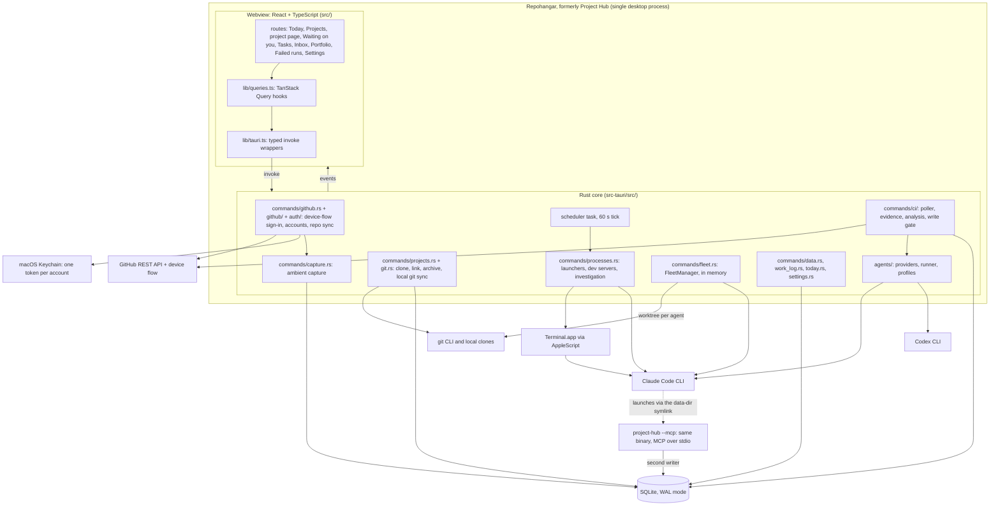

# Architecture

## System Diagram

## Component Descriptions

### Webview front end
- **Purpose**: The whole user interface: Today, Projects and a page per project, a Waiting-on-you queue, Tasks, Inbox, Portfolio, Failed runs, Settings, plus a ⌘K palette
- **Location**: `src/routes/`, `src/features/`, `src/ui/`, `src/components/`, `src/lib/`
- **Key responsibilities**: File-based routing with TanStack Router; all server state through TanStack Query hooks in `src/lib/queries.ts`; every call into Rust goes through a typed wrapper in `src/lib/tauri.ts`; `src/main.tsx` owns the sync timers (shortly after launch, every five minutes, and when the window becomes visible again)

### Rust command layer
- **Purpose**: Everything the UI can ask for, exposed as Tauri commands
- **Location**: `src-tauri/src/commands/` (`github`, `capture`, `projects`, `git`, `processes`, `fleet`, `scheduler`, `data`, `work_log`, `today`, `settings`, `agents`, `ci/`), registered in `src-tauri/src/lib.rs`
- **Key responsibilities**: GitHub sync, project lifecycle, local git operations, spawning child processes, notes and tasks, the Today aggregations, settings

### GitHub client and account store
- **Purpose**: Sign in with one or more GitHub accounts and read their repositories and commits
- **Location**: `src-tauri/src/github/device_flow.rs`, `src-tauri/src/github/api.rs`, `src-tauri/src/auth/`
- **Key responsibilities**: GitHub device-flow sign-in with a public, compiled-in client id (no client secret, no listener); account metadata in the `accounts` table and tokens in the macOS Keychain; the app binary as a per-command git credential helper, so no token is written into a repository; a one-time move of tokens out of the old plain-text accounts file; a REST client with connect and request timeouts that reports an expired token or an exhausted rate limit as a specific error

### Ambient capture
- **Purpose**: Build an activity journal from pushed commits, with no manual logging
- **Location**: `src-tauri/src/commands/capture.rs`, called from `sync_github_repos`
- **Key responsibilities**: Insert recent commits into `work_log` idempotently; find `[hub-N]` tags in commit messages and resolve task `N` in the same transaction

### Database
- **Purpose**: Local persistence and schema evolution
- **Location**: `src-tauri/src/db/` (`mod.rs`, `migrations.rs`, `backup.rs`, `schema.rs`)
- **Key responsibilities**: One mutex-guarded connection; WAL mode, foreign keys and a busy timeout; thirteen tables (projects, tasks, notes, the work log, settings, scheduler history, agent runs and five CI tables); ordered migrations keyed on `PRAGMA user_version`, each in its own transaction after a verified backup, and a refusal to open a database written by a newer build

### Process launchers and dev servers
- **Purpose**: Get from a project card to a running tool in one click
- **Location**: `src-tauri/src/commands/processes.rs`
- **Key responsibilities**: Open Terminal.app, Finder or Claude Code in a project; start and stop dev servers and track them in a `ProcessManager`; run a headless investigation and import its findings as tasks; host the scheduler loop

### Fleet (experimental)
- **Purpose**: Run several headless Claude Code sessions in parallel, each isolated from the others and from my working tree
- **Location**: `src-tauri/src/commands/fleet.rs`, `src/components/fleet/`
- **Key responsibilities**: Create a git worktree and branch per agent under the app-data directory; start `claude -p` with stream-json output; parse the stream into status and activity; resume a session with a follow-up note; discard the worktree and branch on request. The registry is in memory only

### CI failure detection and analysis
- **Purpose**: Notice when a GitHub Actions run fails on a default branch and get a diagnosis, and possibly a fix, ready for review
- **Location**: `src-tauri/src/commands/ci/`, `src-tauri/src/github/transport.rs` and `actions.rs`
- **Key responsibilities**: Poll watched repositories with ETags and per-account rate-limit pauses; turn runs into incidents with failure signatures; build a scrubbed evidence bundle and a triage class; run the coding agent read-only to diagnose, then in an isolated edit profile to propose a fix, in a per-incident worktree; compute the diff itself; push and open a pull request only through one write gate, bound to the hash of the diff that was reviewed. Off unless switched on

### Agent providers
- **Purpose**: One place that knows how to run each coding-agent CLI
- **Location**: `src-tauri/src/agents/`
- **Key responsibilities**: Detect Claude Code, Codex, Gemini CLI and Antigravity CLI; map permission profiles to each CLI's flags; parse each CLI's event stream into one event type; spawn runs in their own process group with a timeout and cancel; validate structured answers against a JSON schema; record every run

### Scheduler
- **Purpose**: Run an investigation on chosen projects daily or weekly
- **Location**: loop in `src-tauri/src/commands/processes.rs`, decision logic and history in `src-tauri/src/commands/scheduler.rs`
- **Key responsibilities**: Wake every minute, decide whether to fire from four settings, run opted-in projects one at a time, record each result in `scheduled_runs`

### MCP server
- **Purpose**: Let an agent session (Claude Code, Codex, Gemini CLI) read and update the task board for the repository it is working in
- **Location**: `src-tauri/src/mcp/`, with the task, work-log, project and note rules in `src-tauri/src/core/`, shared with the app's own commands
- **Key responsibilities**: The app binary run with `--mcp` serves `hub_*` tools over stdio (Rust `rmcp`): identify the project, list, get, create, update, start and resolve tasks, bulk create, log work, read the work log, project status, list projects, add a note. It opens the same SQLite file as the app, never creates or migrates it, checks the schema version on every call, and writes each call in one transaction. It works with the app closed. Settings > Agents registers it with each agent's own CLI, only on click and after showing the exact command; agents are pointed at a symlink in the data directory that the app re-points at itself on every launch

## Data Flow

1. Shortly after launch, every five minutes and when the window comes back into view, the front end calls `sync_github_repos` if an account is connected. Local git state is read without the network; projects on screen are fetched in the background, and nothing is ever pulled without a click.
2. Sync lists repositories for each account, upserts them into `projects` keyed by GitHub id, and records which account each came from.
3. For the 20 most recently pushed projects, sync fetches the latest 30 commits and hands them to ambient capture, which writes `committed` rows to `work_log` and resolves any task referenced by `[hub-N]`.
4. The Today page aggregates `work_log` and `tasks` in SQL (heatmap, velocity, standup, stuck tasks) and combines stored git state with a `git log` call for the Stale Work Radar.
5. User actions invoke commands that change SQLite, spawn a process, or both; the matching query keys are invalidated so the UI refetches.
6. Setting a cloned project to `done` or `archived` first runs a read-only safety check of the clone, then copies its `.portfolio/` directory to a `.done/` or `.archive/` folder in the clone directory and removes the local clone; restoring re-clones it and copies the directory back.
7. When an agent session has the MCP server registered, its tool calls write straight to the same database. The app checks `PRAGMA data_version` every two seconds, emits a `db-changed` event when another process has committed, and the front end refetches tasks, notes, the work log, Today, projects and the inbox.
8. With CI watching on, a background loop polls GitHub Actions, records failures as incidents, and may start an agent analysis in a worktree; its result waits for my approval before anything reaches GitHub.

## External Integrations

| Service | Purpose | Notes |
|---------|---------|-------|
| GitHub REST API | List repositories and commits, identify the signed-in user | Bearer token per account; first page of the default branch only for commits; no caching or backoff |
| GitHub OAuth (device flow) | Sign-in | The user enters a code on github.com while the app polls; scopes `repo` and `read:user` (`workflow` only on re-authorize); public client id compiled in, no secret |
| `git` CLI | Clone, fetch, fast-forward pull, status, worktrees, push | Invoked with argument arrays; network calls have a 60-second timeout |
| Claude Code CLI | Interactive sessions seeded with a task prompt; headless investigation, docs refresh, Fleet agents and CI analysis | Headless runs use `-p` with stream-json output and a permission profile, in a worktree; the prompts are compiled into the app (only Fleet's "Run a skill" mode names user skills) |
| Codex CLI | CI analysis when chosen | `codex exec --json` inside Codex's sandbox |
| GitHub Actions API | CI detection, logs, evidence; re-run and pull requests through the write gate | Off unless CI watching is on |
| Terminal.app | Host for interactive sessions | Driven through AppleScript, so macOS only |
| MCP clients | Read and write tasks from inside a coding session | stdio transport; the server is the app binary run with `--mcp`, registered through `claude`, `codex` or `gemini mcp add` from Settings |

## Key Architectural Decisions

### Local SQLite as the only store
- **Context**: The app tracks my own repositories on my own machine and needs to work offline and start instantly
- **Decision**: All state lives in one SQLite file in the app-data directory; there is no backend service
- **Rationale**: A hosted database would add accounts, hosting and a network dependency for no benefit to a single-machine tool. Flat JSON files would not give me the joins and aggregations the Today page is built on

### Derive activity from commits instead of asking for it
- **Context**: A work log is only useful if it is complete, and manual logging is the first thing to lapse
- **Decision**: Every GitHub sync ingests recent commits into `work_log`, and a `[hub-N]` tag in a commit message closes the task
- **Rationale**: The record is accurate without any effort from me, and one convention links code to tasks. Capture rides on the sync that already runs every five minutes, so there is no second schedule to maintain; I rejected a separate capture command and webhooks (which need a public endpoint) for that reason. The cost is that only pushed commits on the default branch count

### A second process writing to the same database
- **Context**: A coding session should be able to read and update the task board from any repository, with Repohangar remaining the single source of truth
- **Decision**: The MCP server is the app binary run with `--mcp`, and each server process opens the SQLite file itself. The database runs in WAL mode with a busy timeout, and the app enforces a single instance of its window process
- **Rationale**: Sharing the file means the tools work in any session, even with the app closed, without the app brokering each call. WAL plus a timeout turns writer contention into a short wait instead of an error. Building the server into the same binary (it replaced an earlier separate Node server) means it shares the app's task logic and schema version, so there is no second copy of the SQL to drift and nothing extra to install. The server never migrates; it checks the version on every call and asks the user to open the app when the file is older than it expects. The app learns about the server's writes by polling `PRAGMA data_version`

### One worktree per Fleet agent, outside the repository
- **Context**: Several unattended sessions editing the same working tree would trample each other and my own uncommitted work
- **Decision**: Each agent gets a fresh branch and a git worktree under the app-data directory
- **Rationale**: Worktrees are cheap, share the repository's object store, and leave the main checkout untouched, which running in place would not. The registry of running agents is in memory only, so the app loses track of them on restart while their worktrees and branches stay on disk

### Pure helpers behind thin commands
- **Context**: Tauri commands need app state and are awkward to call from a unit test
- **Decision**: Logic that can be a function of its inputs is one: `compute_stale_projects`, `build_task_prompt`, `should_run_now`, `parse_stream_line`, `extract_task_ids`
- **Rationale**: These carry the rules most likely to be wrong, and they can be tested without a window, a network or a real repository

### Versioned migrations with a backup first
- **Context**: The schema had been evolved by idempotent checks on every start, with no version number, while a second program reads the same file and real user data sits in it
- **Decision**: `PRAGMA user_version` plus an ordered list of steps; the old idempotent code is frozen as step 1, so any earlier database is adopted. Before a pending step the app takes a `VACUUM INTO` copy and checks it; each step runs in its own transaction; a database newer than the build is refused untouched
- **Rationale**: A failed upgrade rolls back to the last good version and leaves a verified backup, an older build cannot damage a newer database, and the MCP server can refuse a schema it does not know

### Every AI change behind a human approval
- **Context**: CI analysis lets an agent edit code unattended
- **Decision**: The agent never holds git credentials and never commits; the app computes the diff itself, and a single write gate pushes only after I approve, refusing if the diff no longer hashes to what I reviewed
- **Rationale**: The approval means something only if what is pushed is exactly what was shown. The remaining gap, that the fix phase can still run project scripts, is recorded as a release blocker
