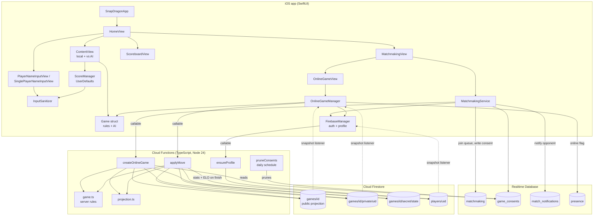

# Architecture Overview

## System Diagram

## Component Descriptions

### Game (client rules engine)
- **Purpose**: All rules and the AI opponent for local play, plus the model the online UI renders
- **Location**: `SnapDragon/Game.swift`
- **Key responsibilities**:
  - 52-card deck, dealing 4 hand / 4 face-up / 4 face-down per player, setup-phase swaps
  - Play validation: 2s and 10s always playable, matching the top card is always allowed, Aces rank high, and after an Ace only an Ace, 2 or 10 can follow
  - 10s and four-of-a-kind clear the pile and give the player another turn
  - AI opponent: setup swap heuristic, then a priority order for hand plays (chase four-of-a-kind, lowest regular rank, 2, 10), with extra caution when the opponent has one card left
  - `Card.hidden()` placeholders for opponent cards the client is not allowed to know

### ContentView (local gameplay)
- **Purpose**: Gameplay UI for 2-player pass-and-play and vs-AI games
- **Location**: `SnapDragon/ContentView.swift`
- **Key responsibilities**: card selection, the player handoff overlay, driving AI turns, and recording results through `ScoreManager`

### OnlineGameManager
- **Purpose**: Client side of an online match: it reads state and sends moves, but never decides outcomes
- **Location**: `SnapDragon/OnlineGameManager.swift`
- **Key responsibilities**:
  - Snapshot listeners on the public game doc and the player's own `private/{uid}` doc; it rebuilds a `Game` only once both have loaded, so the player's hand never flashes empty
  - Sends every action (switch, endSwitch, play, playFaceDown, pickup, forfeit) to the `applyMove` callable, using the server's card ids
  - Writes a `presence/{uid}` flag with `onDisconnectRemoveValue()` and watches the opponent's flag; it only reports a disconnect after it has seen the opponent online

### MatchmakingService
- **Purpose**: Pairs two players and gets exactly one game created for them
- **Location**: `SnapDragon/MatchmakingService.swift`
- **Key responsibilities**:
  - Adds a queue entry in RTDB `matchmaking/` and watches for compatible entries (rating within ±200, same `GameSpeed`)
  - Derives an order-independent game id (`game_<lowUid>_<highUid>`) and writes this player's consent token under `game_consents/<gameId>/<uid>`
  - Picks one initiator by comparing uids. The initiator calls `createOnlineGame`, retrying up to 5 times about 600 ms apart while the opponent's consent is still missing, then notifies the opponent through `match_notifications/`
  - The non-initiator only joins a notified game after confirming the game doc lists it as a player

### FirebaseManager
- **Purpose**: Shared auth and profile state
- **Location**: `SnapDragon/FirebaseManager.swift`
- **Key responsibilities**: anonymous sign-in (`ensureSignedIn()` is called when the matchmaking screen opens), calling `ensureProfile` to seed the server-owned profile, a live listener on `players/{uid}` so rating changes show without a relaunch, and decoding dates stored either as Firestore Timestamps or epoch milliseconds

### Cloud Functions
- **Purpose**: The only writer of game state and player stats
- **Location**: `functions/src/index.ts`, `functions/src/game.ts`, `functions/src/projection.ts`, `functions/src/types.ts`
- **Key responsibilities**:
  - `createOnlineGame`: idempotent on the deterministic id; requires both consent tokens before dealing a new game; deals with a `crypto.randomInt`-backed Fisher-Yates shuffle inside a transaction; removes the consumed tokens afterwards
  - `applyMove`: validates the payload shape, checks the caller is a participant whose turn or setup turn it is, applies the move to the full state, bumps `moveSequence`, and rewrites the public, private and secret docs in one transaction. When the move ends the game it also updates both players' `gamesPlayed`, `gamesWon` and ELO `ranking`
  - `ensureProfile`: creates `players/{uid}` with a 1000 rating if missing; on an existing profile it only refreshes `lastActive` and the display name
  - `pruneConsents`: runs every 24 hours and deletes numeric consent tokens older than one hour, so pairings that never became a game do not pile up

### Security rules
- **Location**: `firestore.rules`, `database.rules.json`
- **Key responsibilities**: Firestore denies every client write to `games`, `private`, `secret`, `players`, `matches` and `leaderboards`. Players can read only games they are in, and only their own private doc; nobody can read `secret`. In RTDB, queue entries must carry the writer's uid and a numeric `skillLevel` between 0 and 3000, consent and presence nodes can only be written by their owner, and a notification must name its sender as `from`

### ScoreManager and InputSanitizer
- **Location**: `SnapDragon/GameScore.swift`, `SnapDragon/InputSanitizer.swift`
- **Key responsibilities**: local game history, per-player stats and recent names in UserDefaults. If the stored history fails to decode, it is copied to a backup key and history resets, so saving keeps working. Names are stripped of tags, filtered to letters, digits, spaces and `-'.`, collapsed, capped at 20 characters, and rejected if nothing alphanumeric is left. This runs both in the input views and again inside `ScoreManager`

### Shared views and logging
- **Location**: `SnapDragon/SharedCardViews.swift`, `SnapDragon/GameLogger.swift`, `SnapDragon/FirebaseTestView.swift`
- **Key responsibilities**: card, card-back, empty-slot and pile views used by both local and online screens; `GameLogger.log` takes an `@autoclosure` and prints only in DEBUG builds; the Firebase diagnostics screen and its home-screen button are compiled only into DEBUG builds

## Data Flow

1. **Local / AI game**: `HomeView` → name entry → `ContentView` mutates a `Game` value directly; AI turns call `Game.performAITurn()`. At game over, `ScoreManager` saves the result to UserDefaults.
2. **Sign-in**: opening matchmaking calls `ensureSignedIn()`. The auth listener calls `ensureProfile` and then attaches a live listener to `players/{uid}`.
3. **Matchmaking**: the client writes its queue entry (using its server `ranking` as `skillLevel`) and watches the queue. When it finds a compatible entry, both clients write a consent token for the shared game id. The initiator calls `createOnlineGame`, which checks both tokens, deals the cards and writes `games/{id}`, `games/{id}/private/{uid}` for each player, and `games/{id}/secret/state`. The initiator then notifies the opponent.
4. **Playing**: each tap becomes an `applyMove` call. The function loads `secret/state` and both player docs, authorizes and applies the move, and writes the new projections. Both clients' snapshot listeners rebuild the board from the public doc (pile, face-up cards, card counts, `deckCount`) plus their own private doc.
5. **Turn clock**: the public doc's `lastUpdated` marks when the turn started. `TurnTimer` computes the time left, and if it runs out the current player's client sends one `pickup`.
6. **Finish**: the move that empties a player's last zone (or a forfeit) sets `winner` and `status: "finished"`, and the same transaction writes the stat and ELO updates. Any later move is rejected with `Game over`.

## External Integrations

| Service | Purpose | Notes |
|---------|---------|-------|
| Firebase Auth | Anonymous identity for online play | No account creation; the uid is the player id everywhere |
| Cloud Firestore | Game projections, server-only full state, player profiles | Client writes denied everywhere except the owner-scoped `test/{uid}` connectivity doc |
| Firebase Realtime Database | Matchmaking queue, consent tokens, match notifications, presence | `onDisconnectRemoveValue()` clears presence when a client drops |
| Cloud Functions (2nd gen) | `createOnlineGame`, `applyMove`, `ensureProfile` callables; scheduled `pruneConsents` | The scheduled function needs Cloud Scheduler and the Blaze plan |

## Key Architectural Decisions

### Server-authoritative online play instead of a shared client engine
- **Context**: With both clients writing game state, either one could deal itself a better hand, read the opponent's cards from the shared doc, or write an illegal move.
- **Decision**: Port the rules to TypeScript (`functions/src/game.ts`) and make Cloud Functions the only writer. Clients send intents (`{type: "play", cardIds}`) and render whatever the server projects back.
- **Rationale**: Security rules can check who is writing and the shape of the write, but not whether a card play is legal. Running the real rules on the server is the only way to enforce them. The cost is keeping two copies of the rules in step, which the Jest game-logic suite covers on the server side.

### Three-way state projection
- **Context**: Each player needs their own hand, nobody should see the deck or the opponent's hidden cards, and Firestore rules work per document, not per field.
- **Decision**: Every write produces a public doc (pile, face-up cards, counts, `deckCount`), one `private/{uid}` doc per player, and a `secret/state` doc holding the full `GameState`, which rules make unreadable to clients.
- **Rationale**: Splitting by document is what lets rules enforce visibility. The secret doc is the single source the next move starts from, so the server never has to rebuild hidden state from what clients can see.

### Mutual consent tokens before creating a game
- **Context**: The deterministic game id makes `createOnlineGame` idempotent, but it also means anyone could create a game against any uid.
- **Decision**: Require both players' `game_consents/<gameId>/<uid>` tokens before dealing. RTDB rules let only the owner write their token. The initiator retries the stable `failed-precondition` error for about 3 seconds while the opponent's token arrives, and a daily scheduled job removes leftover tokens.
- **Rationale**: This proves both players agreed to this specific pairing without needing a matchmaking server. The idempotency check runs before the consent check, so a legitimate retry still works after the tokens have been cleaned up.

### Deterministic initiator for match creation
- **Context**: Both clients see each other in the queue at about the same time and would each create a game.
- **Decision**: The player with the lexicographically smaller uid creates the game, and the game id comes from both uids sorted.
- **Rationale**: Both sides reach the same decision with no coordination. Combined with the idempotent create, even a duplicate call lands on the same document.

### Server-owned stats with ELO in the move transaction
- **Context**: Ratings drive matchmaking, so a client that could write its own `players` doc could inflate its rating.
- **Decision**: Deny all client writes to `players`. `ensureProfile` seeds the doc, and the `applyMove` transaction that ends a game updates both players.
- **Rationale**: Firestore transactions need every read before any write, so `applyMove` reads both player docs on every move. That way the move that ends the game can write the stats atomically, exactly once. If a player doc is missing, its update is skipped and logged, and the move still commits.

### Two Firebase databases, split by access pattern
- **Context**: Matchmaking and presence are short-lived, chatty and need disconnect hooks; game state needs documents, transactions and rule-scoped reads.
- **Decision**: Realtime Database for queue, consents, notifications and presence; Firestore for games and profiles.
- **Rationale**: Only RTDB has `onDisconnect`, which presence detection depends on. Firestore transactions and per-document rules are what the authoritative game model depends on.
