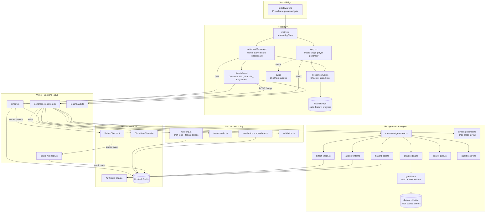

# Architecture

## System Diagram

## Component Descriptions

### Generation orchestrator
- **Purpose**: Turns themes and a grid shape into a clued, scored puzzle, or returns `null` so the caller can refund
- **Location**: `lib/crossword-generator.ts` (`generateCrossword`)
- **Key responsibilities**:
  - Resolve the mask (shipped template or operator-drawn) and extract slots (`lib/grid/slots.ts`)
  - Choose how many theme entries the shape can hold (`selectThemeSlots`, `defaultThemeCount` in `lib/grid/seeding.ts`)
  - Make one word-pool call sized to the theme slots only, then flag answers that are missing from the word list or that the model marked as unsure
  - Build a dictionary pool at the requested score floor, with a higher floor inside the 8+ letter band, and run `seedFillAndPick` to build 3 candidate fills and keep the best-scoring one
  - Write clues for the placed answers, run the independent fact check, then apply the quality gate
  - Return the puzzle plus a `FillReport` (fill rate, quality grade, novel answers, long fill, warnings) and a per-theme `CoverageReport`

### Grid engine
- **Purpose**: A crossword-specific constraint solver that operates on a real black-square mask
- **Location**: `lib/grid/` (`mask.ts`, `slots.ts`, `filler.ts`, `seeding.ts`, `templates.ts`, `shape.ts`, `labels.ts`)
- **Key responsibilities**:
  - `mask.ts`: grid masks, 180-degree symmetric toggling, and a compact bitset serialization used to store saved grids
  - `filler.ts`: a budgeted backtracking search that maintains arc consistency over crossing letters, using per-slot word bitsets, MRV slot choice, least-constraining-value ordering and deterministic restarts
  - `seeding.ts`: places themed answers in 7+ letter slots at symmetric positions and rotates which answers are used across attempts
  - `templates.ts` + `shape.ts`: hand-searched 11/15/21 templates, measured against published-grid rules (symmetry, no runs under 3, every letter checked, connected white space). `templates.test.ts` asserts each rule

### AI call sites
- **Purpose**: The three model calls, each with a narrow, injectable client interface (`AnthropicLike`)
- **Location**: `lib/ai/word-pool.ts`, `lib/ai/clue-writer.ts`, `lib/ai/fact-check.ts`, `lib/ai/models.ts`
- **Key responsibilities**:
  - Word pool: theme-tagged candidate answers for the requested length histogram, each carrying `kind` and `sure` provenance fields
  - Clue writer: batches of 40, split-retry for missing answers, a fallback clue so no cell is ever left unclued, and validation of each clue against its style constraints and against duplicated answers
  - Fact check: a zero-cost regex picks the clues that assert a checkable fact, then a fresh-context batched call returns true/false/unsure. Clues judged false are rewritten
  - `models.ts`: per-call-site model selection, defaulting to Claude Sonnet 5

### Quality scoring and gate
- **Purpose**: Measure every generation with crossword-craft criteria and refuse the ones that should not ship
- **Location**: `lib/quality-score.ts`, `lib/quality-gate.ts`, `lib/server/score-oracles.ts`
- **Key responsibilities**:
  - Scorer: penalties for duplicates, naticks (split into fabricated entries and unfair crossings), green paint, partials, crosswordese, theme wallpaper and thin theme, summarised as a 0-100 score, an A-F grade and up to 6 findings
  - Gate: hard failures return `null`. A fill below 95% fails outright, and anything between that and complete is decided by whether blackening the misses still leaves a legal grid (`blackeningIsSafe`). Soft findings become `FillReport.warnings`
  - Both modules are pure. Word-list knowledge is injected as `ScoreOracles`, so the scorer runs the same in tests, in the offline study and in production

### Simple crossword
- **Purpose**: An all-theme alternative product, sold on the same meter
- **Location**: `lib/simple/generate.ts`, `lib/simple/layout.ts`, `lib/simple/sizes.ts`
- **Key responsibilities**: Reuses the same three AI modules, then interlocks the theme words in a criss-cross with no dictionary fill. `auditLayout` re-derives every letter run from the finished grid and rejects any run that is not a placed word. A result that places under 60% of the requested words is treated as a failure and refunded

### Tenant platform
- **Purpose**: Branded multi-tenant hosting for published puzzles, with paid generation
- **Location**: `lib/tenants.ts`, `lib/tenant-store.ts`, `lib/tenant-auth.ts`, `lib/tenant-authz.ts`, `api/tenant.ts`, `api/tenant-auth.ts`, `src/tenant/`
- **Key responsibilities**:
  - `resolveAppView` routes a request by subdomain, then `/t/<slug>`, then `/legacy` or a legacy share link, then the configured default tenant
  - Redis-backed tenant documents (config, up to 50 puzzles, daily pick, top 100 scores, up to 20 saved masks) with UTF-8 byte caps
  - One authorization function (`authorizeTenant`) used by every entry point. Public reads omit saved masks and the token balance. `submit-score` is the only anonymous write, and credential and token grants are restricted to the platform operator
  - `src/tenant/exposure.ts` shows customers a reduced set of controls. Obscure vocabulary, the word-score dial and the grid designer are operator-only

### Metering and payments
- **Purpose**: Bill tenants per puzzle without double charging or double crediting
- **Location**: `lib/metering.ts`, `lib/draft-jobs.ts`, `lib/tenant-tokens.ts`, `lib/pricing.ts`, `lib/checkout.ts`, `lib/token-purchase.ts`, `api/stripe-webhook.ts`
- **Key responsibilities**:
  - `beginGeneration` claims a draft (`INCR` on a job key with a 24h TTL) and spends a token only on a job's first draft (`DECRBY`, compensated on overshoot)
  - `rollbackGeneration` refunds when the pipeline fails to produce a puzzle
  - `TOKEN_PACKS` is the only price authority, so the browser sends a pack id and never an amount
  - The webhook verifies the Stripe signature over the raw body, then `creditPurchase` claims the session id with `SET NX` before running `INCRBY`

### Legacy single-player app
- **Purpose**: The original public generator and solver, now served at `/legacy`
- **Location**: `src/App.tsx`, `src/components/`, `src/hooks/`
- **Key responsibilities**: Theme form with Turnstile, exponential-backoff retry (1s, 2s, 4s), offline fallback to cached puzzles, history, statistics and settings. `CrosswordGame` is shared with the tenant site

## Data Flow

### Tenant generation
1. The operator signs in through `api/tenant-auth.ts`, which verifies the PBKDF2 credential and sets an HttpOnly session cookie bound to the slug
2. The admin panel POSTs to `/api/generate-crossword?slug=<slug>` with themes, size or mask, difficulty axes, style and a `jobId`
3. The handler applies the per-IP rate limit, then `authorizeTenant`, then `validateCrosswordRequest`
4. `beginGeneration` claims a draft and, on the job's first draft, spends a token. With no Redis configured it returns 503 rather than generating for free
5. `generateCrossword` runs pool, seed, fill (best of 3), clues, fact check and the gate
6. On `null` or an exception the token and draft are rolled back. On success the response carries the puzzle, the fill report, the coverage report, the remaining balance and the draft number
7. The operator reviews the grade, findings and flagged answers, then publishes. `publish-puzzle` writes to the tenant's Redis document, and `set-daily` features the puzzle on the home page

### Buying tokens
1. `BuyTokens` posts `create-checkout-session` with a pack id
2. `checkoutSessionParams` builds the session from the server-side catalog, with slug and pack in the metadata
3. Stripe calls `api/stripe-webhook.ts`. The handler verifies the signature and ignores any event other than `checkout.session.completed`, and any session that is not `paid`
4. `creditPurchase` writes a `claimed` record with `NX`, increments the balance, and marks the record `credited`. A redelivered event finds the claim and does nothing

### Public generation and sharing
1. The legacy form sends a theme, size, axes and an optional Turnstile token
2. A valid token earns 10 requests/min per `x-real-ip`. Without one the limit is 3/min. The optional `PUBLIC_DAILY_GENERATION_CAP` bounds total unmetered spend
3. Shared puzzles are compressed with `lz-string` into `?p=`, and the root still routes those links to the legacy solver

## External Integrations

| Service | Purpose | Notes |
|---------|---------|-------|
| Anthropic Claude | Themed word pool, clues, fact check | Server-side key only. Model selectable per call site and defaults to Sonnet 5 |
| Upstash Redis | Tenant documents, token ledger, draft jobs, purchase records, rate limits | Reads `UPSTASH_*` or Vercel's `KV_*` names. Metering and login fail closed without it |
| Stripe | Token-pack checkout and fulfillment | Pinned API version. Webhook signature verified over the raw bytes |
| Cloudflare Turnstile | Trust signal for the public rate-limit tier | Never a hard gate, and tokenless requests skip `siteverify` |
| Vercel | Static hosting, Node functions (120s `maxDuration`), Edge Middleware | `vercel.json` bundles `data/**` into the functions and sets HSTS and CSP |
| Crossword Nexus word list | Dictionary for the filler | MIT. Rebuilt by `scripts/build-wordlist.ts` with a blocklist and a supplement |

## Key Architectural Decisions

### The grid is a solver problem, not an LLM output
- **Context**: Asking a model for words and handing them to a layout library produced sparse, unchecked grids that read nothing like a newspaper puzzle
- **Decision**: Fix the shape first as a symmetric mask, fill it from a scored dictionary with a MAC/MRV search (`lib/grid/filler.ts`), and use the model only for a handful of themed marquee answers and for the clues
- **Rationale**: The output obeys real grid rules (every letter checked, symmetric, no 2-letter runs) and the model's cost is limited to short calls. The earlier mode, in which the model chose slots itself, was dropped after measuring far below seeded fills. Its literal survives only so that old stored reports still parse

### Best-of-N on the free step, not the paid one
- **Context**: Quality varied widely between fills of the same word pool, and clue writing is most of the per-puzzle spend
- **Decision**: `seedFillAndPick` builds 3 fills from one pool and ranks them lexicographically, fill rate first and then the clue-free `scoreFill`. Only the winner is clued
- **Rationale**: This lifts the worst-case tail without multiplying model cost. The default of 3 was chosen against a pre-stated threshold, because 5 bought almost nothing and would have tightened the per-call timeout clamp

### Fact checking as an independent call
- **Context**: Fluent, on-theme, wrong clues (a player who does not exist, a wrong jersey number) pass every form check
- **Decision**: `lib/ai/fact-check.ts` runs a fresh-context verifier that shares no writing context, gated by a free local heuristic so that only clues with checkable claims are sent
- **Rationale**: A model asked about its own clue in the same context repeats its blind spot. Asking the verifier to state the deciding fact before giving its verdict is what made the check catch fabrications on a labelled fixture

### Flag, never drop, unknown answers
- **Context**: A themed puzzle exists for exactly the entries no static list knows, such as a current player's name, and fabrications look the same
- **Decision**: Answers missing from the list, or marked unsure by the model, stay eligible and are surfaced as `novelAnswers` for the operator. The hard gate fails any that escape unflagged
- **Rationale**: Only a human can tell a new real entry from an invented one. Dropping them would remove the reason to buy a themed puzzle

### Atomic Redis primitives for money
- **Context**: Concurrent generations and at-least-once webhooks are both double-spend and double-credit hazards
- **Decision**: Token spend is a single `DECRBY`, compensated on overshoot. A draft claim is a single `INCR`. A purchase credit is `SET NX` on the session id, followed by `INCRBY`
- **Rationale**: Redis serialises commands, so N concurrent callers get N distinct results. A crash between claim and credit leaves a repairable record rather than silently giving tokens away

### One authorization seam, Web Crypto only
- **Context**: Auth has to run in Node functions, Edge Middleware and Vitest, and the cross-tenant bug it replaced came from per-handler checks
- **Decision**: Every entry point calls `authorizeTenant`. Credentials use PBKDF2-HMAC-SHA256 at 600k iterations via `crypto.subtle`, and sessions are self-contained HMACs with a 12h TTL. The pre-release `site_auth` cookie grants visibility only, never authority
- **Rationale**: PBKDF2 is the only real KDF available in all three runtimes without a dependency. Stateless sessions avoid a Redis read on every request, and rotating the secret revokes every session at once
