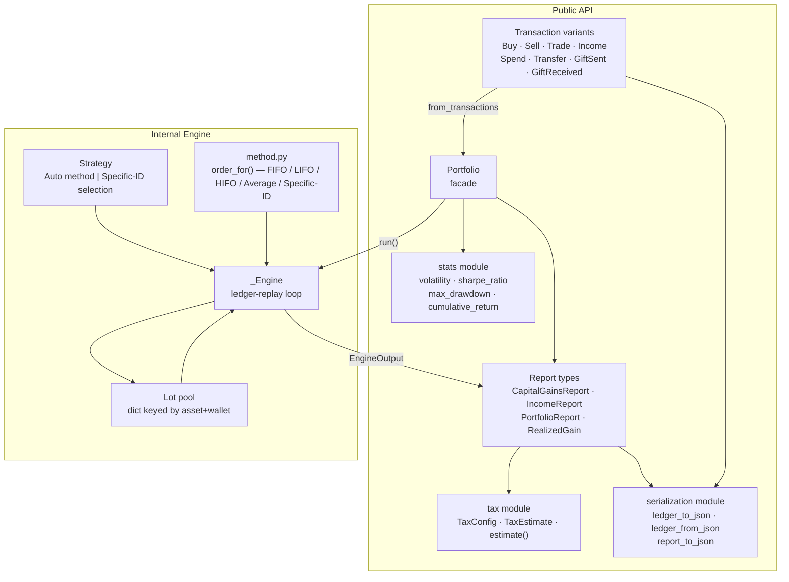

# Architecture — coinbasis (Python)

## System Diagram



## Component Descriptions

| File | Role |
|---|---|
| `src/coinbasis/transaction.py` | Eight frozen dataclasses (one per event type) plus `IncomeSource` enum. `__post_init__` normalizes every timestamp (including `GiftReceived.donor_acquired_at`) to UTC and raises `ValueError` on naive datetimes. `validate()` enforces invariants (positive quantities, non-negative prices/fees) and raises typed `PortfolioError` subclasses. |
| `src/coinbasis/errors.py` | Exception hierarchy rooted at `PortfolioError`. Eight typed subclasses: `InsufficientLots`, `InsufficientTransfer`, `NonPositiveQuantity`, `NegativeValue`, `NegativeFee`, `MissingLotSelection`, `InvalidLotSelection`, `SelectionRequired`. Each carries structured fields for programmatic inspection. |
| `src/coinbasis/lot.py` | `Lot` dataclass (mutable — the engine reduces quantity/cost_basis in place during consumption) and `GiftBasis` (holds `fmv_per_unit` for the IRS dual-basis calculation). Both are internal; not re-exported. |
| `src/coinbasis/method.py` | `CostBasisMethod` enum (FIFO / LIFO / HIFO / AVERAGE / SPECIFIC_ID), `LotPick`, the `LotSelection` alias (`dict[int, list[LotPick]]`, keyed by disposal input index), and `order_for()` which returns a sorted index list over an open-lot pool. Tie-breaking by `lot_id` ensures determinism across identical timestamps. |
| `src/coinbasis/engine.py` | `_Engine` class and `run()` entry point. Maintains a `dict[(asset, wallet) -> list[Lot]]` pool. For each transaction (replayed in timestamp order, preserving original input indices for Specific-ID lookups) it calls `_acquire`, `_dispose`, or `_take`. `_take` (the non-taxable move used by Transfer and GiftSent) re-pools under Average and otherwise draws in FIFO order, including under Specific ID. Division uses a pinned 28-digit `decimal.Context` (ROUND_HALF_EVEN) to avoid floating-point rounding errors in cost basis. |
| `src/coinbasis/report.py` | Frozen output dataclasses: `RealizedGain`, `IncomeEvent`, `Holding`, `AssetValuation`, `PortfolioReport`, `CapitalGainsReport`, `IncomeReport`. `Term.classify()` applies the strict `> 365 days` boundary; `acquired_at` and `term` are `None` on rows produced under Average Cost. |
| `src/coinbasis/portfolio.py` | `Portfolio` facade. Stores a validated ledger and exposes query methods (`realized_gains`, `holdings`, `valuation`, `capital_gains_report`, `income_events`, `income_report`, `tax_estimate`), with `*_with_selection` variants of the gains, report, and tax methods for Specific ID; the automatic-method versions raise `SelectionRequired` if passed `SPECIFIC_ID`. A `transactions` property returns a copy of the ledger. Each method constructs the appropriate `Strategy` and calls `run()`; no engine state is retained between calls. `holdings()` returns one `Holding` per open lot. |
| `src/coinbasis/tax.py` | `TaxConfig` (jurisdiction, long-term threshold in days, short-term flat rate, progressive long-term brackets), `TaxEstimate`, `estimate()` (net losses clamp to zero tax), `estimate_long_term_tax()`, and `reclassify()` (re-buckets rows by whole days held, `>= threshold_days` counting as long-term). `TaxConfig.default()` supplies a US preset: 0% / 15% / 20% long-term brackets with ceilings at 47,025 and 518,900, and a 35% short-term rate. |
| `src/coinbasis/stats.py` | Pure statistical functions operating on `Sequence[float]`: `returns_from_values`, `volatility` (sample std dev), `sharpe_ratio`, `max_drawdown`, `cumulative_return`. Uses `float` / `math`, which is standard for statistical functions. |
| `src/coinbasis/serialization.py` | JSON helpers using an externally-tagged enum representation (`{"Buy": {...}}`): `transaction_to_dict` / `transaction_from_dict`, `ledger_to_json` / `ledger_from_json`, `lot_selection_to_json` / `lot_selection_from_json`, and `report_to_json()` for output dataclasses. `Decimal` values are encoded as strings, and decoding also accepts JSON numbers without going through `float`. Timestamps are RFC-3339 UTC with a trailing `Z`, at whole-second precision. No file I/O — string in, string out. |
| `src/coinbasis/__init__.py` | Re-exports everything that belongs to the public API. Importing `coinbasis` is sufficient for all normal use. |

## Data Flow

```
Caller assembles Transaction objects (Buy / Sell / Trade / …)
        │
        ▼
Portfolio.from_transactions(txs)
  — validates each transaction (raises PortfolioError on bad input)
  — stores a shallow copy in input order
        │
        ▼ (on each query call)
engine.run(txs, strategy)
  — sorts transactions by timestamp (stable, preserving original indices)
  — _Engine._process() dispatches on transaction type:
      Buy / Income / GiftReceived  →  _acquire()  →  opens a Lot in the pool
      Sell / Spend / Trade         →  _dispose()  →  _consume() → matches lots
      Transfer                     →  _dispose() fee leg (only if fee > 0) + _take() qty leg → re-opens lots in destination pool
      GiftSent                     →  _take()     →  removes lots, no gain recorded
  — _consume() routes to _consume_ordered (FIFO/LIFO/HIFO),
               _consume_average, or _consume_specific (Specific-ID)
  — every disposal goes through _gain_for(), which applies the dual-basis rule
    to lots that carry GiftBasis (Average does not attach it)
  — returns EngineOutput { realized: list[RealizedGain], income: list[IncomeEvent], holdings: list[Lot] }
        │
        ▼
Portfolio method wraps EngineOutput into typed report dataclasses
  — capital_gains_report() → CapitalGainsReport (filtered by tax year, split by Term)
  — income_report()        → IncomeReport
  — valuation()            → PortfolioReport (aggregates across wallets, computes allocation %)
  — tax_estimate()         → TaxEstimate via tax.estimate()
  — *_with_selection()     → the same reports, replayed under a Specific-ID LotSelection
```

## External Integrations

None. The library is entirely offline and stateless. It reads no files, makes no network calls, and holds no persistent state. All input is passed in as Python objects; all output is returned as Python dataclasses or serialized to a string by the serialization module. This boundary is deliberate — I chose to keep I/O outside the library so it can be embedded in any CLI, web service, or Jupyter notebook without coupling to a particular I/O model.

## Key Architectural Decisions

### 1. `decimal.Decimal` throughout (except `stats`)

**Constraint:** Crypto lot math involves multiplying fractional quantities by fractional prices across potentially thousands of lots. Floating-point rounding accumulates to meaningful dollar errors at scale.

**Options considered:** `float` everywhere (simple, fast, wrong); `fractions.Fraction` (exact, slow); `Decimal` with a pinned context (exact to 28 significant digits, fast enough).

**Choice:** `Decimal` end-to-end in all accounting code, with a pinned 28-digit ROUND_HALF_EVEN context for division (see `engine._PREC28` and `_div()`). The `stats` module uses `float`, which is standard for statistical functions.

**Why:** Eliminates the class of bugs where FIFO on a 0.1 BTC lot produces $0.000000000001 rounding errors in the cost-basis. Exact decimal arithmetic via a pinned 28-digit ROUND_HALF_EVEN context avoids floating-point rounding errors in cost basis across the entire engine.

---

### 2. Class-hierarchy `Transaction` over tagged dicts or union types

**Constraint:** Eight distinct event shapes need to be defined, validated, and dispatched on throughout the engine.

**Options considered:** A single dict with a `"type"` key (flexible but untyped); `TypedDict` per variant (typed but no methods or validation); a single dataclass with optional fields (awkward, no exhaustiveness); frozen dataclasses in a class hierarchy.

**Choice:** Frozen dataclasses (`@dataclass(frozen=True)`) inheriting from a common `Transaction` base. Each variant carries only its own fields and its own `validate()`. The engine and the serializer dispatch with an `isinstance` chain.

**Why:** Immutability prevents callers from mutating transactions after validation. The class hierarchy is explicit, self-documenting, and gives each variant typed fields that editors and type checkers understand. Frozen instances are also hashable and safe to use in sets. The trade-off is that an `isinstance` chain is not checked for exhaustiveness: the serializer raises `TypeError` on an unknown subclass, while the engine would skip it, so adding a variant means touching both.

---

### 3. Per-wallet lot pooling keyed by `(asset, wallet)`

**Constraint:** A user may hold the same asset across multiple wallets (hardware wallet, exchange, DeFi). IRS rules require tracking which wallet a lot came from; a disposal can only draw on the wallet it is sold from.

**Options considered:** Global per-asset pool (simpler, but conflates wallets — wrong for transfers); per-wallet per-asset dict.

**Choice:** `_pools: dict[tuple[str, str], list[Lot]]` keyed by `(asset, wallet)`.

**Why:** Correctly models the tax reality that selling 1 BTC from your cold wallet cannot draw the cost basis from your exchange wallet. Transfers explicitly move lots (preserving `cost_basis`, `acquired_at`, `lot_id`, and gift metadata) from source to destination pool.

---

### 4. Externally-tagged JSON schema

**Constraint:** The library needs to serialize and deserialize transaction ledgers to JSON for interop with other tools.

**Options considered:** Internally-tagged (`{"type": "Buy", "wallet": …}`); untagged (a flat dict, ambiguous); externally-tagged (`{"Buy": {…}}`).

**Choice:** Externally-tagged: `{"Buy": {"wallet": "hot", …}}`. Decimals are strings; timestamps are RFC-3339 UTC with a trailing `Z`.

**Why:** The externally-tagged schema is unambiguous when parsing without a schema — the outer key names the variant. This enables schema-free round-trip of ledger files and clear human readability without an additional `"type"` field alongside the payload.

---

### 5. Pure library boundary — no I/O inside the package

**Constraint:** The library is intended for embedding in CLIs, web APIs, and notebooks.

**Options considered:** Built-in file reading (`load_ledger(path)`); database connectivity; coupling to a specific web framework.

**Choice:** Zero I/O. Every public function takes Python objects or strings and returns Python objects or strings. File loading, HTTP fetching, and database access live outside the library in the consuming application.

**Why:** A library that touches I/O forces its error model, async strategy, and file format on every consumer. Keeping the boundary at string-in / object-out means the same library core works unchanged in a synchronous CLI, an async FastAPI handler, and a Jupyter notebook.

---

### 6. IRS gift dual-basis implemented at the lot level, not the report level

**Constraint:** The IRS "dual-basis" rule for gifted assets requires knowing both the donor's basis and the FMV at receipt to determine whether a disposal produces a gain, a loss, or neither (the dead zone).

**Options considered:** Apply the rule at report generation time as a post-processing step on `RealizedGain` rows; store dual-basis metadata on the lot itself and resolve at disposal time.

**Choice:** `GiftBasis` (holding `fmv_per_unit`) is embedded in the `Lot` at acquisition time and inspected by `_gain_for()` during `_dispose()`, before the `RealizedGain` row is created.

**Why:** The gain field in `RealizedGain` is already the correct IRS-rule gain. Downstream code (reports, tax estimation) does not need to know whether a row originated from a gift. This keeps the dual-basis logic in one place (`engine._gain_for`) and ensures FIFO/LIFO/HIFO/Specific-ID all apply it identically. GiftBasis also travels with a lot through a Transfer, so a gift moved to another wallet keeps its dual basis. Average Cost is the one exception: it blends the pool into a single basis, so the engine does not attach `GiftBasis` under that method and gifted lots are treated at donor basis.
