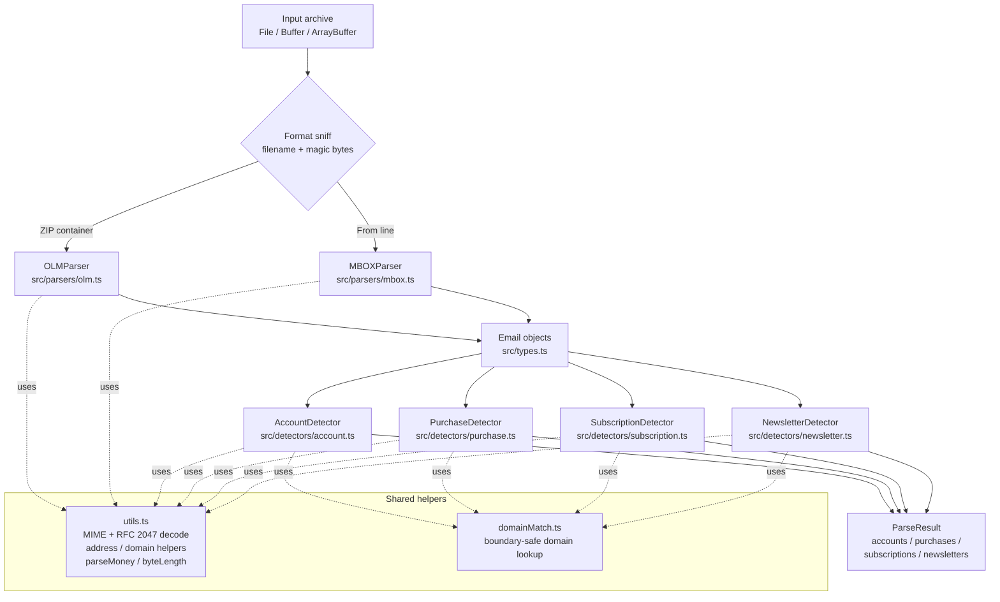

# Architecture

I designed this library as two clean layers — a **parser layer** that turns raw archive bytes into typed `Email` objects, and a **detector layer** that mines those objects for accounts, purchases, subscriptions, and newsletters. The two layers share a small set of stateless helpers (MIME decoding, address/domain utilities, and a boundary-safe domain matcher). Keeping them separate means the parsers know nothing about detection and the detectors know nothing about archive formats.

## System Diagram

## Component Descriptions

### Entry point — `src/index.ts`
The public surface. Re-exports the two parsers, four detectors, the type definitions, and the utility functions. It also provides `parseArchive()`, a convenience function that sniffs the input format (filename for a `File`, leading bytes otherwise — ZIP magic `PK\x03\x04` for OLM, `From ` for MBOX), dispatches to the right parser, and optionally runs detectors based on `ParseOptions` flags.

### MBOX parser — `src/parsers/mbox.ts`
Parses the line-oriented MBOX format used by Gmail Takeout, Thunderbird, and Apple Mail. Key responsibilities:
- **Message splitting** on `From ` separator lines, validated by requiring a three-letter weekday token immediately after the sender so prose lines like "From Bob, see you Friday" are not mistaken for message boundaries. Both the ctime form (`Mon Jan  1`) and the RFC 2822 form (`Thu, 15 Jan`) are accepted.
- **mboxrd unescaping** — a leading `>` is stripped from `>From ` body lines.
- **Streaming** — three code paths (browser `File` slicing in 5 MB chunks above 20 MB, Node file-path read streams via `parseFile`, and 100 MB chunking for `Buffer`s over 500 MB, which would otherwise exceed V8's string limit) all process the archive in chunks while carrying over a "leftover" tail so a message split across a chunk boundary is never lost. Every path, including the streaming ones, finishes with the same sender-contact aggregation and sequential id assignment as the small-file path.
- **MIME handling** — multipart bodies are split on their boundary (including nested multipart), and parts are decoded per their `Content-Transfer-Encoding` (base64 / quoted-printable).
- **Gmail labels** — `X-Gmail-Labels` is parsed into folder assignment plus read/starred flags.
- **Noise rejection** — bodies that look like binary/base64 image payloads or are mostly non-printable are dropped.

### OLM parser — `src/parsers/olm.ts`
Parses Outlook for Mac `.olm` archives, which are ZIP containers of XML. Uses JSZip to locate `message_N.xml` email entries, Address Book `Contacts.xml` files, and `Calendar.xml` files, then reads them into the same typed model the MBOX parser produces. Each XML document goes through `DOMParser` when the runtime provides one and a tag-regex fallback otherwise, so the parser works in Node without a DOM shim. Contacts are merged from the Address Book and from email senders; Address Book entries carry `lastEmailDate: null` rather than an invented date.

### Shared utilities — `src/utils.ts`
Stateless helpers used by both layers. The notable ones:
- `decodeQuotedPrintable` and `decodeHeaderValue` — charset-aware MIME and RFC 2047 (`=?charset?B/Q?text?=`) decoding. Bytes are accumulated and decoded together through `TextDecoder` so multi-byte UTF-8 sequences and surrogate-pair emoji decode correctly, with a UTF-8 fallback when a charset label is unknown.
- `cleanEmailAddress`, `extractDomain`, `formatDomainAsName` — address and domain normalization.
- `stripHtml`, `normalizeSubject` — body and subject cleanup, with a DOM path in the browser and a regex fallback in Node.
- `parseMoney` — the locale-aware amount parser shared by the purchase and subscription detectors (see the decision below).
- `byteLength` — UTF-8 byte count (`Buffer.byteLength` in Node, `TextEncoder` in the browser) used by both parsers to fill `Email.size`.

### Domain matcher — `src/detectors/domainMatch.ts`
A single generic helper, `matchKnownDomain`, that all four detectors use to look up a sender domain in a registry. It matches only on exact equality or a true subdomain suffix (`domain === key` or `domain.endsWith('.' + key)`), guarded by a `hasOwnProperty` check — never on a bare substring.

### Detectors — `src/detectors/*.ts`
Four stateless classes, each exposing `detect(email)` for a single email and `detectBatch(emails)` for deduplicated aggregate results:
- **AccountDetector** — scores 150+ known-service domains plus subject/body signup patterns; `detectBatch` deduplicates by service name and keeps the earliest *known* signup date (undated emails never overwrite a real one).
- **PurchaseDetector** — scores receipt/invoice patterns and 60+ known merchant domains, rejects emails that hit three or more promotional anti-patterns, and extracts a locale-aware amount and order number; an email counts only at confidence 70+ with a non-zero amount. `detectBatch` emits one `Purchase` per qualifying email.
- **SubscriptionDetector** — recognizes recurring-billing patterns, trusts a price only when billing wording sits within 40 characters of it, and infers frequency only from a billing verb or a per-period phrase. `monthlyAmount` and `frequency` are left unset when no cadence is found; `detectBatch` groups by service.
- **NewsletterDetector** — scores newsletter vs. promotional signals, extracts unsubscribe links, and estimates frequency from dated emails only; `detectBatch` groups by sender. Sender domains are classified as a *strong* signal (a full known promotional domain such as `em.ebay.com`) or a *weak* one (a bare `mail.`/`news.`/`updates.` prefix), and weak signals only score when the body also matches marketing patterns.

## Data Flow

1. The caller hands an archive (`File`, `Buffer`, or `ArrayBuffer`) to `parseArchive`, or instantiates a parser directly.
2. The format is determined — filename suffix for a browser `File`, otherwise the leading magic bytes.
3. The chosen parser walks the archive: MBOX splits on validated `From ` lines and streams in chunks; OLM extracts the ZIP and reads its XML entries.
4. For each message, headers are parsed, the body is decoded per its content type and transfer encoding (multipart parts are walked recursively), and MIME/RFC 2047 encoded headers are decoded with the declared charset.
5. Each message becomes a typed `Email` with `date: null` when the header is missing or unparseable and `size` as its UTF-8 byte count; the parser assigns a stable sequential `id` so detection results can point back to their source email.
6. Contacts are aggregated from senders (on every MBOX path, streaming included), and the parser returns a `ParseResult` with `emails`, `contacts`, `calendarEvents`, and summary `stats`.
7. If any detection flag is set, each requested detector runs `detectBatch` over the parsed emails and attaches its deduplicated results (`accounts`, `purchases`, `subscriptions`, `newsletters`) to the same `ParseResult`.

## External Integrations

| Integration | Purpose | Notes |
|-------------|---------|-------|
| JSZip (`^3.10`) | Extracts the ZIP container that backs an `.olm` archive | The only runtime dependency. Works in both Node and the browser. |

The library is intentionally dependency-light. Everything else — MIME decoding, charset handling, base64 — is built on platform primitives (`TextDecoder`, `TextEncoder`, `atob`) with `Buffer` fallbacks, so the same code runs in Node and the browser with no extra packages.

## Key Architectural Decisions

### Separate parsing from detection
**Decision:** Parsers produce plain `Email` objects; detectors are stateless classes that consume them. `detectBatch` handles deduplication and aggregation separately from `detect`.
**Rejected alternative:** Detecting inline while parsing. That would couple every format parser to detection logic, make detectors impossible to run standalone on already-parsed emails, and force the dedup/grouping concerns into the parse loop. Keeping them apart means I can run a single detector over an arbitrary email list, and a new format only needs to produce `Email` objects to get all detection for free.

### Boundary-safe domain matching
**Decision:** `matchKnownDomain` matches a sender domain only on exact equality or a true subdomain suffix (`domain.endsWith('.' + key)`), with a `hasOwnProperty` guard.
**Rejected alternative:** Substring checks like `domain.includes(key)`. Those produce false positives — `fedex.com` contains `x.com`, `amazonaws.com` contains `amazon.com`, and a naive `domain.includes('mail.')` flagged `gmail.com`/`hotmail.com` as promotional. Anchoring on the label boundary eliminates that whole class of bug.

### Charset-aware MIME decoding instead of assuming UTF-8
**Decision:** Quoted-printable and RFC 2047 payloads accumulate raw bytes and decode them through `TextDecoder` using the declared charset, falling back to UTF-8 when the label is unknown. Surrogate pairs are encoded together so astral code points (emoji) survive.
**Rejected alternative:** Assuming UTF-8 and masking each character with `& 0xff`. That corrupts any non-UTF-8 body and mangles multi-byte sequences and emoji. Honoring the declared charset keeps international mail readable.

### One locale-aware money parser, shared
**Decision:** `parseMoney` in `src/utils.ts` strips spaces and apostrophes, then resolves the decimal separator from position and currency: when both `.` and `,` appear, whichever comes last is the decimal; a lone separator followed by a 1–2 digit tail is a decimal (for a comma, when the currency is EUR, BRL, or CHF, or it is the only comma); anything else is thousands grouping. `1.234,56`, `1,234.56`, `1'234.56`, and EUR `1.234` (→ 1234) all parse correctly. Both `PurchaseDetector` and `SubscriptionDetector` call it.
**Rejected alternative:** Stripping commas and calling `parseFloat`, or keeping a separate amount routine per detector. The first silently misreads European amounts (`€1.234,56` collapsed to roughly a thousandth of its value); the second let the two detectors drift apart, which is exactly how subscriptions ended up with the US-only version. One shared, tested function removes both problems.

### Streaming with carried-over leftovers for large archives
**Decision:** MBOX input is read in chunks, and any partial message at the end of a chunk is carried into the next chunk before splitting on `From ` lines.
**Rejected alternative:** Reading the whole file into one string. Multi-gigabyte exports exceed Node's string-size limit and blow up browser memory. Chunked reads with a leftover tail keep memory flat while guaranteeing no message is split or dropped at a chunk boundary.

### Null for unknown dates instead of `now()`
**Decision:** `Email.date`, `Contact.lastEmailDate`, `Account.signupDate`, `Subscription.lastRenewalDate`, and `Newsletter.lastEmailDate` are typed `Date | null`, and the parsers return `null` for a missing or unparseable `Date:` header. Detectors drop undated emails from any time-based calculation.
**Rejected alternative:** Substituting the current time. It keeps the type simpler, but a fabricated timestamp is indistinguishable from a real one: an undated email would masquerade as the most recent message, shift "earliest signup" and "last renewal" toward today, and distort the newsletter interval math. Shipping this was a breaking change (v3.0.0), which I accepted because the old values were silently wrong.

### Weak vs. strong sender-domain evidence
**Decision:** In `NewsletterDetector`, a full known promotional domain is strong evidence on its own, while a generic subdomain prefix (`mail.`, `news.`, `updates.`, ...) matched at the start of the domain is weak evidence that only scores alongside at least one marketing-body pattern.
**Rejected alternative:** Treating every prefix as decisive. Plenty of transactional senders (shipping notices, receipts, password resets) come from `mail.` or `news.` subdomains, so a prefix alone pushed real mail into the promotional bucket.

### Dual CJS + ESM build via tsup
**Decision:** The package ships both CommonJS and ESM bundles plus `.d.ts` declarations, built with tsup from a single entry point.
**Rejected alternative:** Shipping ESM only, or hand-maintaining two build configs. Dual output via one tsup command means the library imports cleanly from modern ESM projects and legacy `require`-based Node code without me maintaining parallel toolchains.
