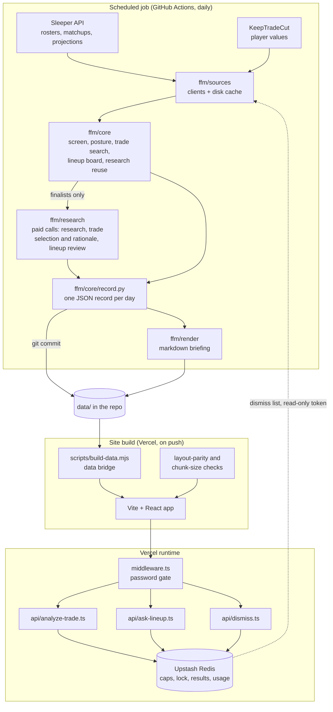

# Architecture

## System Diagram

## Component Descriptions

### Sources
- **Purpose**: Read the league from Sleeper and player values from KeepTradeCut, and cache what was read.
- **Location**: `ffm/sources/`
- **Key responsibilities**: Sleeper client (rosters, matchups, transactions, projections), KeepTradeCut client with a rankings fallback, a disk cache that prunes yesterday's snapshot, a read-only reader for the site's dismiss list.

### Core
- **Purpose**: Every decision that does not need a model.
- **Location**: `ffm/core/`
- **Key responsibilities**: The free-agent screen (value gap, replacement-level gate, benchmark drop), team posture from value rank and real standings, the mutual trade search, the weekly lineup board scored by the league's own settings, the rule that decides when yesterday's research can be reused, and the daily record's schema.

### Research
- **Purpose**: The paid model calls, and everything that bounds what they cost.
- **Location**: `ffm/research/`
- **Key responsibilities**: One gateway for every paid request (`paid.py`), per-model and per-tier pricing with a usage log on every record (`usage.py`), the research prompt and its web-search tool (`agent.py`), the trade selection and rationale calls, the game-morning lineup review, and an offline evaluation harness (`eval/`).

### Daily job
- **Purpose**: Orchestrate one morning: read, screen, research, search trades, build the lineup board, write the record and the briefing.
- **Location**: `ffm/jobs/daily_waiver.py`, with `ffm/jobs/weekly_lineup.py` for the free lineup board
- **Key responsibilities**: Route the day by calendar phase (pre-draft, draft day, post-draft, in season), refuse to run on the paid provider outside CI, and leave a run-status file so the site can tell a failed morning from a stale one.

### Data bridge
- **Purpose**: Turn the committed archive into what the browser loads.
- **Location**: `scripts/build-data.mjs`
- **Key responsibilities**: Emit a small main bundle holding only the newest day plus an index, one file per day, per team and per player, and refuse to emit a bundle over its size ceiling.

### Site
- **Purpose**: The screens: Today, the reasoning behind each call, Lineup, My Team, League, Trades, History, a scorecard, and a page per player.
- **Location**: `src/` (routes in `src/routes/`, components in `src/components/`)
- **Key responsibilities**: Render the day's record, load older days on demand, and call the three functions for the interactive features.

### Serverless functions
- **Purpose**: The only code that runs per request: a trade analyzer, a lineup question box, and a dismiss list.
- **Location**: `api/` (thin entry points) and `server/` (handlers, model clients, specs)
- **Key responsibilities**: Check the password cookie, enforce the daily cap and the spend ceiling, hold a one-at-a-time lock, refund a failed attempt, and log usage.

## Data Flow

1. A scheduled workflow starts each morning. It builds the lineup board from public Sleeper reads, runs the test suite, then runs the daily job.
2. The job screens every free agent with value math and keeps at most five finalists. For each finalist it either reuses research from the last three days (when value, injury status, team, depth chart, posture and the planned drop are all unchanged) or makes one paid research call with web search.
3. It searches for trades both sides would accept, asks the model to choose among the candidates and explain each choice, and on game mornings asks for a review of the lineup.
4. It writes one JSON record and one markdown briefing for the day and commits them.
5. The push triggers a build. The bridge reads the archive, the build checks layout rules and chunk sizes, and the site deploys behind the password gate.
6. In the browser, the trade desk and the lineup question box call serverless functions that spend from a shared daily allowance.

## External Integrations

| Service | Purpose | Notes |
|---------|---------|-------|
| Sleeper | League rosters, matchups, transactions, standings and weekly projections | Public read-only API, no auth; a polite client with a request budget for the multi-league measurement job |
| KeepTradeCut | Dynasty player values behind every threshold and trade calculation | Snapshot cached to disk daily; a rankings fallback when the league page fails |
| Anthropic API | Research with web search, trade judgment, lineup review, and the two interactive features | Called only by the scheduled job and the functions; prompt caching on the web-search calls |
| Upstash Redis | Daily caps, the spend ceiling, the request lock, stored results and the usage log | The scheduled job reads the dismiss list with a read-only token and runs normally without it |
| GitHub Actions | Runs the job and commits the day's data | Dependencies pinned through a constraints file |
| Vercel | Builds and hosts the site and functions | Every push is a deploy |

## Key Architectural Decisions

### The repository is the database
- **Context**: One league produces one small record a day, and I wanted every past day reproducible and diffable.
- **Decision**: The job commits JSON records and markdown briefings to the repo, and the site is built from them.
- **Rationale**: A hosted database would add a service to run, secure and back up for a few kilobytes a day. Git gives history, review and rollback for free. The cost is that the archive grows with every morning, which the bridge handles by shipping each day as its own file.

### Math first, model last
- **Context**: A model with web search costs close to a dollar a call, and there are hundreds of free agents.
- **Decision**: Deterministic value math screens the pool, and only the top five survivors reach the model.
- **Rationale**: Asking the model to rank the whole pool would be slower, far more expensive and harder to test. The screen is pure code with unit tests; the model is spent only where judgment about news and role actually matters.

### Reuse research until something changes
- **Context**: The same few players clear the screen day after day.
- **Decision**: A finalist's research is reused for up to three days unless a named trigger fires (a 5% value move, an injury or roster status change, a new team or depth chart slot, a posture change, or a different drop).
- **Rationale**: Caching by time alone would serve stale advice after an injury; never caching pays for the same answer repeatedly. Explicit triggers make the reuse decision auditable: the record says which calls were reused and from which day.

### One newest day in the bundle, everything else on demand
- **Context**: Embedding the whole archive in the client bundle eventually broke the build.
- **Decision**: The main bundle carries the newest record and an index. Days and teams load as separate chunks, and player pages ship as plain files fetched by path.
- **Rationale**: The archive grows forever and the bundle must not. A build-time check fails the deploy if a day, team or player file is ever imported eagerly again.

### Spending guards that fail closed
- **Context**: Two site features spend real money from a browser click.
- **Decision**: Each request passes the password check, a daily cap reserved before the call and refunded on failure, a separate ceiling on billed attempts that counts failures too, a one-at-a-time lock, no retries, and a token limit.
- **Rationale**: A cap on successes alone does not bound spend, because failed calls can still be billed. Two counters do. Without the key or the store, the functions refuse instead of running unguarded.

### Hold-out evaluation for prompt changes
- **Context**: A prompt edit can look better on the cases it was tuned on and worse everywhere else.
- **Decision**: Reference cases are split into training and held-out sets, and the held-out answers are redacted from every report by default.
- **Rationale**: The held-out score is the only honest signal of whether a change generalises, and it only stays honest while those cases are unseen. Redaction by default makes the safe path the easy one.
