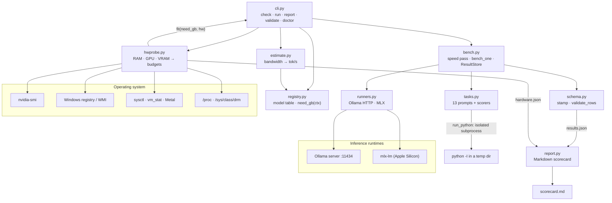

# Architecture

## System Diagram

## Component Descriptions

### Hardware probe
- **Purpose**: Works out how much memory a model can use on this machine, on any OS.
- **Location**: `src/llm_bench/hwprobe.py`
- **Key responsibilities**:
  - Total and free RAM: `GlobalMemoryStatusEx` (via ctypes) on Windows, `sysctl hw.memsize` and `vm_stat` on macOS, `/proc/meminfo` on Linux
  - GPUs and VRAM from `nvidia-smi`, then the Windows display-adapter registry key (`HardwareInformation.qwMemorySize`) with WMI as the last resort, or `/sys/class/drm` on Linux for AMD and discrete Intel Arc cards
  - On Apple Silicon, the GPU's real memory limit: a raised `iogpu.wired_limit_mb` first, then Metal's recommended working set (read through MLX), then a ratio of RAM
  - Hardware rules: identical cards pool their VRAM (`combine_identical`), Intel integrated graphics are ignored, and Ryzen AI Max APUs are budgeted as shared memory (`amd_unified_gpu`)
  - Two budgets, `fast_gb` (fits on the GPU) and `spill_gb` (fits if some layers move to the CPU), plus a `free_budget` for what other apps have left
  - `fit(need_gb, hw)` returns `fast`, `slow` or `no`. `override()` grades imagined hardware for `--vram` and `--ram`
  - `raw_sources()` returns every raw tool output for `llm-bench doctor`

### Model registry
- **Purpose**: One table of models. Each row has the Ollama tag, MLX repo, vendor, architecture, total and active parameter counts, and the KV-cache shape.
- **Location**: `src/llm_bench/registry.py`, regenerated with `scripts/model_metadata.py`
- **Key responsibilities**: `Model.need_gb(ctx, runtime)` is the weights at the runtime's real quantization (Q4_K_M for Ollama, bits plus scale overhead for MLX), plus the KV cache at `ctx` tokens, plus 0.5 GB for the runtime. `max_ctx_within(budget)` inverts it to give the longest context that fits.

### Speed estimate
- **Purpose**: A generation speed before anything is downloaded.
- **Location**: `src/llm_bench/estimate.py`
- **Key responsibilities**: memory bandwidth from a spec-sheet table, divided by the bytes each token reads (active parameters only), times an efficiency factor. Laptop GPUs, unknown GPUs and models that spill to the CPU get no estimate.

### Runtimes
- **Purpose**: The same `run(target, prompt) -> Generation` call for two very different backends.
- **Location**: `src/llm_bench/runners.py`
- **Key responsibilities**:
  - Ollama through its HTTP API. Timings come from the nanosecond counters in the response. Resident memory and the share of the model on the GPU come from `/api/ps`.
  - The Ollama context window (`num_ctx`) is sized to the prompt, and a prompt the runtime evaluated far fewer tokens of is flagged as truncated
  - Each model is unloaded after its run (`keep_alive: 0`, or freeing MLX's cache), so it doesn't hold memory while the next one is measured
  - MLX through `mlx_lm.stream_generate`. Time to first token is measured on the stream, and peak memory comes from `mx.get_peak_memory()`.
  - Download checks, and `strip_thinking()`, which removes reasoning blocks before scoring

### Task suite
- **Purpose**: 13 prompts in five categories, each with a fixed scoring function that returns a number from 0 to 1.
- **Location**: `src/llm_bench/tasks.py`
- **Key responsibilities**: run generated code against hidden asserts (`run_python`), match numbers exactly, check the last line for reasoning answers, find one sentence hidden in a generated 9,000-word document, and validate JSON and bullet formatting.

### Benchmark loop
- **Purpose**: Measures one model on one runtime.
- **Location**: `src/llm_bench/bench.py`
- **Key responsibilities**: a speed pass (a warmup that measures load time, then three timed runs with a fixed output length, reported as a median and range), then every quality task, averaged per category. `ResultStore` replaces a model's row when it is run again and saves after every model.

### Result format
- **Purpose**: Makes `results.json` comparable across machines without identifying anyone.
- **Location**: `src/llm_bench/schema.py`
- **Key responsibilities**: `stamp()` adds a schema version, tool version, timestamp and a hardware block describing the class of machine (GPU model, memory tier, CPU model, OS family). `validate_rows()` rejects hostnames and home paths, impossible numbers and oversized files.

### Scorecard
- **Purpose**: Turns results into a readable comparison.
- **Location**: `src/llm_bench/report.py`
- **Key responsibilities**: overall ranking (70% quality, 30% speed, with speed capped at 80 tok/s), quality per category, a performance table with estimates next to measurements, the best model on each measure, and MLX against Ollama for the same model.

## Data Flow

1. `llm-bench check` probes the hardware, saves `hardware.json`, asks Ollama which models are pulled, and prints each model's estimated memory and speed at the chosen context, its verdict, the longest context that fits, and the pull command. Where an earlier run measured the model, the measurement is shown instead and labelled as measured.
2. `llm-bench run` picks the runtime (MLX and Ollama on Apple Silicon with mlx-lm installed, Ollama everywhere else) and selects the downloaded models that fit at the benchmark's context.
3. For each model, the speed pass runs first, then every task prompt. Every Ollama request to a model uses the same context window. The reasoning block is removed from each reply, the answer is scored, and timings, peak memory, GPU share and truncation are recorded.
4. The model's row is stamped, written to `results.json` straight away so a stopped run keeps the models that finished, and the model is unloaded.
5. `report.py` builds `scorecard.md` from `results.json` and `hardware.json`. `llm-bench validate` checks the results file against the format.

## External Integrations

| Service | Purpose | Notes |
|---------|---------|-------|
| Ollama | Runs models on every OS | Local HTTP API on port 11434. Respects `OLLAMA_HOST`. No authentication. |
| Hugging Face cache | MLX model weights | Only checks whether weights are present. Respects `HF_HUB_CACHE` and `HF_HOME`. The user does the downloading. |
| `nvidia-smi`, registry, WMI, `sysctl`, sysfs | Hardware facts | Each probe returns zero or None on failure instead of raising. System tools are resolved to absolute paths, never the current directory. |

## Key Architectural Decisions

### Fixed scoring instead of a judge model
- **Context**: Scores need to be comparable across machines and across runs.
- **Decision**: Every task is checked by code: run the generated program, match a number, or check the format.
- **Rationale**: A judge model adds its own randomness and cost, and tends to reward longer answers. The price is a narrower set of tasks (nothing like essay quality), which I accepted so that results repeat exactly.

### Memory estimated from the model's architecture, at a stated context
- **Context**: Memory need depends on context length as much as on parameter count, and hybrid models (Qwen3.5, Gemma 4, Granite 4, Nemotron 3) only keep a growing cache on a few of their layers.
- **Decision**: Store each model's KV-cache shape, counting only the layers whose cache grows with context, and estimate weights plus cache at the context the user asks for.
- **Rationale**: A flat per-parameter rule overstates hybrid models and understates long contexts on older ones. The KV-cache numbers come from each repo's `config.json` through a script, so they aren't hand-typed. On the sample runs every estimate landed within 0.5 GB of the measured peak, on the high side.

### Two memory budgets instead of one
- **Context**: "Does it fit?" has a different answer on a graphics card than on a Mac's shared memory. Ollama can split a model between VRAM and system RAM, which works but is several times slower.
- **Decision**: Track `fast_gb` and `spill_gb`, which gives three verdicts.
- **Rationale**: With a single threshold, the tool would either hide models that run acceptably with offload or recommend ones that crawl. On Apple Silicon and Ryzen AI Max the GPU uses system RAM, so the two budgets are the same.

### One Ollama context window per model
- **Context**: Ollama allocates the KV cache for its whole window up front and reloads the model whenever the window changes. If each prompt were sized separately, load times, memory and GPU share would describe a different setup on each task.
- **Decision**: Size one window to the longest task and use it for every request to that model, including the speed pass. Fit selection grades at that same context.
- **Rationale**: Speed, memory and offload numbers then all describe one configuration, and the long-context task is never cut short by Ollama's small default window.

### The registry key instead of WMI for Windows VRAM
- **Context**: The usual Windows API, `Win32_VideoController.AdapterRAM`, is a 32-bit field. It never reports more than 4 GB, so it gets nearly every modern GPU wrong.
- **Decision**: Try `nvidia-smi` first, then the display-adapter registry key's 64-bit `qwMemorySize` (or the older binary `MemorySize`), and only then WMI, with a note when WMI was used.
- **Rationale**: A wrong VRAM figure means wrong recommendations. Reading the registry needs no extra package. The parser is tested against recorded registry output on every OS, and runs for real on a Windows CI runner.

### No estimate rather than a wrong one
- **Context**: Speed estimates depend on memory bandwidth, and a laptop GPU often shares its name with a desktop card on a much narrower bus.
- **Decision**: Laptop GPUs, unknown GPUs and models that spill to the CPU get no speed estimate. Every number shown is labelled as either an estimate or a measurement.
- **Rationale**: A confident wrong number is worse than a gap. Labelling keeps the formula honest, because the scorecard puts each estimate next to what was measured.

### Standard library for detection, runtimes loaded only when used
- **Context**: The tool has to install cleanly on a fresh Windows Python and import on machines with no GPU software.
- **Decision**: `hwprobe.py` uses only the standard library (`ctypes`, `winreg`, `subprocess`). `mlx` and `httpx` are imported inside the functions that need them.
- **Rationale**: `check` works before anything else is set up, and the package imports on Windows, where MLX can't be installed at all.

### Containing generated code instead of sandboxing it
- **Context**: The coding tasks only mean something if the generated code actually runs.
- **Decision**: `run_python` writes the code to a private temporary folder, runs `python -I` there with a time limit, and deletes the folder afterwards.
- **Rationale**: A real sandbox (containers, seccomp) would make Windows setup much harder. Isolated mode and a throwaway folder prevent accidental damage, and the README says plainly that this is not a security boundary.
