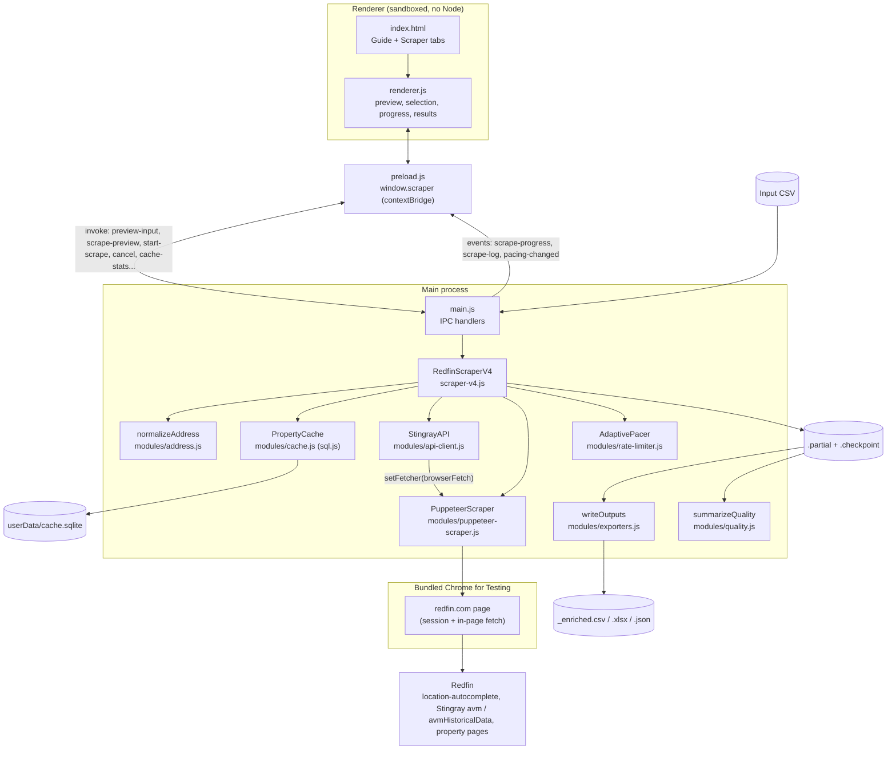

# Architecture Overview

## System Diagram

## Component Descriptions

### Electron main process
- **Purpose**: Owns the window, the file dialogs, and every IPC handler; creates one `RedfinScraperV4` per run and forwards its callbacks to the renderer
- **Location**: `Redfin-Gui/main.js`, with Electron-free helpers in `main-helpers.js` (`buildScraperOptions`) and `main-cache-path.js` (`resolveCacheDbPath`)
- **Key responsibilities**: `select-csv-file`, `preview-input`, `scrape-preview`, `start-scrape`, `cancel-scrape`, `check-checkpoint`, `discard-checkpoint`, `clear-cache`, `cache-stats`, `download-template`; tracks the in-flight scraper so Stop works for both batch and single-row runs

### Preload bridge
- **Purpose**: The only surface the renderer can reach — runs with `contextIsolation: true` and `nodeIntegration: false`
- **Location**: `Redfin-Gui/preload.js`
- **Key responsibilities**: Exposes `window.scraper` methods (one per IPC channel), event subscriptions (`onScrapeProgress`, `onScrapeLog`, `onPacingChanged`), and `outputColumns` as a plain string array for building the column picker

### Renderer UI
- **Purpose**: Guide tab plus a Scraper workspace: file pick or drag-drop, input preview table with row checkboxes, output-format and output-column pickers, cache controls, progress bar, activity log, results and data-quality panel, throttle banner
- **Location**: `Redfin-Gui/renderer.js`, `Redfin-Gui/index.html`
- **Key responsibilities**: Keeps a boolean row mask over the whole file (not just the 10 rendered rows), gates the Run button on at least one row and one column being selected, and builds every CSV-derived element with `createElement`/`textContent` rather than `innerHTML`

### RedfinScraperV4 orchestrator
- **Purpose**: Runs the per-address pipeline and the batch loop
- **Location**: `Redfin-Gui/scraper-v4.js`
- **Key responsibilities**: CSV parse and validation, row selection (`applyRowSelection`), resume decision (`resolveResumeState`, `selectionMatchesCheckpoint`), cache lookup and write-through, in-file dedup, checkpointing, pacing between addresses, final export and quality summary. Also exports pure helpers used by the IPC layer: `buildPreview`, `buildAddressFromRow`, and `scrapeSingle` for the "Test first row" flow

### StingrayAPI
- **Purpose**: Client for Redfin's JSON endpoints
- **Location**: `Redfin-Gui/modules/api-client.js`
- **Key responsibilities**: `searchByAddress` (location-autocomplete, prefers type-6 property rows), `getAVM`, `getHistoricalData`; retries on status 0, 403, and 5xx with exponential backoff and jitter (`isRetryableStatus`, `getBackoffDelay`); returns the HTTP status so the pacer can learn from it. The fetch function is injectable (`setFetcher`)

### PuppeteerScraper
- **Purpose**: Owns the Chrome session; used both as the transport for API calls and as the fallback scraper
- **Location**: `Redfin-Gui/modules/puppeteer-scraper.js`
- **Key responsibilities**: `browserFetch` (runs `fetch` inside the redfin.com page with an `AbortController` timeout, strips the `{}&&` prefix), `getPropertyId` (search-box fallback), `scrapePropertyFull` (scroll-and-extract with `trySelectors` over ordered selector lists from `modules/config.js`), periodic page refresh every 100 addresses, user-agent rotation. `buildLaunchArgs` keeps Chrome's sandbox enabled in packaged builds and drops it only in dev or CI

### AdaptivePacer
- **Purpose**: Scales the inter-address delay to how Redfin is responding
- **Location**: `Redfin-Gui/modules/rate-limiter.js`
- **Key responsibilities**: Sliding window of the last 20 statuses (403 weighs 1.0, network failure 0.5); raises a throttle level when the weighted block rate reaches 0.3 after at least 5 samples; delay = baseline x 1.8^level, capped at 15 s; steps down one level per 10 consecutive clean responses

### PropertyCache
- **Purpose**: Cross-run memory of scraped properties
- **Location**: `Redfin-Gui/modules/cache.js`, keyed by `normalizeAddress` from `modules/address.js`
- **Key responsibilities**: Two tables (`properties`, `not_found`) in an in-memory sql.js database persisted to `cache.sqlite` under Electron's userData; 30-day TTL for found rows and 3-day TTL for misses; flushes every 10 writes and on close; backs up a corrupt file and starts fresh instead of failing the run

### Exporters and quality
- **Purpose**: Turn the completed dataset into files and a summary
- **Location**: `Redfin-Gui/modules/exporters.js`, `Redfin-Gui/modules/quality.js`
- **Key responsibilities**: `writeOutputs` writes CSV, JSON, and XLSX from one projected column list and isolates per-format failures (a locked `.xlsx` does not block the CSV); `coerceCell` turns currency and number strings into typed Excel cells and leaves unparseable values blank rather than 0. `summarizeQuality` computes found/not-found, per-column fill rates, and a data-source tally; `buildQualitySummaryView` is a DOM-free view model the renderer draws

## Data Flow

1. **Pick a file** — The user drops or selects a CSV. `preview-input` parses it with the same csv-parse options as the batch run and returns columns, the first 10 rows, the total, validation results, and a duplicate mask over all rows.
2. **Choose scope** — The user unticks rows (or clicks "Deselect duplicates"), unticks output columns, picks formats, and optionally ticks "Force fresh". "Test first row" runs `scrapeSingle` on row 1 with a throwaway browser session.
3. **Start** — `start-scrape` builds a scraper with the selection, formats, and cache path. The scraper filters rows, then checks for a checkpoint for the same input file and the same selection; if it matches and the `.partial` file holds the expected rows, it resumes, otherwise it starts clean.
4. **Per address** — Check in-file dedup, then a fresh cache hit, then a fresh not-found record. On a miss: autocomplete API for the property ID (browser search if that fails), then `avm` and `avmHistoricalData` in parallel, then the page fallback only if no estimate came back. Every response status is fed to the pacer.
5. **Persist** — The row is appended to `<output>.partial`, the `.checkpoint` JSON is rewritten, the result is written through to the cache, and the next address waits `pacer.currentDelay()` plus jitter.
6. **Finish** — The browser closes in a `finally` block. The full `.partial` (which includes rows from earlier resumed sessions) is parsed, summarized for quality, projected to the chosen columns, and written to every selected format. Checkpoint files are removed unless the run was stopped.

## External Integrations

| Service | Purpose | Notes |
|---------|---------|-------|
| Redfin location-autocomplete (`/stingray/do/location-autocomplete`) | Address to property ID and URL | Called first; browser search is the fallback |
| Redfin Stingray AVM (`/stingray/api/home/details/avm`) | Estimate, beds, baths, sq ft, last sale price and date | Retried on 0/403/5xx |
| Redfin Stingray history (`/stingray/api/home/details/avmHistoricalData`) | Year built | Fetched in parallel with AVM |
| Redfin property pages | Fallback for missing fields (lot size, price per sq ft, property type, listing status) | Scraped through Puppeteer |
| Chrome for Testing | Bundled browser, pinned in `scripts/download-chrome.js` | Downloaded by the `prebuild` script, shipped via electron-builder `extraResources` |

## Key Architectural Decisions

### Route API calls through the browser, not Node's HTTPS stack
- **Context**: Redfin's CDN rejects plain Node.js HTTPS requests at the TLS layer, so a direct HTTP client never reaches the JSON endpoints.
- **Decision**: Open one Chrome session on redfin.com at startup and inject `PuppeteerScraper.browserFetch` into `StingrayAPI` via `setFetcher`. Each call runs `fetch` in the page with a 15 s abort timeout.
- **Rationale**: The requests carry the same TLS session and cookies as a normal page load and stay same-origin. `httpsGet` in `modules/utils.js` remains as the injectable default, which keeps `StingrayAPI` unit-testable with a stub fetcher and no browser.

### API first, page scraping last
- **Context**: Page scraping is slow and breaks on layout changes; the JSON endpoints return structured data but can miss.
- **Decision**: Autocomplete for the ID, AVM and history in parallel for data, and full-page scraping only when no estimate comes back. The `Data Source` column records which path filled each row.
- **Rationale**: The common case avoids DOM work entirely. The fallback merges only into empty fields, so API values are never overwritten by scraped text.

### WASM SQLite for the cache
- **Context**: Re-running the same list (or a list with repeats) re-scraped every address.
- **Decision**: `sql.js` with an in-memory database flushed to `cache.sqlite` in batches, with `sql-wasm.wasm` shipped via `extraResources` and located by `modules/cache-wasm-path.js`.
- **Rationale**: A native SQLite binding would need rebuilding against Electron's ABI for every platform and architecture; WASM ships one file that works everywhere. A short TTL on not-found records means a typo'd address is not re-tried every run but does get another chance within days.

### Feedback-driven pacing instead of a fixed delay
- **Context**: A fixed delay is either too slow when Redfin is happy or too fast when it starts returning 403s.
- **Decision**: `AdaptivePacer` raises the delay multiplicatively when weighted block rate crosses a threshold and steps down only after a run of clean responses.
- **Rationale**: Only a blocked outcome can raise the level and only a clean streak can lower it, so a single borderline reading does not cause flapping. It is pure logic with no timers, so its behaviour is covered by unit tests in `modules/rate-limiter.test.js`.

### Checkpoint per row, and tie the checkpoint to the selection
- **Context**: Long batches can be stopped or crash, and the user can change which rows or columns they want between runs.
- **Decision**: Append each row to `.partial` and rewrite `.checkpoint` after every address. The checkpoint stores the input path and the row/column selection; `selectionMatchesCheckpoint` compares rows by exact order and columns order-insensitively, and `resolveResumeState` refuses to resume if the partial is shorter than the checkpoint claims.
- **Rationale**: Resuming with a different selection would silently mix two different row sets in one file. Re-reading the partial at the end, rather than using in-memory rows, makes exports and quality numbers correct across resumes.

### Fetch everything, project at write time
- **Context**: Users want to drop columns from the output, but the cache should stay complete.
- **Decision**: Every scrape fetches all 15 fields. Column selection is applied only in `writeOutputs`, and the quality summary is computed before projection.
- **Rationale**: Cached rows remain reusable by a later run that wants different columns, and deselecting a column does not make the quality panel report it as 0% filled.
